# Accession-to-document acquisition decision tree

This is the contract map from Phase-1 filing metadata through catalog selection,
inventory, target planning, and acquisition/processing handoffs. It
separates implemented behavior, proposed behavior, and frozen legacy behavior; a
calendar-era label is never a substitute for an observed locator or a pinned target.

**Retrieval correction:** Review-run and fixture evidence establishes the SEC mapping
from positive numbered child names to accession-prefixed archive leaves, for example
`0001.txt` to `<accession>-0001.txt`. A display filename alone is not a URL: inventory
direct retrieval requires an observed, validated accession-prefixed link. Catalog primary
metadata can construct that same leaf from the exact `primaryDocument` value. Positive
numbered filenames, including `0001`, are not inherently placeholders. If an eligible
indexed target lacks a usable prefixed child link, S6 may pin the advertised bundle and
its observed positive sequence under the role-specific rules below. A direct 404 remains
a failure; it does not trigger bundle fallback.

Exact primary `0000.txt` and `0000.htm` names remain placeholder signals. Inventory-backed
cases require the advertised bundle and observed positive sequence; catalog-only cases
remain unresolved. Secondary-document hrefs continue to come from the index and are not
rewritten.

**Sequence-name distinction:** Review analysis observes numbered child links whose leaf
names run from `0001` through values beyond `0007`; the larger value is not an upper
bound. Profile role, observed type/sequence, and the accession-prefixed link determine
the target. Never derive a child URL from the display filename alone.

## Status and entry point

- **Implemented:** `filing_catalog` materialization/plans; S1–S6 inventory and
  profile-based target planning; S2/S3/S4 fixture, parser, and worker foundations;
  S7 review surfaces. `document_planning` is a separate pipeline from the older
  `filing_catalog` locator-plan contract. Planning can consume an immutable S5 snapshot,
  but does not create or run that snapshot.
- **Implemented:** S9 validates pinned S6 plans, projects acquisition runs, and executes
  bounded direct acquisition or exact-sequence extraction. `acquisition run` invokes
  per-target S10 processing under the same run lock and persists operation state/results.
  It does not compare sizes, group targets into one bundle request, or switch an ordinary
  failed direct request to bundle mode. Fixture create/fill/list and offline review
  generate/compare/analyze are routed through the acquisition operator/CLI.
- **Partial:** S6 v4 declares operation/source-input intent and S9 work-order v3 resolves
  operation support/handler pins, but production text/HTML normalization remains disabled:
  the production route/handler budget registry is empty, so unbudgeted transforms fail
  closed. Raw identity and the test-budgeted TEXT path are covered. Form 4 XML and the
  S10 role-assessment evaluator are not runtime features. Lazy-index trigger pins are
  null, so the old selector field does not authorize index recovery.
- **Not implemented/gated:** S11 durable acquisition-payload publication and the S12
  cross-stage vertical quality gate. S9 stage commands can be run manually through
  `run.py`; no `documents plan` end-to-end command exists.
- **Documentation reconciliation:** `implementation.md` reports S1–S6 implemented
  and `document_planning` has profile, catalog-scope, inventory-evidence, matching,
  publication, operator, and CLI modules. Current matching permits accession-prefixed
  numbered direct links, catalog construction of positive numbered primary leaves, and
  role-eligible bundle-sequence retrieval when an advertised bundle and observed positive
  sequence are pinned. Exact `0000` primary names remain placeholders; `0001` is not a
  placeholder when accession-prefixed child evidence supports direct retrieval.
- **Retired:** `document_storage`, its date/name candidate gate, full-submission fallback,
  and evaluator-driven delegation are not replacement behavior. Do not restore them or
  replace observed accession-prefixed links with date/name heuristics.
- **Evidence gate:** S0's stratified historical page survey has not established broad
  era/parser coverage. Era layout descriptions below summarize observed examples and
  legacy behavior; they are not universal guarantees.

A form selection and primary-document link are not currently supplied together as a
manual one-filing `filing_catalog` input. `filing_catalog materialize` reads a published
Phase-1 metadata snapshot; its SEC submission rows carry `form`, `accession_number`, and
`primary_document`. `filing_catalog plan` then filters the materialized catalog by
form/date/cohort and other plan criteria. When no primary filename exists,
materialization derives `<accession>.txt` and marks the path source as bundle. A primary
link is therefore upstream metadata, not a manually submitted target or fetched body.
The published catalog plan records filing scope and locator hints; it is not an
inventory observation or proof that the hinted body is the statutory primary. An
arbitrary URL is not passed directly to S9. See
[the accession-flow roadmap](../../implementation.md),
[S6 target plans](../S6_target_plans.md), and
[catalog source and matching rules](../document_planning/specs.md).

Code anchors for the implemented path are `engine/submissions/filings.py`,
`pipelines/filing_catalog/materialization.py` and `planner.py`,
`pipelines/document_inventory/snapshot/projection.py`,
`pipelines/document_planning/planner.py` / `matching.py`, and
`pipelines/document_acquisition/runner.py` / `processing/run.py`. Former candidate and
fallback behavior is retained only as historical context. The
engine's `scan_filing_bundle()` remains a non-S9 reference; S9 uses its bounded exact
sequence extractor and never falls back from an ordinary direct failure to a bundle.

## End-to-end flow

The graph combines current and target-state paths: S9 direct/bundle run, raw and
test-budgeted S10 processing, and local fixture review are wired. Production derived
rendering, role assessment, lazy-index recovery, and S11 publication are not enabled.

```mermaid
flowchart TD
    INPUT["Phase-1 metadata snapshot<br/>form, accession, primaryDocument<br/>plus user-selected plan filters"] --> MAT["filing_catalog materialize<br/>placeholder primaryDocument → accession-qualified child URL + stub reason<br/>absent → accession.txt bundle path"]
    MAT --> CAT["filing_catalog plan publishes immutable selection<br/>form/date/cohort/filter scope + path hints"]

    CAT --> INVPROJECT["inventory project<br/>catalog rows → accession/CIK cohort<br/>discard catalog path; build -index.html work order"]
    INVPROJECT --> INVRUN["inventory run<br/>anti-join base snapshot; execute only missing/refresh accessions"]
    INVRUN -->|work item| INDEX["S4 fetches accession -index.html<br/>through shared broker"]
    INDEX --> PARSE["S3 parses observed document/data rows<br/>plus separately advertised bundle locator"]
    PARSE -->|recognized page| RUNRESULT["S4 commits typed attempt/checkpoint<br/>one terminal outcome per accession"]
    RUNRESULT --> PUB["inventory publish / S5<br/>validate and publish immutable snapshot"]
    PARSE -->|fetch/parse/unrecognized failure| HOLD["No snapshot publication<br/>retry or correct evidence/parser"]
    INVRUN -->|already indexed| REUSE["Reuse pinned page facts<br/>add new source-CIK edge if needed"]
    REUSE --> PUB

    PROFILE["S6 profile<br/>form → role/type requests"] --> PLAN
    CAT --> PLAN["S6 plans against required catalog scope<br/>and optional pinned inventory evidence"]
    PUB -->|full evidence path| PLAN
    CAT -. "catalog-direct alternative:<br/>primary-only, weaker identity evidence" .-> PLAN
    PLAN --> TARGETS["Publish immutable target plan<br/>matched and explicit non-match rows"]

    TARGETS --> PROJECT["S9 validates pinned S6 bundle<br/>retains all rows; executable only if matched + supported locator"]
    PROJECT -->|non-executable| SKIP["Persist skipped outcome<br/>no network request"]
    PROJECT -->|direct_url| DIRECT["S9 streams exact planned document URL<br/>accession-scoped redirect validation"]
    PROJECT -->|bundle_sequence| BUNDLE["S9 streams advertised submission bundle<br/>bounded extraction of exact planned sequence"]
    DIRECT -->|HTTP/body failure| ACQFAIL["failed<br/>typed acquisition failure"]
    BUNDLE -->|complete valid bundle, sequence absent| NOTFILED["not_filed"]
    BUNDLE -->|duplicate sequence| AMBIG["ambiguous"]
    BUNDLE -->|malformed/truncated/oversize| ACQFAIL
    DIRECT -->|verified bytes| BODY["acquired candidate body<br/>physical slot from locator"]
    BUNDLE -->|one exact child selected| BODY

    BODY --> POLICY{"Catalog-direct selector?"}
    POLICY -->|inventory-backed / none| FINALBODY["Assign exact planned physical slot"]
    POLICY -->|submitted_primary| SUBMITTED["Accept catalog sequence 1 as submitted<br/>no type evidence required"]
    SUBMITTED --> FINALBODY
    POLICY -->|only with pinned family trigger;<br/>current plans have none| SCREEN["Strict SGML <TYPE> screen;<br/>direct HTML is unverifiable"]
    SCREEN -->|form_match| FINALBODY
    SCREEN -->|not_run / type_mismatch / unverifiable| LAZY["Fetch and parse -index.html<br/>S9 fails closed on not_run/unverifiable"]
    LAZY -->|one matching indexed slot| RECOVER["Select direct or exact bundle sequence<br/>retain sequence-1 attempt"]
    LAZY -->|no type match| ABSENT{"Target optional?"}
    ABSENT -->|yes| RECOVERYRESULT["not_filed<br/>with index evidence"]
    ABSENT -->|no| REQUIREDMISSING["required_missing<br/>with index evidence"]
    LAZY -->|duplicate / fetch or parse failure| RECOVERYRESULT2["ambiguous / failed<br/>with index evidence"]
    RECOVER --> FINALBODY

    FINALBODY --> S10["S10 current: raw / test TEXT<br/>derived handler path budget-gated"]
    S10 --> RESULT["Per-operation results<br/>raw plus requested supported outputs"]
    S10 --> RECEIPT["Write S9 BodyConsumptionReceipt<br/>after verified read; does not clean body"]
    REVIEW["S7 local fixture review<br/>generate / compare / analyze"]
    RESULT --> PUBLISH["S11 publishes immutable acquisition snapshot<br/>binary and text payload Parquet relations"]
    PUBLISH --> CLEAN["Publication receipt permits transient cleanup"]
    S5 -. "pinned metadata-only reconciliation<br/>no document-body fetch" .-> S11["S11 Parquet/DAG snapshot relations<br/>slots, payloads, sparse types, target selections"]

    FIXTURE["Optional S9 response-evidence retention<br/>for local fixture/review"] -. "offline evidence; not production storage" .-> BODY
    FIXTURE -. "fixture verification" .-> REVIEW
    BODY -. "run staged body" .-> REVIEW
```

The `exact_form_with_lazy_index` graph branch is conditional design, not an active path:
current projections carry no trigger IDs/versions and the target runner refuses that
branch without them. S11 publication/cleanup nodes are likewise not available through
the current pipeline.

## Component handoffs

| Owner | Input contract | Output contract | Decision boundary |
|---|---|---|---|
| `filing_catalog materialize` / `plan` | Materialize reads a Phase-1 metadata snapshot. Plan selects catalog rows by form/date/cohort and selection options; `primary_document` originates in the Phase-1 filing row. | Materialization emits a durable catalog; a separate plan publishes selected accession/form/date scope and locator fields. Missing `primary_document` materializes as `<accession>.txt` with bundle path provenance. | This is not a CLI for entering one arbitrary form+URL. Catalog path hints do not become inventory rows or verify body type. |
| Inventory project | Validated filing-catalog plan, optional base snapshot, refresh/branch policy. | Accession facts, source-CIK edges, and an index-page work order/manifest. | Projects catalog plan locators away: `primary_document`, `document_path`, and `archive_url` do not enter the index work order. It constructs `-index.html` from accession identity; accession is the fetch/dedup grain. |
| S2/S4/S3 inventory run | Missing/explicitly refreshed accession work items, shared broker or pinned fixture bytes. | Typed page outcomes/checkpoints plus observed document/data rows and separate bundle URL/size metadata. | Known accessions reuse snapshot facts; fetch/parse failure is never empty inventory. No child body is acquired here. S0 evidence gates final historical parser acceptance. |
| Inventory publish / S5 | Validated cohort, committed S4 results, expected parent snapshot. | Cumulative immutable inventory snapshot and current pointer advanced only after complete validation. | Failed or unrecognized accessions prevent publication; inventory stores observed index facts, not targets or payloads. |
| S6 target planning (implemented) | Required pinned catalog plan; optional pinned S5 snapshot; versioned profile. | Immutable target-plan bundle with one target row per request/candidate and explicit status/provenance/retrieval locator. | Without a snapshot only primary catalog-direct planning is valid. With a snapshot it is the sole locator evidence; never fall back to catalog paths. Accession-prefixed numbered child URLs may be direct locators. Role-eligible bundle-sequence locators require an advertised bundle and observed positive sequence; exact `0000` primary names require that bundle route. |
| S9 acquisition (implemented) | Validated S6 plan bundle, pinned source provenance, supported matched locators. | `acquisition run` records attempts/outcomes, exact source and selected-body digests, staged-body references, and operation state/results under one run lock. | Executes direct or exact bundle-sequence targets. It does not compare sizes, group targets into one bundle request, or switch an ordinary failed direct request to bundle mode. Lazy index recovery is not currently executable because no family trigger pins are emitted. |
| S10 processing (partial; combined run wired) | Acquired S9 body plus pinned operation/work-order state. | Raw identity is supported; the test-budgeted TEXT identity route is covered. The production route/handler budget registry is empty, so derived text/HTML normalization fails closed. | Processes only the resolved body. It never changes targets, types, slots, routes, or acquisition outcomes and cannot fetch an index, create targets, or trigger retries. Form 4 XML and role assessment are not runtime features. |
| S11 snapshot publication (planned; approval-gated) | Validated S9/S10 run, imported worker receipts, expected DAG parent. | Immutable acquisition Parquet snapshot with separate binary-route and text-route payload relations joined to target/slot evidence by digest. | Design and schema live in [the lifecycle plan](lifecycle.md); durable publication waits for representative S9/S10 evidence and S11 approval. Reconciliation consumes pinned S5 facts and does not alter S5/S6 schemas. |

The manual prepublication path is catalog materialization → catalog plan → S5 inventory
publication (when using inventory evidence) → S6 plan → S9 acquisition → S10 processing.
S11 acquisition snapshot publication remains gated and is not part of the current runnable
path. The catalog-direct route
skips S5 only for a primary-only profile and intentionally has weaker evidence. Its
future lazy-index path is an explicit trigger-authorized exception, not a fallback for an
accession missing from a selected inventory snapshot.

## S6 planning decisions

The catalog plan always defines the accession scope and form used to select the profile
rule. The optional snapshot changes only the locator evidence source.

| Planning input/evidence | Primary request | Companion/exhibit request | Resulting provenance |
|---|---|---|---|
| Catalog plan only | Accept a safe same-accession direct path only when the catalog occurrence has a non-empty `primary_document` that agrees with `document_path`. An exact placeholder filename is unresolved because catalog-only planning has no observed sequence. If materialization supplied `<accession>.txt` because `primary_document` was absent, planning also returns `unresolved / no_usable_primary_path`. | Reject a non-primary profile before planning. | `source_origin=catalog_direct`, `availability_evidence=catalog_metadata`; no inventory entry ID. |
| Catalog plan + pinned snapshot, accession present | Match observed `document_type` to filing form and declared aliases. Never pick sequence 1 by position. Use an observed accession-prefixed numbered child URL directly; an exact `0000` primary uses bundle mode only with advertised bundle URL and observed positive sequence. A primary `0001.txt`/`.htm` row without a usable prefixed URL may use its observed sequence and bundle URL; other unlinked primaries remain unresolved. | Match only the profile's declared exhibit/data-file type against observed table rows. An eligible unlinked exhibit with positive observed sequence and advertised bundle URL uses `bundle_sequence`; unlinked data-file/graphic rows remain unresolved. | `source_origin=inventory_index`, `availability_evidence=index_html`; catalog document path is ignored as a locator. |
| Catalog plan + pinned snapshot, accession absent | `unresolved / accession_not_indexed`. | Same, regardless of optionality. | `inventory_index`; no catalog fallback. Publish S5 evidence and make a new S6 plan to resolve. |

For a recognized indexed page, one usable type match becomes `matched`; multiple
matches become `ambiguous` and no candidate is selected; no match becomes
`not_filed` for an optional request or `required_missing` for a required request. One
matching row with no usable locator is `unresolved`, not absent.

An index row's advertised child size, the full-submission bundle size, and S1's reported
catalog size are distinct measurements. S6/S9 do not compare these values to choose a
retrieval mode; size-aware direct-versus-bundle selection is deferred.

Current S6 permits exact `bundle_sequence` selection for an eligible unlinked exhibit
with an observed positive sequence and advertised bundle URL. Positive numbered child
filenames are not placeholder signals: an observed accession-prefixed link is a direct
locator, including sequence 1. Exact primary `0000.txt` and `0000.htm` names remain
placeholder signals and require an advertised bundle URL plus observed positive sequence;
catalog-only cases remain unresolved. Other unlinked primaries remain unresolved. Nested
paths and the complete-submission accession `.txt` are not placeholders. A failed/unrecognized page
cannot be treated as `not_filed`; S5 does not publish such a page as an observed empty
result. Catalog-only planning rejects a non-primary profile before emitting a plan.

An S6 `constructed_candidate` XBRL ZIP locator is non-executable metadata, not acquisition
authorization. An advertised bundle URL does not authorize fetching or unzipping the ZIP
or selecting embedded assets. Those actions require S0 availability evidence and a
separately approved policy. S9 executes only matched direct/bundle locators.

## Retrieval decisions from observed index rows

S6 derives the retrieval mode from the selected row's evidence, not from a date-era
table:

1. **Observed accession-prefixed child link:** validate the same-accession archive URL
   and emit `retrieval_mode=direct_url`, with that exact child URL as `target_url`. This
   includes positive numbered leaves such as `<accession>-0001.htm`; the numeric leaf
   alone does not imply bundle retrieval.
2. **Exact `0000` primary placeholder:** emit `bundle_sequence` only when the accession
   bundle URL and observed positive sequence are present. Otherwise emit `unresolved`.
3. **No usable child link:** an exact SEC CIK/accession-directory `href` is not a
   document URL. For an eligible exhibit, if the index advertises a safe accession
   `.txt` bundle and the row has an observed positive sequence, emit `bundle_sequence`
   with that URL and exact sequence. Never infer sequence from row order, filename, or
   type.
4. **Neither supported locator is usable:** emit `unresolved / no_usable_retrieval_locator`.
   Do not synthesize a bundle URL or treat a missing catalog primary as an envelope.

For inventory-backed targets, a numbered display filename never constructs a child URL;
direct retrieval requires the observed, validated accession-prefixed child locator.
Eligible bundle retrieval requires the advertised bundle URL plus that row's observed
sequence. A direct 404 is a recorded failure, not permission to guess a sibling URL or
change retrieval modes. Catalog-only primary planning may construct the accession-prefixed
numbered child path from exact SEC `primaryDocument` metadata; without index evidence, a
404 stays failed and does not imply a bundle slot.

For the initial catalog-direct fetch, the locator is direct-only; S6 does not promote
an absent catalog link into an envelope guess. The profile selector may separately
authorize post-fetch lazy index resolution as described below. The plan records target
role and requested type as intent. Inventory-backed S6 does not currently carry its
observed `document_type` as a promised SGML-header assertion. S9 records the selected
child's actual `<TYPE>` as provenance; validating it against a pinned inventory row
would require a versioned S6 plan field. See [S6 matching](../S6_target_plans.md) and
[S9 extraction](run/extraction.md).

## Catalog-direct selector contract and lazy-recovery gate

The S6 plan may carry `submitted_primary` or
`exact_form_with_lazy_index`, but that selector value alone is not current runtime
authority to fetch an index. S6 projections presently emit null family-trigger IDs and
versions, and the S9 runner requires a pinned trigger before it will enter lazy recovery.
The second row below describes the retained contract, not an executable path for current
plans.

Catalog-only planning remains primary-only. The profile selector is binary:

| Selector | Initial slot behavior | Identity/recovery behavior |
|---|---|---|
| `submitted_primary` | Fetch the catalog primary link, anchored to physical sequence 1. | Accept as submitted; do not inspect type or fetch an index. `slot_types` stays empty unless evidence is observed independently. This is the supported catalog-direct path. |
| `exact_form_with_lazy_index` | The retained selector contract starts from the same sequence-1 candidate. | Only with a pinned family-trigger ID/version may the screen authorize one index request. The designed bundle check uses strict ASCII equality on SGML `<TYPE>`; HTML is currently unverifiable. Only a unique index row whose observed `document_type` matches the expected form family through the shared alias registry chooses the actual physical slot. Current projections have no trigger pins, so this path is refused before the screen runs. |

`exact_form` is dropped. A lazy selector requires an explicit S6 trigger pin, which
current projections do not provide. If enabled by a later versioned policy, a 404 or
other transport failure still does not trigger ordinary bundle fallback; a recognized
index without a filing-form row is a typed absence, duplicates are ambiguous, and failed
or unrecognized index responses are failures, not absence.

For catalog-direct selection, the initial payload remains associated with slot 1 even
when it is an exhibit. Lazy lookup may enrich metadata for every observed sequence
and acquire a separate matching slot. Keep the index rows/type observations, payload
links, and target-to-selected-slot assignment separate. S10 receives only the final
selected body. This selector-authorized S9 lookup does not publish or mutate an S5
snapshot.

When a family trigger is implemented, the local screen and index `document_type` answer
different questions. The screen decides whether to spend a request; only an index/bundle
metadata row creates a `slot_types` fact. A positive local SGML screen is recorded in the
target resolution and does not populate that relation; `form_match` means “do not fetch
the index,” not “the body is proven to have the expected statutory type.” Preserve
evaluator version/outcome and index-response/parser provenance with the resolution. Do
not treat cover-boundary diagnostics in S10 as another recovery trigger.

### Requested family-specific lazy-index policy (not implemented)

The old selector value does not currently authorize a lookup because the plan contains no
trigger pins. Replace that dormant field with versioned per-family triggers. A trigger may
scan rendered text only for a family whose trigger evidence has been designed and
reviewed; `raw` alone is not a trigger. Form 4 has no designed trigger and must not
perform lazy-index lookup. Its raw selection remains tied to the pinned URL and observed
exhibit-like links available for that filing era. The replacement is a new S6 policy
version, not a backward-compatibility alias for the uniform selector.

---

## Era context: observed layouts versus selection rules

The legacy-era columns describe tendencies and historical `document_storage` behavior;
they do not define replacement selection rules. S6 and S9 do not branch on `filing_era`
or use date/name cues to choose a locator. S9's separate pinned catalog-direct lazy-index
selector remains as documented above.

| Filing era | Layout evidence / common case | Frozen `document_storage` behavior | Replacement acquisition rule |
|---|---|---|---|
| 1993–1999 | Child rows may be unlinked while SGML content is in the complete-submission file. | Historical fallback and heuristic SGML selection are retired. | No primary bundle inference by era. Exact `0000` primary placeholders require observed bundle evidence; eligible unlinked exhibits may use their observed sequence. |
| 2000–2004 | Transition-era examples include direct links, unlinked exhibits, and Sequence 1 inversion. | Date/name candidate gate and bundle recovery are retired. | Use observed S6 locators; positive numbered accession-prefixed children are direct links. Other unlinked primaries remain unresolved except an explicitly eligible placeholder/bundle case. |
| 2005–present | Individual archive links are common; envelopes and iXBRL/Data Files links may also be present. | Ordinary full-submission fallback is retired. | Direct links use `direct_url`; eligible unlinked exhibits use their observed bundle sequence. S9 does not fall back after an ordinary direct failure. |

---

## Worked examples by form and era

The following concrete scenarios illustrate how the decision tree operates across
different filing eras, document formats, and exhibit link states.

### Observed SEC case: accession-prefixed numbered primary

- **Filing:** Form `10-Q`, filed 2000-11-14, accession `0000899681-00-000405`.
- **Source:** SEC [`-index.html`](https://www.sec.gov/Archives/edgar/data/898015/000089968100000405/0000899681-00-000405-index.html) and [complete-submission text](https://www.sec.gov/Archives/edgar/data/898015/000089968100000405/0000899681-00-000405.txt).
- **Observed rows:** Seq 1 is `0001.htm`, Type `10-Q`, child size 63,833 bytes, with an href of `0000899681-00-000405-0001.htm`. Seq 2 is `0002.txt`, Type `EX-27`, size 2,077 bytes. The complete-submission text is 67,488 bytes.
- **Catalog URL construction:** The exact SEC submissions `primaryDocument` value `0001.htm` maps to the accession-prefixed child URL `0000899681-00-000405-0001.htm`. The observed index href has the same leaf. Review-run and fixture evidence now corroborates this accession-number mapping for positive numbered children beyond this example, including later sequences and non-`.txt` extensions.
- **S6 result:** The observed accession-prefixed primary link is pinned as `direct_url`; catalog-only planning constructs that same candidate URL from `primaryDocument`. A direct failure does not switch to the submission bundle. The filename `0001.htm` alone does not imply placeholder behavior.
- **Scope:** The example and review runs establish locator mapping in the reviewed evidence, not a universal claim about every accession. Exact `0000.txt`/`.htm` remain separate placeholder names; nested and unobserved paths are not synthesized.

### Example 1: Pre-2000 Form 10-K with exhibits (1994, Pure SGML, ASCII)
- **Filing:** Form `10-K`, Accession `0000950123-94-000687` (Johnson & Johnson).
- **Index state:** `has_index = True`. The `-index.html` table lists:
  - Seq 1: Type `10-K`, Description `FORM 10-K, JOHNSON & JOHNSON`, size 60,710, **no link**.
  - Seq 4: Type `EX-13`, Description `ANNUAL REPORT TO STOCKHOLDERS`, size 144,384, **no link**.
  - Advertised bundle: `0000950123-94-000687.txt` (231,224 bytes).
- **Profile request:** Primary `10-K` (required), Exhibit `EX-13` (optional).
- **Planning (S6):**
  - The primary matching unlinked Seq 1 is unresolved: this example supplies no exact
    placeholder filename. The 1994 date alone does not affect selection.
  - Exhibit matches Seq 4 $\to$ `retrieval_mode = bundle_sequence`, `target_url = .../0000950123-94-000687.txt`, `sequence = 4`.
- **Acquisition (S9):**
  - The eligible exhibit target acquires its pinned bundle-sequence source and
    extracts exact sequence 4. It is a per-target request; the unresolved primary is
    not acquired. S9 does not coalesce both target selections into one bundle fetch.
- **Processing (S10):**
  - The example does not produce a primary S10 input. Any processing proposal applies
    only to the selected exhibit body and is not current verified behavior.

### Example 2: 2000–2004 Form 10-K with Sequence 1 inversion (2002, Mixed links, HTML)
- **Filing:** Form `10-K`, Accession `0000999999-02-000123`.
- **Index state:** `has_index = True`. The `-index.html` table lists:
  - Seq 1: Type `EX-23.1`, Filename `dex231.htm`, link `dex231.htm` (Inverted exhibit).
  - Seq 2: Type `10-K`, Filename `form10k.htm`, link `form10k.htm` (True primary).
  - Seq 3: Type `EX-21`, Filename `subsidiaries.txt`, **no link**.
  - Advertised bundle: `0000999999-02-000123.txt`.
- **Profile request:** Primary `10-K` (required), Exhibit `EX-21` (optional).
- **Planning (S6):**
  - Planner matches `document_type == "10-K"`, completely ignoring Seq 1!
  - Primary resolves to Seq 2 $\to$ `retrieval_mode = direct_url`, `target_url = .../form10k.htm`.
  - Exhibit resolves to Seq 3 $\to$ `retrieval_mode = bundle_sequence`, `sequence = 3`.
- **Acquisition (S9):**
  - Primary streams `form10k.htm` directly $\to$ `acquired`.
  - Exhibit streams bundle $\to$ extracts Seq 3 $\to$ `acquired`.
- **Outcome:** Sequence 1 inversion is completely bypassed at planning time with zero regex
  heuristics, while unlinked exhibit is retrieved safely via bundle sequence.

### Example 3: future catalog-direct recovery policy (not currently executable)
- **Filing:** Form `10-K`, Accession `0000888888-01-000456`.
- **Plan state:** no inventory snapshot is pinned (catalog-only run).
- **Catalog metadata:** Catalog lists `primary_document = dex231.htm` (misindexed Seq 1 exhibit).
- **Profile:** primary target with a future `exact_form_with_lazy_index` policy and a
  versioned family-trigger pin. Current S6 projections emit no such trigger.
- **Initial acquisition:** S9 fetches the catalog URL into physical slot 1. The expected type is `10-K`; the slot is not asserted to be primary by its sequence.
- **ASCII case:** Under that future pinned policy, S9 reads the bounded SGML header,
  observes `<TYPE>EX-23.1`, and may trigger lazy index lookup.
- **HTML case:** the direct-body `html_cover` screen is unverifiable; under the future
  pinned policy a successful sequence-1 response triggers one bounded index lookup. No HTML
  cover evaluator is run.
- **Lazy lookup:** a recognized `-index.html` reports Seq 1 as `EX-23.1` and Seq 2 as `10-K`. S9 records both slot types, acquires Seq 2 from its exact direct or bundle locator, and assigns the target to slot 2. Seq 1 remains available as an acquired slot if durable storage has been approved.
- **Processing:** S10 receives only the slot-2 body under the same S6 `target_id`; its own cover diagnostic cannot trigger further lookup.
- With `submitted_primary`, the same catalog link would be accepted as submitted at slot 1, with no local screen or index request.

### Example 4: Post-2005 Form 20-F / 8-K (2018, Direct Links & iXBRL)
- **Filing:** Form `20-F`, Accession `0001193125-18-000789`.
- **Index state:** `has_index = True`.
  - Seq 1: Type `20-F`, Filename `form20f.htm`, link `/ix?doc=/Archives/.../form20f.htm`.
  - Seq 2: Type `EX-4.1`, Filename `ex4-1.htm`, direct link `ex4-1.htm`.
- **Planning (S6):**
  - Primary matches Seq 1; resolves viewer link to direct archive path $\to$ `retrieval_mode = direct_url`.
  - Exhibit matches Seq 2 $\to$ `retrieval_mode = direct_url`.
- **Acquisition & Processing (S9/S10):**
  - Both stream direct URLs.
  - S10 unrolls inline-XBRL tags for Form 20-F visible text normalization and emits
    its 20-F cover-boundary diagnostic.

---

## S9 acquisition outcomes

Proposed S9 validates the pinned S6 plan and creates a work order that retains every target row.
Only `status=matched` rows with a supported `direct_url` or `bundle_sequence` are
executable. It validates a locator, streams the exact response to managed staging,
enforces the response-byte ceiling, and keeps source-response and selected-body
provenance distinct. Redirects must remain inside the accession archive boundary.

| Retrieval / observation | Acquisition result | Next action |
|---|---|---|
| Direct URL returns a complete verified response | `acquired`; direct source and selected body are the same bytes. | Give S10 the staged body reference. |
| Direct URL returns HTTP 404 or another transport/body failure | `failed` (404 is `http_not_found`), not `not_filed`. | Use S9's explicit retry policy if retryable; do not fall back to bundle or another path. |
| Bundle fully parses and requested sequence occurs once | `acquired`; retain separate envelope and selected-child digests/paths. | Give only the exact selected child to S10; record actual SGML header fields as provenance. |
| Valid complete bundle contains no requested sequence | `not_filed`. | Terminal target outcome; do not choose a different sequence. |
| More than one child has the requested sequence | `ambiguous`. | No body is selected. |
| Bundle fetch fails, is oversized/truncated, or is structurally invalid | `failed`. | No successful selected-body reference. |
| S6 row was non-matched or unsupported | `skipped`, with its S6 status retained in the plan/work order. | No HTTP request; retry cannot make it executable. |
| Catalog-direct `submitted_primary` body acquired | `acquired` at physical sequence 1; no type assertion. | Give the slot-1 body to S10; do not fetch an index. |
| Catalog-direct `exact_form_with_lazy_index` body screen confirms an exact SGML `<TYPE>` match | `acquired` at sequence 1. | Give slot 1 to S10; an HTML direct-body screen is unverifiable and triggers the pinned index lookup after a successful response. |
| Catalog-direct screen suspects inversion; recognized index has one row matching filing form | Acquire/lookup the observed direct or exact bundle slot and record the target-to-slot resolution; preserve slot-1 evidence. | Give only the selected slot to S10. Sparse type evidence records each observed index row. |
| Lazy index is recognized but has no expected-form row | `not_filed` for optional, `required_missing` for required, with index provenance. | Never infer sequence or silently use another candidate. |
| Lazy index has duplicate matches / fetch or parse fails | `ambiguous` / `failed`, respectively, with index provenance. | Never infer sequence or silently use another candidate. |

For an inventory-backed bundle target, the observed S6 sequence remains authoritative;
S9 does not use a selected header mismatch to find a replacement. The explicit
catalog-direct lazy policy is different: it may fetch the index after the sequence-1
body screen suspects mismatch and then selects by the index's observed `document_type`.
S9 fixture capture stores Zstandard-compressed exact response bodies in its SQLite
replay store; S11 publishes successful slot bodies and processed representations in
Parquet. See the [acquisition lifecycle](lifecycle.md), [S9 acquisition](../S9_acquisition.md),
[bounded extraction](run/extraction.md), and
[fixture storage](fixtures/storage.md).

## S10 processing and representation decisions

S10 joins each acquired body to its S9 work-order row by `target_id`, verifies and
processes that same staged file, then emits one result per operation. Raw is always
preserved; render operations add derived representations. The effective selected document
path chooses the byte route; the planned role chooses the generic normalization context.
The filing form is not a route and `target_type` is not an assertion about the selected
SGML header.

| Input role / effective route | Processing contract | Representation/result boundary |
|---|---|---|
| Primary + `MARKUP`/`RENDERED` | Use a family/route-specific text renderer first, otherwise the generic normalizer with the filing-form profile. | Keep raw separate from normalized text; no XBRL fact extraction. |
| Primary + `TEXT` | Use a family-specific text renderer first, otherwise generic normalizer with the filing-form profile. | Keep raw separate even when normalized text has the same digest. |
| Standalone exhibit + text/markup | Use a family-specific override or the generic no-cover normalizer; do not apply primary cover rules. | Exhibit remains its own planned target and result. |
| Flat `XML`, `XSD` | Preserve selected bytes unchanged as raw. | No validation, rewriting, or semantic extraction. |
| `BINARY`, PDF, ZIP | Preserve selected bytes unchanged as raw; no text extraction is available. | No derived text result. |
| `PAPER` | Preserve the paper/no-content raw state. | Never follow the off-archive document-control reference. |
| `UNKNOWN` | Preserve raw; do not guess a conversion. | `unrecognized` with route diagnostic. |

Path routing is independent of era and form. A rendered XSL path (including a nested
`.xml` filename) follows the rendered/HTML route; a flat `.xml` remains raw. A
`render_to_xml` transform consumes only its declared HTML input. Family-specific handlers
override generic renderers; generic XML transforms require reviewed evidence. Route
handling does not fetch an alternate archive-root candidate in S10.

Under a future role-assessment profile, if a primary's cover-required policy finds no
cover boundary, S10 may emit
`cover_boundary_not_detected`; it does not reclassify the primary, refetch a bundle,
or replan. An optional exhibit assessment is diagnostic-only and is not currently
implemented. Independently, when S10 has fully read and verified selected bytes, it writes
the S9 `BodyConsumptionReceipt` even when later processing fails or is unrecognized.
Admission refusal before reading or digest mismatch has no receipt, so S9 retains the
staged body. Cleanup follows only after the matching receipt is durable. See
[S10 processing](../S10_processing.md).

## Explicitly excluded recovery branches

- No automatic S9/S10 index lookup, filename search, era-based reclassification, or
  target replacement. A future lazy-index exception requires a versioned family-trigger
  pin; current projections provide none and the runner refuses that branch.
- No fallback from a missing inventory accession to its catalog primary link.
- No fallback from a direct URL 404 or transient failure to the bundle, another URL,
  or sequence 1.
- No comparison between a fetched bundle child's `<TYPE>` and a pinned S5 row in the
  ordinary inventory-backed path until a future versioned S6 contract carries that
  observed type. Any future catalog-direct recovery would select by freshly fetched
  index rows under its pinned trigger policy.
- No S10 evaluator action that schedules an exhibit. Companion targets such as EX-13
  must be in the S6 profile/plan before acquisition begins.
- No durable raw/normalized payload publication before S11 review and explicit
  approval.

If correct document-type evidence is required without accepting the selector's
conditional suspicion screen, or companion targets are required, publish the S5
inventory and generate a new S6 plan. The inventory snapshot, target plan, acquisition
run, slot resolution, and processing result remain separate immutable or independently
versioned artifacts.
