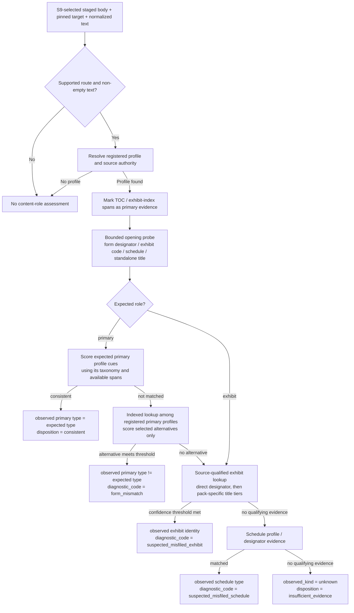

# Architecture & Implementation Plan: Prose-Driven Content Evaluation Decision Tree

## Goal Description

In EDGAR filings, HTML and flat text documents do not carry SGML `<TYPE>` tags inside
the document body. Determining whether a document is a primary report (initially Forms
10-K, 10-Q, and 8-K) or an exhibit (e.g. Item 601 EX-10 material contract, EX-21
subsidiary list, EX-31 certification, EX-99 press release), or detecting misfiled
documents, requires analyzing visible prose. Form 20-F remains a separate source
authority in the coverage ledger but is disabled in the initial S10 scope.

Drawing architectural inspiration from:
- [edgar_sec/domain/taxonomy/statements/cash_flow.py](../../../../edgar_sec/domain/taxonomy/statements/cash_flow.py) (lexical evidence pack compilation, tiered scoring, vetoes),
- [uploads/exhibits.md](../../../../uploads/exhibits.md) (17 CFR § 229.601 official SEC rules; Item 601(a)(2) Exhibit Index placement before signatures),
- [uploads/research/](../../../../uploads/research/) (a growing set of external research notes; currently includes `exhibits-classification.md` and `exhibits-followup.md`),
- [uploads/10-k.md](../../../../uploads/10-k.md), [uploads/20-f.md](../../../../uploads/20-f.md), [uploads/10-q.md](../../../../uploads/10-q.md), [uploads/8-k.md](../../../../uploads/8-k.md), and [uploads/6-k.md](../../../../uploads/6-k.md) (official form structures and exhibit instructions),
- [edgar_sec/domain/forms/families/annual/taxonomy.py](../../../../edgar_sec/domain/forms/families/annual/taxonomy.py) and [quarterly/taxonomy.py](../../../../edgar_sec/domain/forms/families/quarterly/taxonomy.py) (existing `FORM_10K_ITEMS`, `FORM_20F_ITEMS`, `FORM_10Q_ITEMS`),
- [roadmap/accession_document_flow/subplans/document_acquisition/decision_tree.md](../../../../roadmap/accession_document_flow/subplans/document_acquisition/decision_tree.md) (end-to-end plan/acquisition/processing tree),
- [roadmap/accession_document_flow/subplans/S10_exhibit_assessment.md](../../../../roadmap/accession_document_flow/subplans/S10_exhibit_assessment.md) (role assessment and diagnostic contract),
- [edgar_sec/engine/forms/cover/toc/finder.py](../../../../edgar_sec/engine/forms/cover/toc/finder.py) and [TocSpan](../../../../edgar_sec/engine/forms/cover/toc/models.py) (structural Table of Contents detection),

this plan specifies an **efficient, short-circuiting decision-tree evaluator** that integrates official SEC statutory structures, reuses existing form family item taxonomies, handles optional Table of Contents, and uses an **orthogonal, non-exploding diagnostic taxonomy**.

Research Markdown is input for review, not a normative implementation specification.
Its proposed code, regexes, module names, snippets, prevalence claims, and thresholds may
not match this repository's APIs or `AGENTS.md` contracts. Treat them as hypotheses:
verify the underlying legal claim, redesign the signal to fit repository conventions,
and compile regexes through the repository's builder. Record every supporting source
individually; additional notes may be added under `uploads/research/` without changing
the evaluator contract.

---

## 1. Insights from Official Uploads (`uploads/`)

Inspection of the official CFR rules, form instructions, and classification guidelines establishes two foundational architectural invariants:

### A. Source-specific Exhibit Index Placement
Under **17 CFR § 229.601(a)(2)** (from [uploads/exhibits.md:L13](../../../../uploads/exhibits.md#L13)):
> *"Each registration statement or report shall contain an exhibit index, which must appear before the required signatures in the registration statement or report."*

The local Item 601 forms place exhibit material in designated sections:
- **Form 10-K:** `Item 15. Exhibits and Financial Statement Schedules` (Part IV)
- **Form 10-Q:** `Part II, Item 6. Exhibits`
- **Form 8-K:** `Item 9.01 Financial Statements and Exhibits`

Form 20-F has separate exhibit instructions: Item 19 lists exhibits, and its exhibit
index immediately precedes the exhibits (`uploads/20-f.md:1935-1952`). Do not apply
Item 601 numbering or placement rules to that authority.

**Decision Tree Rule:**
- Mentions of exhibits (e.g. `"Exhibit 10.1"`, `"Exhibit 21"`) in a profile-recognized **Exhibit Index** or TOC are structural evidence of the primary filing, not standalone exhibit headers. The profile owns span detection; do not assume one universal index position.
- Conversely, a **standalone exhibit file** may place its exhibit designator and/or
  discriminating legal title in an early standalone heading. The handbook's opening
  1–25-line range is a hypothesis to validate separately for each title rule, not a
  universal cutoff.

### B. Candidate tag-free exhibit evidence (from local research notes)
Research notes suggest that when a visible exhibit label is absent, a distinctive title or
body signal may still occur early. These are candidates only: verify each against the
official local source, inspect local fixtures, and apply repository conventions before
designing a pack. The opening-line range is not normative.
- **EX-3.1 (Articles/Charter):** `CERTIFICATE OF INCORPORATION`, `ARTICLES OF INCORPORATION`, `CHARTER` + `DELAWARE GENERAL CORPORATION LAW`, `SECRETARY OF STATE` (*negative lookahead: `BYLAWS`, `MERGER`*).
- **EX-3.2 (Bylaws):** `BYLAWS`, `AMENDED AND RESTATED BYLAWS` + `ARTICLE I OFFICES`, `MEETINGS OF STOCKHOLDERS`.
- **EX-4 (Securities):** `INDENTURE`, `DESCRIPTION OF THE REGISTRANT'S SECURITIES`, `DESCRIPTION OF CAPITAL STOCK`.
- **EX-10 (Material Contracts):** `CREDIT AGREEMENT`, `LOAN AGREEMENT`, `EMPLOYMENT AGREEMENT`, `SEPARATION AGREEMENT`, `STOCK OPTION PLAN` + `ADMINISTRATIVE AGENT`, `LENDERS`, `BORROWER`, `BASE SALARY`.
- **EX-21 (Subsidiaries):** `SUBSIDIARIES OF`, `SIGNIFICANT SUBSIDIARIES`, `LIST OF SUBSIDIARIES` + `JURISDICTION OF INCORPORATION`.
- **EX-23 (Consents):** `CONSENT OF INDEPENDENT REGISTERED PUBLIC ACCOUNTING FIRM`, `WE CONSENT TO THE INCORPORATION BY REFERENCE`.
- **EX-24 (Power of Attorney):** `POWER OF ATTORNEY` + `KNOW ALL BY THESE PRESENTS`, `ATTORNEY-IN-FACT`.
- **EX-31.1 / 31.2 (SOX 302):** `CERTIFICATION OF CHIEF EXECUTIVE OFFICER`, `CERTIFICATION PURSUANT TO RULE 13A-14(A)` / `SECTION 302` + `I, [NAME], CERTIFY THAT:`.
- **EX-32.1 (SOX 906):** `CERTIFICATION PURSUANT TO 18 U.S.C. SECTION 1350` / `SECTION 906 OF THE SARBANES-OXLEY ACT OF 2002`.
- **EX-99 (Press Releases):** `PRESS RELEASE`, `FOR IMMEDIATE RELEASE`.

---

## 2. Orthogonal Diagnostic Taxonomy (Preventing Code Explosion)

To prevent a combinatorial explosion of form-specific diagnostic strings (e.g. avoiding `suspected_form_inversion_20f`, `suspected_form_inversion_10q`, etc.), the assessment model cleanly separates:
1. **The Diagnostic Category (`diagnostic_code`):** A small, closed, stable enumeration.
2. **The Specific Types (`expected_type`, `observed_type`):** Dynamic form/exhibit identifier strings.
3. **The Human/Audit Details (`diagnostic_detail`):** A formatted explanation of the discrepancy.

### Canonical Diagnostic Codes:
- `None`: When disposition is `consistent` or `insufficient_evidence`.
- `"form_mismatch"`: When another registered primary report is observed, but `observed_type != expected_type` (e.g. expected `10-K`, but observed `10-Q` or `8-K` in the initial profile set). Scales to additional profiles without adding new codes.
- `"suspected_misfiled_exhibit"`: When `expected_role == "primary"`, but the body is an exhibit.
- `"suspected_misfiled_primary"`: When `expected_role == "exhibit"`, but the body is a primary report.
- `"suspected_misfiled_schedule"`: When a schedule (e.g. `14A`, `13D`) is observed where a primary/exhibit was expected.

```python
# ExhibitIdentity = (authority_id, code)
# content_family and pack_id are separate concepts.

@dataclass(frozen=True, slots=True)
class DocumentRoleAssessment:
    schema_version: int
    evaluator_version: str
    taxonomy_version: str
    expected_role: str  # pinned S6 intent
    expected_type: str  # pinned S6 target_type; not body truth
    filing_form: str  # pinned S6 form
    expected_identity: PrimaryFormIdentity | ExhibitIdentity | ScheduleIdentity | None
    observed_kind: Literal["primary_report", "exhibit", "schedule", "structured_data", "paper_stub", "unknown"]
    observed_identity: PrimaryFormIdentity | ExhibitIdentity | ScheduleIdentity | None
    disposition: Literal["consistent", "possible_role_mismatch", "insufficient_evidence"]
    diagnostic_code: str | None  # "form_mismatch", "suspected_misfiled_exhibit", etc.
    diagnostic_detail: str | None
    supporting_evidence: tuple[MatchedSignal, ...]
    contradicting_evidence: tuple[MatchedSignal, ...]
    matched_evidence_tier: str | None
    confidence_band: str | None  # ordinal, never a probability
    evaluator_quality: str
    profile_id: str
    profile_version: str
    pack_id: str | None
    pack_version: str | None
```

---

## 3. Multi-Form Recognition as Registered Profiles

This decision tree should handle **multiple forms through one form-agnostic evaluator**,
not a set of form-specific branches. Primary recognition is
data-driven: each supported primary form contributes a source-backed profile. Exhibit
identity is resolved separately through filing context and authority-qualified codes.
Mismatch diagnostics compare the expected form with a registered observed primary
profile. Adding a form adds profile data and tests, not a decision-tree branch or
diagnostic code.

The repository already owns form taxonomies in
[`edgar_sec/domain/forms/families/`](../../../../edgar_sec/domain/forms/families/README.md).
Reuse those definitions as profile data instead of duplicating their item vocabulary.
Primary-profile selection may reuse the existing
[`FormPlugin` registry](../../../../edgar_sec/engine/forms/plugins/registry.py) and
family taxonomy contracts, but activation requires an explicit assessment profile.
Do not infer exhibit or primary-assessment activation from plugin-family membership.

- The annual taxonomy provides 10-K and 20-F item sets. Form 10-K is in the initial
  primary scope; Form 20-F is a separate exhibit-code authority until primary assessment
  is explicitly added to S10 scope and backed by fixtures.
- The quarterly taxonomy provides the 10-Q item set.
- The current taxonomy covers 8-K and 6-K. Form 8-K is in the initial primary scope.
  Form 6-K has local form evidence, but its instructions define a cover, variable
  issuer-furnished report/document, and signature page (`uploads/6-k.md:45-80`). It
  remains unregistered until its selected-body semantics and fixtures are reviewed.
- Other forms, including Form 4, remain out of scope unless a profile is explicitly
  justified and reviewed.

### Scope audit of existing form references

| Current reference group | What it represents | Design treatment |
|---|---|---|
| Goal and primary-profile scope | 10-K, 10-Q, and 8-K are the initial primary roles in the existing S10 assessment | Keep primary recognition form-agnostic and profile-driven; do not expand S10's primary scope in this plan. |
| Item 601 index placement | 10-K, 10-Q, and 8-K use Item 601 exhibit sections; Form 20-F has separate exhibit instructions | Keep source-specific spans and numbering in profiles; never apply Item 601 rules to Form 20-F. |
| Item 601 applicability table | S-1, S-3, SF-1, SF-3, S-4, S-8, S-11, F-1, F-3, F-4, Form 10, 8-K, 10-D, 10-Q, 10-K, and ABS-EE | Preserve every source row, but do not auto-register these forms; current S10 runtime scope remains 10-K, 10-Q, and 8-K. |
| Diagnostic taxonomy and mismatch examples | Expected vs. observed primary form values | Keep generic; preserve the closed `form_mismatch` code and dynamic type IDs. |
| Existing form-family taxonomies | Form-specific Part/Item vocabulary | Reuse as profile data; do not put form checks into the exhibit-pack modules. |
| Existing plugin registry | Dedicated 10-K, 20-F, 10-Q, and 8-K plugins; generic fallback for 6-K and unknown forms | Reuse only as a lookup seam; plugin registration is not assessment activation. |
| Original flowchart and execution ladder | Literal alternatives for 10-K, 20-F, 10-Q, and 8-K | Replace with profile lookup and alternate-profile comparison; initial primary profiles remain 10-K, 10-Q, and 8-K. |
| Form 20-F | Local instructions establish a separate exhibit-code namespace; current S10 role-assessment scope does not include the form | Keep source-qualified coverage rows disabled; enable exhibit or primary assessment only after separately scoped and fixture-backed. |
| Form 6-K | Local instructions and current-family evidence exist; form content includes a wrapper around issuer-furnished material | Do not activate from family membership. Defer until target/body selection semantics and fixtures support a profile. |
| Form 40-F | Mentioned as a Form 6-K cover-page annual-report election; no 40-F instructions or profile are in scope | No implicit primary or exhibit assessment; require its own source review and explicit profile. |
| Item 601 vs. Form 20-F exhibit-number examples | Proven authority-local code collision (e.g. EX-1 vs. exhibit 1) | Keep only as source-qualified coverage/alias data; no 20-F-specific branch in the evaluator. |
| Form 4 | Outside the current S10 form scope | No registered profile means no evaluation and no assessment. |

Thus the design scope is a form-agnostic role evaluator with declarative, independently
registered primary-recognition and exhibit-applicability profiles. The initial
primary-report profile set follows the current S10 scope: 10-K, 10-Q, and 8-K. Item 601
is the initial exhibit authority for those in-scope forms where its table establishes
applicability. Form 20-F coverage rows preserve its distinct code namespace but remain disabled for S10 assessment;
its existence does not activate primary or exhibit classification. Forms 6-K, 40-F, and
other unregistered forms likewise receive no assessment. Profile expansion requires
source-backed rules, selected-body fixtures, and an explicit scope decision. Exhibit
content packs remain form-independent unless local sources prove an applicability rule
or a real authority/code collision.

---

## 4. Invariant: Table of Contents is Sufficient, Never Necessary

> [!IMPORTANT]
> **No mandatory structural signal:** The evaluator must tolerate a body without a detected Table of Contents or exhibit-index span. It cannot assume every supported form or acquired representation exposes one.

Therefore, the decision tree enforces a strict asymmetric rule:
- **TOC/index spans are corroborating evidence:** If a profile-recognized contents or exhibit-index span is detected, it can shield exhibit-like references attributable to its rows. It is not a global veto against an unrelated standalone exhibit title elsewhere in the body.
- **TOC absence is never a rejection gate:** If no such span is detected, evaluate:
  1. Statutory title header (e.g. `"ANNUAL REPORT PURSUANT TO SECTION 13..."`).
  2. Standalone form designator line for a registered primary profile.
  3. Commission header (`"UNITED STATES SECURITIES AND EXCHANGE COMMISSION"`).
  4. In-body headings declared by the registered primary profile.

These designators and headings are examples from currently available profiles, not the
closed set of forms supported by the generic evaluator. A contents span is interpreted through
the selected profile and protects only matches attributable to that primary document.

---

## 5. End-to-End Decision Tree Architecture

The decision tree runs after S9 selects and stages a body. It uses bounded text, the
pinned filing/target context, and available structural spans; profile and pack rules set
their own narrower evidence windows:



### Boundary with S9 lazy-index selection

S9's lazy-index screen is a network-request gate; S10's prose classifier is a diagnostic.
Their evidence thresholds are independent. A weak but plausible S9 suspicion may justify
spending one index request even when it would be insufficient for S10 to report a role
mismatch. In an idealized set of `N` catalog-direct primary candidates where `p` are known
inversions requiring recovery, the screen passes `N - p` without an index request and
requests the index for `p`. Real screens can have false positives or false negatives;
the cost/recall tradeoff is measured separately and the screen's “pass” is not a type
assertion.

Only a unique SEC-index row matching the pinned filing form can authorize a changed
physical-slot assignment. A local suspicion signal can request that lookup but cannot
identify the selected document by itself. Ambiguous or missing index evidence remains an
S9 selection outcome; S10 does not repair it. The existing S9 contract records that the
screen decides whether to spend a request, while only index/bundle metadata creates a
`slot_types` fact ([acquisition decision tree](decision_tree.md#catalog-direct-primary-selectors-and-lazy-recovery)).

S10 evaluates the already selected body for an advisory content-role assessment. A
source-backed profile reports only what its diagnostic evidence supports; that inferred
`observed_identity` is not an SEC-index assertion. S10 must not trigger an index request,
authorize/rewrite a selected sequence, change a target or route, or serve as input to the
S9 lazy-index screen. Conversely, a completed S9 selection does not make S10's body
classification authoritative or guarantee that the inferred identity matches an index
row.

### Reuse audit: fast cues and one-scan candidates

Audit these owners before adding new form-title or structural regexes:

| Need | Existing owner and behavior | Design disposition |
|---|---|---|
| TOC candidates | [`toc/finder.py`](../../../../edgar_sec/engine/forms/cover/toc/finder.py) exposes `find_toc_span(text, ..., derived_taxonomy=...) -> TocSpan \| None`; it returns one span with offsets and evidence. [`boundary/detector.py`](../../../../edgar_sec/engine/forms/cover/boundary/detector.py) returns one cover interval and copies evidence strings, not the `TocSpan`. | D0 should split profile-independent candidate discovery from profile-specific scoring, returning all candidate spans from one scan. The normalizer can choose one boundary; the evaluator can compare alternatives in memory. Do not run a whole-text finder once per profile. |
| Normalizer TOC scans | [`normalize.py`](../../../../edgar_sec/engine/forms/normalize.py) detects a TOC for cover boundary, then scans again after text normalization with derived taxonomy. The text frames and inputs differ. | Do not delete either scan by changing only the signature. D0 must map source/normalized coordinates and identify which final spans `NormalizationResult` can safely retain for S10. |
| Cover checkmarks | `extract_cover_candidates(text, boundary, *, family, table_geometries=())` emits labeled `CheckboxCandidate`s, mark states, and character spans; `infer_cover_checkmarks(...)` resolves them. Normalization uses the result for rewriting, then drops it; rewrites/reflow can move offsets. | Reuse resolved checked-state evidence and source spans if preserved by the owner result. If multiple candidate cover schemas are needed, expand extraction to scan once and resolve the candidates in memory. A phrase without a reliably selected mark is only weak suspicion; do not rescan rewritten text. |
| Form-title data | Annual, quarterly, and current title tuples exist in `domain/forms/families/*/evidence.py`, but production code does not consume them. `domain/forms/common/vocabulary.py` recognizes broad `FORM`/`SCHEDULE` tokens, not a canonical mismatch. | Reuse reviewed vocabulary as data, not as an existing classifier. `foundation/text/automaton.py` and `foundation/text/evidence.py` can share lexical scans; their positions are token-based and need explicit mapping to source spans. |
| Existing evaluators | The annual evaluator checks EX-13 delegation/stub cues; quarterly and current evaluators currently proceed. `body_start.find_body_start` returns structural/semantic candidates, not canonical form identity. | Do not route primary-form classification through these evaluators. Reuse only narrow evidence/model components whose semantics match. |

Cheap competing-form cues can precede TOC/profile scoring. Local templates expose an
annual-versus-transition choice on Form 10-K (`uploads/10-k.md:152-162`), a quarterly
report choice on Form 10-Q (`uploads/10-q.md:99-103`), and a Form 20-F/40-F annual-report
election on the Form 6-K cover (`uploads/6-k.md:26-29`). The latter is a 6-K signal, not
a 10-K checkbox. If a body expected to be 10-K contains a reliably selected competing
cover choice, it may raise S9 suspicion before TOC analysis, but it does not establish
`observed_identity`. A phrase alone, an unchecked option, or an offset from a rewritten
text frame must not be promoted to a selected-form fact.

The D0 signature decision should be an actual extraction/result seam, not just a wider
annotation on `find_toc_span`: discover candidate TOC boundaries once, retain their
offsets/evidence, and score them against each registered taxonomy without rescanning the
body. Likewise, let cover candidate extraction accept the registered choice vocabulary
needed for suspicion, then return mark state and source span once. Keep the normalizer's
pre-rewrite and post-rewrite scans distinct until equivalence across their text frames is
proven; source offsets may require a rewrite map before S10 can reuse them.

The legacy inversion predicate is narrower than “link analysis.”
[`document_storage/candidates.py`](../../../../edgar_sec/pipelines/document_storage/candidates.py)
uses a validated filing date in `[2000-01-01, 2005-01-01)`, an Item 601-style filename
grammar, and a form-token pattern to nominate bundle inspection; missing or conflicting
dates fail closed rather than using the accession year. The legacy resolver then scans
SGML `<TYPE>` headers and sequence numbers; it does not classify prose or analyze a
hyperlink graph. The pure date/name predicate may be evaluated as a low-confidence S9
lazy-index suspicion signal for eligible catalog-direct locators, never as a form identity
or slot selector. Its bounds and fail-closed behavior have mirrored tests in
`tests/pipelines/document_storage/test_candidates.py`; measure its false-positive/request
cost by form and era before adopting it. Historical large-corpus claims are not
established by the unit fixture. Do not import the legacy pipeline into S9/S10 or port its
bundle-selection behavior.

One-pass is a semantic contract, not just a wider return annotation: discover structural
and lexical candidates for a given text frame once, retain stable source spans, and score
those candidates against multiple profiles without rescanning the full text. TOC,
checkmark, and normalization passes have distinct scopes today, so D0 must choose the
result owner and coordinate mapping before promising fewer scans. S9 consumes low-threshold
suspicion facts only; S10 applies its independent diagnostic threshold to the selected
body.

---

## 6. Execution Steps: Scalable Classification Ladder

### Step 1: Designator & Document Class Extraction
- Use registered profile designators plus shared exhibit/schedule patterns to extract
  normalized candidate identities from the bounded text.
- Preserve the observed prefix, raw code, source authority, and line position; do not
  reduce a source-qualified exhibit number to an integer-only key.
- Compile alternatives with `build_alternation`; the evaluator does not enumerate form
  names in branching logic.

### Step 2: Primary-Profile Verification
1. Resolve the expected type to its registered primary profile.
2. If a TOC span exists, score only its rows against that profile's taxonomy.
3. Without a TOC, score the profile's own title, designator, and structural anchors from
   a bounded view. TOC omission never rejects a candidate by itself.
4. On a primary match, short-circuit exhibit-pack evaluation. When the expected profile
   fails, use indexed profile cues to select alternate primary candidates; compare only
   those candidates, then report a generic `form_mismatch` if an alternate meets its
   evidence threshold.

### Step 3: Generic Form Mismatch Diagnosis
- If primary checks fail against `expected_type`:
  - If the body matches another registered primary profile:
    - `observed_kind = "primary_report"`
    - `observed_type = matched_form`
    - `disposition = "possible_role_mismatch"`
    - `diagnostic_code = "form_mismatch"`
    - `diagnostic_detail = f"observed primary form '{matched_form}' conflicts with expected form '{expected_type}'"`

### Step 4: Misfiled Exhibit & Schedule Resolution
- If primary checks fail completely:
  - Check a standalone exhibit designator, then the applicable pack's standalone title
    rule within its own opening `N`-line window and required tier/confidence threshold.
  - Use the selected profile's exhibit-index/TOC spans as shields; do not globally veto
    an exhibit match merely because a form-family label or any TOC signal was seen.
  - If no exhibit candidate qualifies, check registered schedule evidence; otherwise
    abstain as insufficient.

---

## 7. Proposed Changes

The following is a design proposal only. It is not authorization to implement M8 or
enable exhibit diagnostics. S10 integration remains read-only and shadow-only; M9 remains
gated separately.

### Domain contracts and visible coverage

Keep filing-form assessment separate from exhibit identity and from evidence text:

```text
edgar_sec/domain/forms/
  common/exhibits.py                  shared immutable assessment/pack contracts
  exhibits/
    README.md
    coverage.py                       unified source-qualified code ledger, including gaps
    registry.py                       authority + code -> content pack, indexed lookup
    profiles.py                       declarative applicability and tiered policies
    packs/
      README.md
      ex13.py, ex21.py, ...            code-named packs where identity is unambiguous
      ex1_item601.py                   collision-qualified pack when meanings diverge
      ex1_form20f.py                   distinct pack only when the clash needs one
edgar_sec/engine/forms/plugins/
  exhibit_selection.py               bounded probe, context routing, selected-pack scoring
  evaluators/content_role.py          overall primary/form/exhibit/schedule decision tree
```

Keep the engine and pack contract form-agnostic. `ExhibitIdentity` is exactly the
source-qualified pair (`authority_id`, `code`); `content_family` and `pack_id` are
separate concepts. A subitem such as Item 601 31(i) is represented in the canonical code,
not as another identity dimension.
Applicability profiles are declarative data loaded by a generic evaluator; it contains no
`if form == ...` branches or form-named evaluator modules. A profile may state form
conditions only when local source material establishes them. Unregistered forms receive
no exhibit evaluation. Use names such as `ex13.py` when the code identifies one pack in
the registry; qualify a module when local sources prove the same number denotes different
content in another namespace. Item 601 EX-1
(underwriting agreement) versus Form 20-F exhibit 1 (organizational documents) is one
such proven collision; the Form 20-F #13 / Item 601 EX-13 meanings also differ. This is
evidence for authority-qualified identity, not a Form-20-F-specific engine. If two
source-qualified identities share a visible-content rule, they may reference one shared
pack only after the duplicate audit establishes that reuse is safe. Dotted subtypes remain
separate pack IDs where required, e.g. Item 601 3(i)/3(ii) and 31(i)/(ii). Split a pack
into a nested package only if it grows beyond a cohesive module; do not consolidate all
vocabularies into one `evidence_packs.py`.

Module and directory names in this plan are illustrative, not copied from research-note
snippets. Select final names after checking package ownership, test mirroring, README
requirements, and `AGENTS.md` conventions.

`coverage.py` is the single source-of-truth ledger across authorities and form scopes. It
must distinguish statutory recognition from actual evaluator readiness. Proposed statuses:

- `reserved`: the cited authority-local number is reserved; no classifier pack.
- `unsupported`: a statutory item is known, but available evidence does not support a
  safe body evaluator or it belongs to another representation pipeline.
- `candidate`: local sources motivate a candidate pack; this is not validated coverage.
- `partial`: only named subtype(s) are candidates; the broader exhibit code remains
  uncovered.

Pack maturity is separate from coverage status. Pack `evaluator_quality` progresses
through `proposed`, `source_supported`, `fixture_reviewed`, `shadow_reviewed`, and
`holdout_evaluated`; the latter records evidence, not permission to change S6 targets or
classify authoritatively. Each coverage row records `authority_id`, an exact
authority-local code (including any subitem), aliases (including EDGAR spellings only
when verified locally), source status, proposed module/pack ID (nullable), coverage
status, source-backed applicability conditions, supported representation, and a
repeatable `source_refs` collection of path/section citations. A row may cite multiple
official documents and relevant research notes; the registry must not assume a fixed
number or name of Markdown inputs. Do not add a form name to a pack identity unless the source establishes
a form-specific rule or a real code collision; ordinary form applicability belongs in
profile data. Reserved, unsupported, broad, and structured-data items stay visible rather
than disappearing from the registry.

### Initial local-source coverage ledger

This inventory uses the official local text, applicable form instructions, current code,
and the evolving collection of relevant notes under `uploads/research/`. The present
notes include `exhibits-classification.md` and `exhibits-followup.md`; this list is not
closed. `EX-` labels are classification/EDGAR code conventions, not literal names used
throughout the CFR extract. Research-note snippets and regexes are untrusted proposals,
not ready-to-copy implementation. “Candidate” means proposed for source/fixture review,
not a claim that a rule works. The local Item 601 table lists form applicability at
`uploads/exhibits.md:77-134`; the local Form 20-F instructions have their own numbered
exhibit list (`uploads/20-f.md:1941-2064`). Form 6-K has distinct wrapper/body
instructions (`uploads/6-k.md:45-80`). The Item 601 table is not a universal form
classifier or a substitute for form-specific rules.

| Item 601 | Local-source scope | Proposed module / pack | Design coverage status |
|---|---|---|---|
| 1 | Underwriting agreements | `ex1_item601.py` | candidate; number clashes with a different source-defined exhibit 1 |
| 2 | Acquisition/reorganization and related plans | `ex2_item601.py` | candidate; distinguish transaction-plan types; number clashes |
| 3 | Articles and bylaws; handbook separates 3.1/3.2 | `ex3_item601.py` | partial; separate subtype packs; number clashes |
| 4 | Instruments defining security-holder rights | `ex4_item601.py` | partial; do not equate one indenture cue with full coverage; number clashes |
| 5 | Legality opinions | `ex5_item601.py` | candidate; tax opinions are a negative distinction; number clashes |
| 6 | Reserved | — | reserved |
| 7 | Accountant non-reliance correspondence | — | unsupported; no handbook family profile; number clashes |
| 8 | Tax opinions | `ex8_item601.py` | candidate; keep distinct from Item 5; number clashes |
| 9 | Voting-trust agreements | `ex9_item601.py` | candidate; number clashes |
| 10 | Material contracts | `ex10_item601.py` | partial; bounded subtypes only, not “any agreement”; number clashes |
| 11–12 | Reserved | — | reserved |
| 13 | Annual/quarterly shareholder reports | `ex13_item601.py` | candidate; distinguish annual/quarterly variants; number clashes |
| 14 | Code of ethics | `ex14_item601.py` | candidate; number clashes |
| 15 | Interim-financial-information letters | `ex15_item601.py` | candidate; number clashes |
| 16 | Change-in-accountant letters | `ex16_item601.py` | candidate; number clashes |
| 17 | Director-departure correspondence | `ex17_item601.py` | candidate; number clashes |
| 18 | Accounting-principles correspondence | `ex18.py` | candidate |
| 19 | Insider-trading policies | `ex19.py` | candidate |
| 20 | Other security-holder documents | — | unsupported until conditional scope has body evidence |
| 21 | Subsidiaries | `ex21.py` | candidate |
| 22 | Subsidiary guarantor/issuer/collateralizer lists | `ex22.py` | candidate |
| 23 | Expert/counsel consents | `ex23.py` | candidate |
| 24 | Power of attorney | `ex24.py` | candidate |
| 25 | Trustee eligibility statement | `ex25.py` | candidate |
| 26–30 | Reserved | — | reserved |
| 31 | Certifications, statutory subparagraphs (i)/(ii) | `ex31.py` | partial; separate ordinary and ABS packs |
| 32 | Section 1350 certifications | `ex32.py` | candidate |
| 33–36 | Servicing reports/statements and ABS shelf certification | `ex33.py`–`ex36.py` | candidate; separate by statutory type |
| 37–94 | Reserved | — | reserved |
| 95 | Mine-safety disclosures | `ex95.py` | candidate; applicability is conditional |
| 96 | Technical-report summary | `ex96.py` | candidate; specialist content, corpus needed |
| 97 | Compensation-recovery policy | `ex97.py` | candidate |
| 98 | De-SPAC reports/opinions/appraisals | `ex98.py` | candidate; conditional scope |
| 99 | Additional exhibits, including earnings statements | `ex99.py` | partial; only evidenced subtypes, never blanket EX-99 |
| 100 | Reserved | — | reserved |
| 101 | Interactive Data File | — | unsupported by prose evaluator; structured-data route |
| 102–103 | Asset Data File / asset-related document | — | unsupported pending representation-specific evidence |
| 104 | Cover Page Interactive Data File | — | unsupported by prose evaluator; structured-data route |
| 105 | Reserved | — | reserved |
| 106 | Static pool | — | unsupported; local handbook examples include index-page links rather than selected bodies |
| 107 | Filing fee table | `ex107.py` | candidate; structured/table cues and form scope need review |

The local Form 20-F text demonstrates a concrete numbering collision: its exhibit 1 is
organizational documents, while Item 601 EX-1 is an underwriting agreement. This
form-specific source is included to prove why the generic ledger needs authority-qualified
identities, not to make Form 20-F a special case in the evaluator. Do not interpret its
numbers as Item 601 EX codes. Keep them as rows in the unified, source-qualified ledger;
the suggested content-pack references below are only candidates for the later duplicate
audit, not form-specific implementation modules.

| Source code (`Form 20-F`) | Local-source scope | Candidate shared content pack | Design coverage status |
|---|---|---|---|
| 1 | Articles/association and bylaws | Organizational documents; compare with Item 601 EX-3 | partial; organizational subtypes |
| 2 | Rights of security holders and indentures | Security-holder instruments; compare with Item 601 EX-4 | partial; distinct instrument subtypes |
| 3 | Voting-trust agreements | Voting trusts; compare with Item 601 EX-9 | candidate |
| 4 | Material contracts | Material contracts; compare with Item 601 EX-10 | partial; do not treat every contract as a hit |
| 5 | Material foreign-patent list on request | — | unsupported; conditional list, no local body profile |
| 6–7 | Reserved | — | reserved |
| 8 | Subsidiaries | Subsidiary list; compare with Item 601 EX-21 | candidate |
| 9 | Financial-statement opinion for specified IPO context | — | unsupported pending a body-level evidence case |
| 10 | Regulation BTR blackout notices (annual report only) | — | unsupported pending a narrow local fixture/profile |
| 11 | Code of ethics and insider-trading policies | Separate ethics/policy subpacks; compare with Item 601 EX-14/19 | partial; keep subtypes distinct |
| 12 | Rule 13a-14(a)/15d-14(a) certifications | Ordinary certification; compare with Item 601 EX-31(i) | candidate |
| 13 | Section 1350 certifications | Section 1350 certification; compare with Item 601 EX-32 | candidate |
| 14 | Legal opinion required by Form 20-F Item 7.B | Legality opinion; compare with Item 601 EX-5 | candidate; distinguish from tax opinions |
| 15 | Additional exhibits / incorporated documents | — | unsupported until a narrow subtype has body evidence; open category is not a generic pack |
| 16 | Conditional mine-safety disclosure | Mine safety; compare with Item 601 EX-95 | candidate; condition and annual-report scope required |
| 17 | Subsidiary guarantors/issuers/collateral affiliates | Guarantor/affiliate lists; compare with Item 601 EX-22 | candidate |
| 18–96 | Reserved | — | reserved |
| 97 | Compensation recovery policy | Compensation recovery; compare with Item 601 EX-97 | candidate; annual report and listing condition required |
| 98–100 | Reserved | — | reserved |
| 101 | Interactive Data File | — | unsupported by prose evaluator; structured-data route |
| 102–103 | Reserved in the Form 20-F list | — | reserved; do not inherit Item 601 meanings |
| 104 | Cover Page Interactive Data File | — | unsupported by prose evaluator; structured-data route |

Source map: Item 601 general filing/index rules and exhibit list are in
`uploads/exhibits.md:9-38,77-134,136-696`; the local Form 20-F list is in
`uploads/20-f.md:1917-2064`. The research collection is open-ended; current examples include
`uploads/research/exhibits-classification.md:7-43,429-1492` and
`uploads/research/exhibits-followup.md:6-78,80-240`. Treat heuristic details in these
notes as hypotheses, not official rules or repository-ready patterns. No cited source
establishes validated packs. The local S10 assessment note records the lack of an exact
selected-body corpus, independent labels, and measured error rates
(`roadmap/accession_document_flow/subplans/S10_exhibit_assessment.md:11-32`).

### Pack and evaluator quality fields

Keep evaluator maturity separate from per-document confidence:

- Pack metadata and the copied assessment field `evaluator_quality`: `proposed`,
  `source_supported`, `fixture_reviewed`, `shadow_reviewed`, or `holdout_evaluated`.
  `source_supported`
  requires traceability to official local authority for legal identity/applicability;
  external research notes can nominate signals but cannot establish this status by
  themselves. It does not claim correct classification. This field states rule maturity,
  not the certainty of an individual result.
- Assessment fields `matched_evidence_tier` and `confidence_band`: tiers identify the
  strongest evidence path; the band is `insufficient`, `low`, `moderate`, or `high`,
  derived from declared pack thresholds and vetoes. It is ordinal, not a probability.

Every pack/result also pins `pack_id`, `pack_version`, `taxonomy_version`, evaluator
version, and matched signal IDs with bounded spans. An assessment copies the selected
pack's `evaluator_quality` so consumers can inspect rule maturity without a registry
lookup. `holdout_evaluated` requires issuer/accession-separated fixtures and reported
per-profile/per-pack confusion counts. Do not emit numeric confidence; the ordinal band
must not be interpreted as a calibrated probability or inferred from phrase count alone.

### Form-agnostic applicability and tiered dispatch

The evaluator is generic; applicability is declarative source data. Keep primary
recognition profiles separate from exhibit-authority profiles: the former recognize
10-K/10-Q/8-K primary bodies initially; the latter initially dispatch only Item 601
for those in-scope filings where the local applicability table supports it. Form 20-F coverage rows
preserve its distinct exhibit-code namespace but remain disabled for S10. An
`ExhibitAssessmentProfile` identifies the applicable source namespace, route/role
conditions, and an ordered candidate-tier graph. Profiles may be shared by filing forms
only when cited rules and evidence match. A role without an approved profile—including
Form 20-F, Form 6-K, Form 40-F, and Form 4 in the initial S10 scope—skips invocation and
produces no assessment (`None`), not `unknown` or a guessed result. Do not infer
applicability from a broad form family, plugin, or alias. A pinned S6 exhibit target
resolves by its source-qualified expected code; an unsupported code yields
`insufficient_evidence`, without altering the target.

For an eligible text/HTML body, dispatch in this order:

1. **Scope gate:** resolve the supplied canonical filing context and expected role.
   Primary-role checks require a registered primary profile; exhibit checks require an
   applicable exhibit-authority profile and source-qualified target identity. Skip when
   no profile applies, the route is unsupported, or the role is ineligible.
2. **Primary-document shields:** do not interpret a title or designator inside an available
   table-of-contents or exhibit-index span as a standalone exhibit header. Those spans
   remain primary-document evidence; their absence is never a rejection gate.
3. **Cheap direct-designator probe:** scan only a bounded opening-line view for a
   line-anchored `EXHIBIT <code>` or `EX-<code>` designator. The handbook's early-line
   window is a fixture hypothesis, not a legal rule; choose the operational bound from
   local fixtures. Normalize the captured code, then look it up using
   `(authority_id, code)`, never the number alone. A phrase in running prose is not a
   direct header. A match is evidence, not automatic acceptance.
4. **Pack-specific standalone-title probe:** only packs with a reviewed, discriminating
   title rule declare this evidence. Require the title to occupy a standalone heading
   line within that rule's first `N` lines; preserve the matched line number and signal
   ID. `N` is pack data selected from fixtures, not a global constant or legal threshold.
   A generic title such as “Agreement” is not discriminating. The pack declares its
   `matched_evidence_tier` and minimum `confidence_band`; a highly specific title may
   satisfy that threshold on its own only when the pack explicitly allows it and no veto
   or contradictory signal fires. Otherwise it only selects or supports candidate packs
   for later corroboration.
5. **Profile-local branch graph and fallback tiers:** when direct designation/title
   evidence is absent or below threshold, consult the selected profile. It branches on
   available, source-backed context and points to ordered candidate tiers. A profile-local
   cue index or compiled multi-pattern prefilter selects candidate pack IDs; score only
   those candidates. Do not loop over every exhibit pack or every profile for every
   document. Keep candidate ordering deterministic and short-circuit when a tier's
   declared decision rule is met.
6. **Abstain:** no supported pack hit, conflicting signals, or an unsupported code
   yields `insufficient_evidence`. Forms without an applicable profile are skipped
   before assessment.

Each profile owns its activation conditions, branches, and veto ordering as data; it
references shared code-owned packs rather than copying vocabulary. A profile may point
to filing-specific index/item cues or a source table's applicability conditions, but the
engine has no embedded form names. The exact candidates and tier weights remain
provisional until fixture review. Reuse the existing `LexicalEvidencePack` and
`score_unit()` only after routing has narrowed candidates; their lexical score is not the
branch graph and the `BowScore.confidence` field is not a calibrated content-role
probability. The Item 601 table and other form instructions describe filing requirements;
S10 only assesses the acquired body's declared role and never infers a missing target or
changes the plan from those requirements.

The cheap probe must be anchored to line start and the opening window, compile regex
alternations through `foundation.regex.builder` where applicable, and expose capture
spans. It should recognize standalone headers with or without a caption on that line,
while excluding ordinary sentences that merely mention an exhibit. It must not scan the
entire primary body for exhibit references.

### Engine and S10 seams

- `engine/forms/plugins/exhibit_selection.py` performs bounded header probing, code
  resolution, profile routing, candidate selection, signal collection, vetoes, and
   the `matched_evidence_tier` and `confidence_band` explanation. It does not fetch a
   selected subdocument.
- `engine/forms/plugins/evaluators/content_role.py` keeps the overall primary-form,
  alternate-form, exhibit, and schedule decision tree. It consumes existing form item
  taxonomies and `TocSpan`; the exhibit matcher remains separately testable.
- `pipelines/document_acquisition/processing.py` may attach the immutable assessment to
  `ProcessingResult` for eligible text/HTML only. It does not change target identity,
  route, profile, acquisition, retry, or normalization behavior. The fingerprint pins
  evaluator, profile, pack, and taxonomy versions when the shadow evaluator runs.
- S10 diagnostic output remains non-authoritative. Unknown, binary, XML/structured, and
  paper routes retain their existing route-specific handling and do not fall through to
  prose classification.

### Bounded evidence-review batches and duplicate audit

Before any packs are implemented, review candidate families in bounded, independent
batches. The source-inventory pass is not a pack-analysis assignment: no single reviewer
owns the entire Item 601 or Form 20-F set. Use this ten-batch plan for the later evidence
review; the Item 601 ranges are anchored in the exhibit table/descriptions
(`uploads/exhibits.md:77-134,138-696`), and the Form 20-F numbers in its own list
(`uploads/20-f.md:1959-2064`). The ledger remains the full inventory; these batches are
review assignments, not new taxonomy boundaries.

| Batch | Item 601 assignment | Form 20-F assignment | Why this is bounded |
|---|---|---|---|
| A — Transactions/contracts | 1, 2, 9, 10 | 3, 4 | Related agreement/planning evidence; Item 10 and Form 20-F 4 stay marked broad/partial. |
| B — Corporate instruments/opinions | 3, 4, 5, 8, 25 | 1, 2, 14 | Keep Item 5/8 opinion categories distinct; Form 20-F identity remains namespace-specific. |
| C — Professional correspondence | 7, 15, 16, 18, 23 | — | Bounded correspondence/consent set; Item 7 remains visible despite no handbook profile. |
| D — Governance/signature policies | 14, 17, 19, 24, 97 | 10, 11 | Small policy/governance set; preserve each type and applicable condition. |
| E — Holder-facing/entity material | 13, 20, 21, 22, 99 | 8, 15, 17 | Related high-level categories, but Item 20/99 and Form 20-F 15 do not become blanket packs. |
| F — Ordinary certifications | 31(i), 32 | 12, 13 | Separate Item 31(i) from ABS Item 31(ii); Form 20-F certification numbers are authority-local. |
| G — ABS reporting/certification | 31(ii), 33, 34, 35, 36 | — | Keep the ABS subtype family together for comparison while retaining independent pack IDs. |
| H — Conditional specialist reports | 95, 96, 98 | 16, 97 | Conditional/specialist evidence is isolated from ordinary corporate prose. |
| I — Reserved ranges | 6, 11–12, 26–30, 37–94, 100, 105 | 6–7, 18–96, 98–100, 102–103 | Verify reserved/gap records remain visible; no prose-pack heuristics. |
| J — Structured/table-oriented | 101–104, 106–107 | 5, 9, 101, 104 | Review representation and conditional/no-pack status; Item 107 remains a table-oriented candidate. |

Each assignment covers only its row and the corresponding local excerpts; use all
relevant official sources and any applicable notes under `uploads/research/`, recording
every path/section citation. Treat external suggested code, regex, module names, and
thresholds as hypotheses; verify and rewrite them for this repository rather than copying
literally. Item 10,
Item 99, Form 20-F 4, and Form 20-F 15 must not be bundled with many routine codes.
The long reserved ranges have their own low-heuristic batch rather than being mixed with
structured and table-oriented items. Do not assume same-numbered codes across authorities
are the same exhibit. Each reviewer returns for every assigned code: authority-local code, exact
source citations, candidate/partial/unsupported/reserved status, applicable form and
conditions, suggested module name, content-family proposal, bounded positive/negative
anchors, and possible duplicate/near-neighbor signals. No reviewer promotes pack quality
or resolves another batch's ownership conflicts.

After the bounded reviews and before approval of implementation, a separate integrator
reconciles the ledgers and runs a cross-pack ownership pass. Assemble the Form 20-F
number-to-pack-or-gap crosswalk from its bounded review rows and spot-check citations
against `uploads/20-f.md:1959-2064`; do not independently re-analyze the entire list.
Unresolved entries receive bounded follow-up assignments. Compare proposed codes,
aliases, headings, and lexical signals against current owners, including
`domain/taxonomy/schedules/statutory/exhibits.py`,
`domain/forms/families/annual/evidence.py` (`ANNUAL_TARGET_EXHIBITS` and existing annual
vocabulary), `domain/forms/common/vocabulary.py`, and the shared lexical machinery in
`foundation/text/evidence.py`. For each overlap, record `reuse`, `extend`, `new`, or
`exclude`, the current owner, and a short rationale. Identical strings are not
automatically duplicates when legal meaning differs; repeated generic terms should not
be copied into every exhibit pack. This audit is a distinct design gate, not a source
edit or an excuse to broaden the candidate set.

### Contract-first implementation task list

These are post-approval implementation milestones. They separate stable interfaces from
evidence-dependent rules so incomplete research does not block useful scaffolding. No
milestone authorizes mutating S6 targets, enabling authoritative classification, or
starting M9 publication.

| Milestone | Deliverables / files | Depends on | Can run in parallel? | Exit condition | Status |
|---|---|---|---|---|---|
| **D0 — Reuse audit and contract freeze** | Map reusable TOC candidate/boundary, cover/checkmark, title-vocabulary, and legacy inversion APIs. Record which results/signatures must retain multiple spans, checked-choice evidence, and source offsets. Freeze a shared scan result consumed by separate S9 suspicion and S10 classification thresholds; then freeze request/result, pack/profile, coverage, and `source_refs` contracts. | User approval of this design. | No; this is the contract gate. | Exact reuse/extension decisions, text-coordinate frames, and one input/output shape are documented; S9 cannot assert type and S10 cannot trigger a request. | [ ] |
| **D1 — Build domain scaffolding** | `domain/forms/exhibits/{coverage.py,registry.py,profiles.py}` and package READMEs. Add source rows, disabled candidate records, indexed lookup and profile schemas; no exhibit heuristics required. | D0. | Parallel with D2 and D3 after contract freeze. | Complete known-code ledger is representable; no inactive/unsupported row resolves to an active pack. | [ ] |
| **D2 — Build generic evaluator shell** | `engine/forms/plugins/exhibit_selection.py`, `engine/forms/plugins/evaluators/content_role.py`, mirrored tests. Implement injected profile lookup, shared candidate extraction, indexed cover/title/TOC evidence, optional standalone-title rules, shields, thresholds, and abstention. Use synthetic packs where local rules are not yet researched. | D0; can use empty D1 registries while those are populated. | Parallel with D1 and source research D3. | No form-specific branch or per-profile whole-text rescan; alternate profiles reuse candidate spans; synthetic collision and tier tests pass. | [ ] |
| **D3 — Review source evidence in bounded batches** | Execute batches A–J in the coverage section. Each reviewer returns only assigned codes, exact local citations, applicability, candidate signals/negatives, status, and possible duplicate owners. | D0's row schema. | Yes; A–J are independent. No one reviewer owns the entire exhibit inventory. | Each Item 601 / source-specific code has a disposition; broad or uncertain types remain explicit gaps. | [ ] |
| **D4 — Add reviewed pack modules incrementally** | Add `domain/forms/exhibits/packs/<code-module>.py` plus mirrored tests for completed batches. Only store reviewed signals, optional title rules, tiers and citations; do not add an unreviewed code to the active registry. | D0 and the corresponding D3 batch result; D1 package scaffolding. | Yes across disjoint batches/modules after D0. | Each active pack has a unique `pack_id`, source-qualified mapping, tests, and `evaluator_quality` no higher than evidence supports. | [ ] |
| **D5 — Reconcile ownership and registry** | Integrator runs the duplicate/owner audit against existing vocabulary modules, resolves pack sharing versus code identity, merges coverage records, and checks the source-qualified code index. | D3 findings and D4 candidate modules. | No; reconciliation is a serial integration gate after parallel returns. | No unresolved duplicate signal has two owners; same-number/different-meaning identities remain distinct. | [ ] |
| **D6 — Validate thresholds and request economics** | Build offline positive/negative/ambiguous fixtures per enabled pack; select title windows, evidence tiers, and minimum `confidence_band`; report per-profile/per-pack errors. Separately measure S9 suspicion requests, false-positive requests, and recovery yield by era/form. Keep holdout issuers/accessions separate. | Candidate packs from D4/D5; S9 suspicion fixtures for the separate request metric. | Fixture preparation can run in parallel by batch; threshold decisions and holdout report are integrated centrally. | No numeric confidence claim; unvalidated packs remain proposed; S9 request behavior is not inferred from S10 classifier accuracy. | [ ] |
| **D7 — Integrate S10 diagnostic shadow** | Attach assessment to `ProcessingResult` for eligible routes and pin evaluator/profile/pack versions. Preserve `capture_stage_trace=False`; do not mutate targets, routes, profiles, retry state, or normalizer behavior. | D0–D2 and at least one D5/D6-reviewed representative pack/profile. | Integration itself is serial; remaining D3/D4 pack work may continue in parallel but stays disabled. | Representative S9/S10 fixtures produce diagnostic-only output and demonstrate no upstream mutation. | [ ] |

Dependency sketch:

```text
D0 contract freeze
 ├── D1 domain scaffolding ───────────┐
 ├── D2 generic evaluator + tests ────┼── D5 dedup/registry integration ── D6 validation ── D7 S10 shadow
 └── D3 bounded source batches ─ D4 reviewed packs ─┘
```

#### Safe work before complete evidence research

Once D0 is approved, the following files can be created without waiting for all pack
research because their contracts do not encode exhibit-specific conclusions:

- `common/exhibits.py`: immutable request/result, identity, evidence-tier,
  confidence-band, evaluator-quality, profile, and assessment contracts. Research batches
  may add evidence records, but may not invent per-pack input/output shapes.
- `exhibits/coverage.py`: source inventory and statuses, including `unsupported`,
  `partial`, and reserved codes; an unreviewed source citation remains visibly pending.
- `exhibits/registry.py` and `profiles.py`: generic source-qualified lookup and empty or
  disabled profiles. Adding an entry does not activate it until its `CoverageStatus` and
  evidence gate permit it.
- `engine/forms/plugins/exhibit_selection.py`: bounded parsing/routing against injected
  profiles and packs. With no applicable profile, return no assessment; with a profile
  but no supported evidence, return `insufficient_evidence`.
- Synthetic contract/routing tests. Later pack tests add real local fixtures without
  changing the public result shape.

Per-code pack modules may be scaffolded only after their identity and module name are
clear. An empty/proposed pack has no active registry entry and no title rule; do not
pretend a placeholder is coverage. Do not create modules for reserved or intentionally
unsupported codes. Full phrase research, the per-pack first-`N` title window, tier weights,
and minimum confidence band can be deferred independently once D0 fixes their fields.
That deferral does not block D1/D2 or other completed D3/D4 batches. `EX-10`, `EX-99`,
conditional items, and additional form profiles can remain partial/disabled while the
generic pipeline is implemented and tested. Expansion to currently unregistered forms
also does not block the initial profile set.

### Verification plan (for a later approved implementation)

1. **Coverage integrity:** mirrored tests assert every Item 601 and Form 20-F code
   reviewed from the local extracts has exactly one ledger row or reserved-range entry,
   every candidate module reference resolves, and every unsupported/reserved item has no
   active pack. Assert known same-number/different-meaning cases resolve by
   `authority_id`, never by integer code alone.
   The new exhibits package and its `packs/` subpackage need concise READMEs; add the
   package to `domain/forms/README.md`. Keep `__init__.py` files free of barrel
   re-exports.
2. **Pack tests:** compile each candidate regex/evidence pack; pin code aliases and
   subtypes; verify source-anchored positives, hard negatives, and ambiguous examples.
   A pack test must not promote maturity beyond its evidence.
 3. **Routing tests:** assert one direct registry lookup for an early header, no scans of
   inapplicable profiles, no iteration across the global pack registry, profile-specific
   ordering, and no assessment when an unregistered form such as Form 4 is supplied.
4. **Decision tests:** protect primary reports with Form TOCs and exhibit indexes,
   test no-TOC primary reports, test standalone exhibits with and without captions, and
   verify uncertain cases abstain. Keep diagnostic codes closed and parameterize code
   and detail.
5. **Corpus gate:** capture exact selected bodies as local offline fixtures; distinguish
   selected child documents from index pages; partition by issuer/accession/time; report
   per-form/per-code false-positive and false-negative counts before even shadow review.
6. **S10 integration:** verify assessment metadata is diagnostic-only and fingerprinted;
   verify normalization, S6 targets, and S9 work state are unchanged.
7. **Focused quality gate after approval:**
   `.venv/bin/python check.py tests/domain/forms tests/engine/forms/plugins/evaluators tests/pipelines/document_acquisition`

Do not implement these tests or code until the user approves this design. Do not run
`check.py` for this planning-only change.
