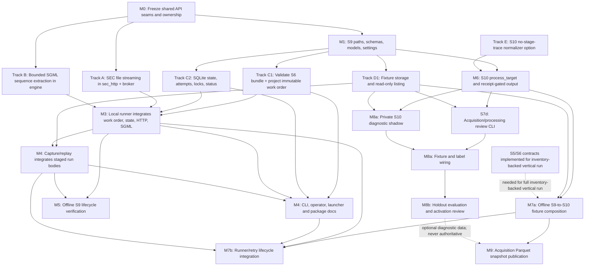

# S9 Document Acquisition: Implementation Plan

This plan tracks the local S9 acquisition implementation and its remaining lifecycle
gates. S9 projection, bounded transport, exact bundle extraction, run state, and the
live acquisition runner now exist. The initial offline S10 worker is partial; S11 durable
publication remains unimplemented. Acquisition distribution and legacy package removal
remain separate.

**Retrieval boundary:** S9 executes each target's pinned S6 mode and observed positive
sequence. It does not compare child/index size, full-submission bundle size, or S1-reported
catalog size; group targets into one bundle transfer; or use bundle retrieval after an
ordinary direct failure. Review-run and fixture evidence now establishes the SEC mapping
from a positive numbered child leaf such as `0001.htm` to the accession-prefixed archive
leaf `<accession>-0001.htm`. A positive numbered filename is not by itself a placeholder:
when catalog metadata or an observed inventory link supports the accession-prefixed
child URL, S6 pins `direct_url`. Exact `0000.txt` and `0000.htm` primary names remain
placeholder signals; indexed cases require an advertised bundle URL and observed positive
sequence to pin `bundle_sequence`, while catalog-only cases remain unresolved. An eligible
indexed `0001.txt`/`.htm` primary without a usable prefixed child URL may also use its
observed sequence and advertised bundle. S9 follows the pinned S6 mode and does not
classify the path or retry a failed direct URL through the bundle.

## 1. Implementation checklist

Status markers are maintained against tracked code and focused offline tests:
`[x]` complete, `[~]` partially complete, `[ ]` not complete or gated.

These markers describe implementation progress, not production authorization. Development
and production evidence are separate axes:

- **Development-ready** means route, handler, evaluator, schema, or CLI wiring may be
  implemented and tested with synthetic or already-captured local fixtures. A live SEC
  fetch is not a prerequisite to wire the path.
- **Evidence-gated production** means enabling a route or family, or publishing durable
  payloads, requires provenance-pinned representative source cases and the specific
  measurements or review listed below. SEC retrieval is one way to obtain missing cases,
  not a prerequisite for offline development.
- **MVP acceptance** is scoped: a route or family can be accepted with a documented error
  profile and limitations. NLP work does not require zero false positives/negatives or an
  exhaustive taxonomy; it does require an explicit acceptance decision for the enabled
  scope.

- [x] **M0 — API seams:** shared transport, parser, and pipeline ownership contracts
  are established.
- [x] **M1 — S9 contracts/configuration:** paths, schemas, models, work-order
  contracts, and the finite `acquisition.max_response_bytes` setting are registered;
  run and fixture body capture use the shared setting.
- [x] **M2A — SEC streaming:** file-backed HTTP and body-free broker streaming are
  implemented and tested.
- [x] **M2B — SGML extraction:** bounded exact-sequence extraction is implemented and
  tested.
- [x] **M2C — Projection/run state:** validated work-order projection, append-only
  attempts, target state, and locking are implemented.
- [x] **M2D — Fixture substrate:** schema v3 stores deduplicated selected parser bodies
  in plan-driven captures and caches required lazy-index pages. Fill fetches the pinned
  S6 targets without creating run state; earlier fixture formats are rejected without
  migration or a compatibility reader.
- [x] **M2E — Trace opt-out:** S10's `capture_stage_trace=False` normalizer option is
   implemented.
- [~] **M3 — Acquisition runner:** direct and bundle acquisition, multi-request
  provenance, and the CLI `run` path are implemented. Catalog-direct lazy-index recovery
  remains unavailable in S9 runs: projections emit no family-trigger IDs/versions and the
  runner refuses that branch. Plan-driven fixture fill separately resolves exact-form
  lazy selectors for offline parser review. Other selectors do not screen the submitted
  primary. Family-aware HTML evaluation and reviewed triggers remain deferred.
- [x] **M4 — Fixture/interactive surfaces:** CLI `project`, `status`, `run`, fixture
  `create`, plan-driven `fill`, `list`, and review `generate`, `compare`, and `analyze` are
  wired through the shared paginated review menu. Plan switching is `s`; fixture fill
  requests a limit and explicit network consent.
- [x] **M5 — Offline parser acceptance:** a plan-pinned fixture captures selected bytes
  without an acquisition run, then generates parser artifacts offline from those bytes.
- [~] **M6 — S10 processing:** S6 v4 operation intent and S9 work-order v3 resolution are
  persisted and consumed by `acquisition run`, which processes acquired targets inline
  under the run lock. The per-target service and route/handler seams are wired and can be
  extended against offline fixtures; raw identity works and TEXT is covered with an
  injected test budget. This development readiness does not enable production transforms:
  the production route/handler budget registry is empty, so derived normalization fails
  closed. Registering a route for production requires representative, provenance-pinned
  S9/S10 cases and measured input, output, and working-set envelopes for that route; the
   evidence gate is per route/handler, not a reason to delay offline route wiring. Form 4
   XML parsing is exercised by offline fixture review; production routing still requires
   representative budgets. Family-specific lazy-index triggers and durable
   source/representation relations remain separate implementation/contracts.
  Malformed XML remains raw-only when no exporter is registered, with focused refusal
  coverage.
- [x] **M7a — Offline S9/S10 composition:** captured direct-TEXT fixture replay,
  `process_target`, actual request/result projection, receipt verification, stable
  fingerprint, staged-output integrity, and unavailable-operation placeholders are
  covered in an offline integration test. It does not require the M3 live runner or M4
  operator. Runner/retry lifecycle integration remains a separate M7b gate.
- [x] **M7b — Runner lifecycle integration:** offline fixture replay now exercises an
  accession-prefixed numbered direct child and a bundle-selected child through S9, S10,
  and terminal projection. The actual bundle filename is persisted on its acquisition
  attempt and validated at handoff; the bundle URL's `.txt` basename is not used as the
  child identity. Tests cover text, binary, and unknown filename routes, a processing
  failure, rerun without reacquiring or removing a retained body, ordinary direct-404
  refusal without mode switching, and acquired-body retention when a sibling target
  fails. A receipt or rerun does not authorize cleanup; future removal still requires a
  separate explicit discard or publication-adoption action. No S5/S6 schema or durable
  payload output is written.
- [~] **M8 — Exhibit/identity development:** source-backed profiles and declarative packs
  exist in `domain/forms/exhibits/`; a bounded opening-view assessment is attached to
  `ProcessingResult` and version-pinned review artifact v2 for eligible planned exhibits.
  Immutable label sidecars, review CLI capture, and explicit issuer/time holdout count
  reports are wired. M8a development is ready and does not wait on a live SEC fetch. M8b
  family activation is evidence-gated: it needs representative selected-body cases,
  independent labels, a partitioned holdout report, reviewed errors, and a recorded
  acceptance decision for each enabled family. Exact duplicate selected bodies are
  rejected; near-duplicate risk must be reviewed and recorded for the bounded holdout.
  Acceptance is an MVP decision for a declared family/scope with known limitations, not a
  demand for zero errors or an exhaustive taxonomy. SEC fetching is needed only to fill
  representative-evidence gaps, not to wire or iterate on diagnostic review tooling.
  Full duplicate/owner reconciliation of candidate signals also remains open and is
  required before activating a family, not before building review tooling or evaluating
  an unambiguous candidate.
  Historical mismatch fixtures remain documented in
  [historical mismatch cases](historical_mismatch_cases.md). No tracked sanitized
  pre-2011 fixture joins submission metadata, envelope/index evidence, and cover text;
  do not claim historical validation from partial fixtures.
- [ ] **M9 — S11 publication:** durable snapshot publication remains gated on
  the approved result schema, representative S9/S10 evidence, and explicit approval.
  This does not block offline publisher/schema/query development and tests against
  disposable fixtures. The evidence and approval gates block enabling durable production
  writes, adoption receipts, or cleanup; representative M8 holdout acceptance is not a
  prerequisite for publishing the base S9/S10 relations.

## 2. Readiness and parallelization

The current S9 runner is local and serial; SEC rate limits remain host-local, and
cross-host coordination is out of scope. The manual S5-to-S6-to-S9-to-S10 path is
available when its published source artifacts exist. This does not provide production
derived text normalization or an integrated S12 quality gate.
The approval-gated Parquet/DAG publication contract is specified in
[the acquisition lifecycle](lifecycle.md), but no S11 publisher exists. S0 historical
parser acceptance and live operational rollout gates remain in force.

### Dependency graph

The former M7/M8 ordering conflated fixture composition with the live acquisition path:
M4's response-capture command consumes an M3 acquisition, while fixture-only integration
and holdout review were also described as waiting on M3/M4. That is an artificial
dependency cycle for offline development. M7a and M8a instead consume local fixture-store
records; new evidence capture remains a separate operation and does not gate wiring or
synthetic/offline tests.

### Delegation boundaries

1. **Track A and Track B can start independently after M0.** Track A owns SEC transport
   and broker RPC changes only. Track B owns bounded envelope parsing only. Neither
   imports or depends on the S9 pipeline package.
2. **M1 is a single-owner integration contract.** One implementer establishes S9
   `paths.py`, `schemas.py`, `models.py`, `arrow_schemas.py`, and setting registration
   before command-service work is delegated. This prevents divergent handoff and
   persisted-row definitions.
3. **Projector, state persistence, and fixture storage can proceed concurrently after
   M1.** Projector owns S6 bundle validation and immutable work-order creation; state
   owns SQLite transitions and locks; fixture storage owns fixture manifest/SQLite
   BLOB persistence. Each consumes M1's records and paths rather than defining local
   copies.
4. **The live/local runner is an integration track.** It starts after the projector
   and state contracts are available and integrates the merged Track A and Track B
   APIs. Fixture replay uses the same extraction boundary without opening HTTP.
5. **The S10 no-trace normalizer change is independently delegatable.** It belongs to
   `engine.forms.normalize`, not S9; it can proceed from the S10 contract and its own
   tests while S9 services are being built.
6. **CLI/operator work follows service contracts.** It delegates to the same project,
   status, run, and fixture services; it does not duplicate planning, retry, or fixture
   behavior.
7. **The S10 body-processing service can start after M1 and M2E.** It processes
   fixture-backed `FixtureBodyRef` values without waiting for the live S9 runner. M7a
   composes local fixture replay with the service; M7b separately exercises runner
   lifecycle behavior. M8a wires local fixture/result review before M8b evaluates a
   labeled holdout. Neither development slice requires live SEC access.

## 3. Milestone breakdown

### M0: Freeze transport and parser seams

**Goal:** Resolve only the cross-layer interface details needed for independent
implementation; do not reopen settled S9 behavior.

#### Decisions to pin

- Add a file-backed SEC operation alongside, not in place of, `get_bytes()`. Preserve
  shared pacing, retry/failure-ledger policy, injected `session_factory`, and typed
  transport failures. Streamed bodies bypass the current byte-returning cache until a
  file-backed cache exists.
- Define how the broker request identifies a destination without accepting an
  unconfined worker-supplied path. The S9 runner owns generated staging paths; the
  broker boundary returns path/metadata handles and never sends body bytes over IPC.
- Keep every redirect check in the shared HTTP path and validate HTTPS, SEC archive
  host, and accession-directory scope before following it.
- Put `extract_bundle_sequence(source_path, destination, selector, ...)` in the engine
  unpacking package. It accepts primitive selectors and paths, returns typed metadata
  or failure, and imports no S9 models.

#### Exit criteria

- The `StreamedResponse`/typed failure shape, cancellation and cleanup behavior, broker
  staging ownership, and parser result/failure mapping are agreed against
  [bounded transport](run/transport.md) and [exact extraction](run/extraction.md).
- No changes weaken the existing byte-fetch API or the shared SEC rate limiter.

### M1: Shared S9 contracts and configuration (`Layer 4`)

**Goal:** Create the one source of truth all command and fixture services consume.

#### Target modules

- `edgar_sec/pipelines/document_acquisition/__init__.py`
- `edgar_sec/pipelines/document_acquisition/paths.py`
- `edgar_sec/pipelines/document_acquisition/schemas.py`
- `edgar_sec/pipelines/document_acquisition/models.py`
- `edgar_sec/pipelines/document_acquisition/arrow_schemas.py`
- S9-specific entry in `edgar_sec/foundation/runtime/settings/`
- `edgar_sec/pipelines/document_acquisition/README.md`
- Mirrored source and test package `__init__.py` files and focused tests under
  `tests/pipelines/document_acquisition/`

#### Contract owners

- `paths.py` owns validated run, staging, fixture, and review paths and delegates
  fixture layout to the shared fixture resolver.
- `schemas.py` owns lightweight run manifests, `StagedBodyRef`, and
  `BodyConsumptionReceipt`; `arrow_schemas.py` owns target/work-order Parquet schemas
  and imports S6's leaf schema directly.
- `models.py` owns immutable target, attempt, outcome, policy, lock, and report values.
- Settings register the finite response ceiling through the modular settings registry;
  worker requests remain optional upper bounds below the derived resource ceiling.

#### Verification criteria

- Safe-ID, digest, containment, symlink, and wrong-file-kind cases refuse without
  creating run or fixture state.
- S9 accepts only the pinned S6 schema versions and the documented catalog-direct
  null-inventory primary case.
- JSON/Arrow schema versions and target nullability match the published S6 contract;
  no `__init__.py` re-exports child symbols.

### M2A: Bounded SEC response streaming (`Layer 2`, Track A)

**Goal:** Add the shared brokered file-stream operation required by S9 without
materializing an HTTP response or changing existing byte consumers.

#### Target modules

- `edgar_sec/infra/sec_http/client.py` and, if needed, a focused sibling module
- `edgar_sec/infra/broker/sec_broker.py` and its client/daemon seam
- `edgar_sec/infra/sec_http/README.md` and `edgar_sec/infra/broker/README.md`
- Mirrored tests under `tests/infra/sec_http/` and `tests/infra/broker/`

#### Verification criteria

- Incremental response decoding, byte counting, and hashing honor the finite ceiling;
  partial, empty, oversized, failed, or cancelled transfers leave no adopted file.
- Redirects are rejected before an out-of-scope request is sent. Direct 404 remains
  `http_not_found`, not `not_filed`.
- Cache hits do not route through the buffered cache API; file-backed cache support is
  not required for this milestone.
- The shared broker still owns pacing, retry classification, and failure accounting;
  body bytes never enter broker RPC frames.
- Tests cover chunked/gzip responses, exact and exceeded bounds, `Retry-After`, timeout,
  redirect scope, cancellation cleanup, and digest parity using injected sessions.

### M2B: Bounded SGML sequence extraction (`Layer 3`, Track B)

**Goal:** Extract one S6-pinned sequence from a large legacy submission while preserving
the selected source bytes exactly.

#### Target modules

- A focused implementation in `edgar_sec/engine/document/unpacking/` (proposed
  `streaming.py`)
- `edgar_sec/engine/document/unpacking/README.md` and, if required, its parent package
  README layout
- `tests/engine/document/unpacking/test_streaming.py`

#### Verification criteria

- Chunk boundaries may split any delimiter or header field; the scanner stays bounded
  and does not materialize unselected document spans.
- One exact positive sequence is selected. A complete valid envelope without it maps
  to `sequence_not_found`; duplicate matches, malformed structure, invalid lengths,
  truncation, and source digest mismatch return typed failures and no adopted output.
- `<TEXT>` bytes are not decoded, trimmed, newline-normalized, or inferred from target
  type/filename. Small fixtures match the existing bytes parser where their contracts
  overlap.

### M2C: Projector and run-state substrate (`Layer 4`, Track C)

**Goal:** Implement offline plan projection and mutable state independently of HTTP.

#### Target modules

- `work_order.py` and `projector.py`
- `run_state.py` and `run_persistence.py`
- `commands/project.py` and `commands/status.py`
- Mirrored `tests/pipelines/document_acquisition/` tests for work-order validation,
  projection, SQLite persistence, locking, and status

#### Verification criteria

- Projection validates the complete S6 bundle, each declared part, digest, row count,
  schema, locator, and source-pin relationship before writing a deterministic run.
- Every S6 row remains in the work order. Only matched supported locators execute;
  skipped rows have stable reasons and cannot be scheduled.
- Identical projection reuses a validated run; corrupted or divergent prior state
  fails closed without overwrite.
- SQLite writes use bound values and transactions. Attempt history is append-only;
  each committed target outcome agrees with verified body files and typed retry data.
- Run locks are token-owned; status is read-only and derives progress from validated
  artifacts and state.

### M2D: Fixture store substrate (`Layer 4`, Track D)

**Goal:** Store plan-selected parser bodies and any lazy-index evidence required for
offline review without creating acquisition-run state.

#### Target modules

- `fixture_store/` for SQLite schema, BLOB lifecycle, fixture manifests, and models
- Mirrored tests under `tests/pipelines/document_acquisition/fixture_store/`
- `fixture_store/README.md`

#### Verification criteria

- Selected parser-body and lazy-index bytes are stored as content-addressed SQLite BLOBs
  with verified digest and size; metadata/manifests remain descriptors.
- Captures append and preserve earlier evidence; fixture paths are confined and schema
  versions agree between manifest and SQLite.
- Listing is read-only and does not hash every stored body. Review verifies selected
  bodies and referenced lazy-index pages before parsing.

### M2E: S10 no-stage-trace normalizer option (`Layer 3`)

**Owner:** S10 / `engine.forms.normalize`, not the S9 pipeline. This work can proceed
in parallel but is not a prerequisite for the S9 runner.

**Goal:** Add the contract's opt-out for stage-trace copies so downstream processing
does not retain repeated full-text representations unnecessarily.

#### Target modules

- `edgar_sec/engine/forms/normalize.py`
- Its mirrored normalizer tests under `tests/engine/forms/`
- `edgar_sec/engine/forms/README.md` if the package contract/layout changes

#### Verification criteria

- Existing callers keep the current trace behavior by default.
- `capture_stage_trace=False` returns equivalent normalization output and an empty
  trace; mirrored tests cover both modes and guard processor-visible results.

### M3: Local acquisition runner and lifecycle integration

**Dependencies:** M1, M2A, M2B, and M2C.

**Goal:** Run only projected executable targets through one local SEC broker, commit
each outcome safely, and support restart after interruption.

#### Target modules

- `runner.py`, `commands/run.py`, and common transport/extraction adapters in
  `edgar_sec/pipelines/document_acquisition/`
- Resource-bounded target scheduling, run locking, cancellation, and selected-body
  handoff to the S10 contract
- Mirrored runner and command tests under `tests/pipelines/document_acquisition/`

#### Verification criteria

- No-work runs create no network client. Only pending targets and explicitly selected
  retryable failures are scheduled; skipped and terminal targets make no request.
- Direct 404 is failed; `not_filed` is reserved for a complete valid bundle lacking
  the exact requested sequence or an optional target whose selector-authorized lazy
  lookup finds no expected-form row. A required target in that latter case is
  `required_missing`; duplicates are ambiguous.
- `submitted_primary` performs no type screen/index request. Lazy recovery tests cover
  ASCII `<TYPE>` mismatch, HTML cover-unverifiable trigger, positive-cover no-lookup,
  unique/no/duplicate type rows, failed index fetch/parse, and exact direct/bundle
  acquisition of the selected slot. Every recovery records the versioned resolution
  and keeps the original sequence-1 attempt separate from the S10 body assignment.
- Worker and in-flight body counts are resource-derived and bounded. Workers exchange
  paths and typed metadata, never full payload bytes.
- Completed target commits survive interruption; partial files are cleaned; resume
  validates prior state and never repeats an acquired target.
- A verified selected-body path/digest/size is exposed through `StagedBodyRef`.
  S10's matching `BodyConsumptionReceipt` proves consumption but cleanup also waits
  for S11 payload-Parquet adoption or an explicit discard; tests use a fake consumer
  until S10/S11 are implemented.

#### Historical form-mismatch fixtures

Keep these identity edge cases in pre-2011 fixtures. Distinguish outer submission and
document metadata disagreements from cover text that contradicts otherwise matching
metadata. The implemented SGML check compares extracted `<TYPE>` with the pinned form
and allows lazy index recovery only for the exact-form catalog-direct selector. There
is no family-aware HTML/cover evaluator; cover evidence must not replace the pinned S6
form or exact index `document_type`. Detailed future cases are in
[historical mismatch cases](historical_mismatch_cases.md).

- Cover an old catalog-direct 8-K whose outer submission declares 8-K but whose
  sequence-1 primary in the SGML `.txt` envelope declares `<TYPE>10-K`, with a unique
  exact 8-K index row at another direct or bundle slot. Screening triggers one lookup
  and selects only that indexed 8-K row.
- Cover a text-only inversion where submission metadata, `<TYPE>`, and the index identify
  an 8-K but the HTML or flat `.txt` cover says 10-K. Keep this separate from SGML
  metadata screening; a future cover diagnostic must not relabel the body or claim that
  index selection reconciled the visible-text discrepancy.
- Cover an entirely misfiled annual report: the pinned form and index identify an 8-K,
  no 10-K index row exists, but the body contains annual-report wording or annual-family
  checkmarks. A future family-aware screen should recognize the likely content mismatch
  using existing annual evidence; generic cover-boundary detection is not form evidence.
  S9 must not invent a 10-K slot: retain the index-evidenced missing outcome for the
  pinned target until an explicitly approved identity-evaluator follow-up defines more.
- Do not add post-2011 metadata-mismatch checks as a required S9 path: modern EDGAR
  submission validation is expected to reject the outer-form/primary-`<TYPE>` mismatch.
  The historical fixtures exercise compatibility with accepted old filings, not a
  second form taxonomy or a new cover vocabulary.

#### Deferred identity-evaluator follow-up

The current family taxonomies and evidence may distinguish an annual report from an
8-K shell even when index metadata has no 10-K row. A future evaluator must reuse that
existing evidence and vocabularies rather than add parallel phrase/checkmark lists. It
must remain a diagnostic unless a separately approved resolution contract explains
how an absent exact-form index row may be handled; cover-boundary location alone cannot
establish statutory form or choose a replacement slot.

Until that evaluator exists, S9 trusts the pinned S6 form for the request and observed
index `document_type` for slot selection. If S6 asks for an 8-K and the index has an
8-K row, the annual-report body can still be acquired as that row; S9 does not infer a
10-K from its text. If S6 asks for a required 10-K and no exact 10-K index row exists,
the result remains `required_missing` rather than selecting an 8-K row by content.

The approval-gated S11 snapshot should retain a sparse, versioned content-identity
finding separately from `slot_types`: bind the S6 expected form and selected physical
slot to the body digest, suspected content family/form, evidence references, and
evaluator fingerprint. This records a diagnostic, not a statutory-type assertion, and
must not overwrite catalog or index metadata. A later plan for the same accession will
repeat the current metadata-based selection unless a future explicit planning/review
contract surfaces the prior finding; the finding alone must not silently rewrite S6.

### M4: Fixture capture, replay, and local CLI/operator

**Dependencies:** M2C, M2D, M2B, and a validated S6 plan bundle. Fixture capture does not
depend on M3's projected runs or run-state service.

#### Target modules

- Plan-driven fixture capture/list/review services and `commands/fixture.py`
- `cli.py`, `operator.py`, command registration in `run.py`
- `edgar_sec/pipelines/document_acquisition/README.md`, pipeline/layer README tables,
  and mirrored tests under `tests/pipelines/document_acquisition/`

#### Verification criteria

- Fixture fill captures selected plan sources through an injected bounded transport;
  review generation makes zero HTTP calls and verifies stored bytes/index evidence.
- Exact-form lazy selection without an inventory entry fetches and caches one index page
  per accession. Fill does not create acquisition-run state or publish snapshots.
- CLI and operator call the same service functions. Interactive fixture fill requests a
  target limit and default-no SEC-network consent; declined actions make no request.
- The launcher replaces the legacy `document_storage` route with the new S9 surface
  only when the local commands pass their focused tests. The legacy package itself is
  not deleted here.
- No distribution command/menu is registered in this local milestone.

### M5: Offline S9 acceptance gate

**Dependencies:** M3 and M4. A full inventory-backed vertical case also requires the
S5 relation-schema owner move and the S6 profile/target-plan implementation; neither
blocks S9 unit tests or use of a valid pinned S6 plan fixture. Full S10 processing is a
separate M6 implementation gate; a fake consumer may verify the S9 staged-body/receipt
boundary until `process_target` is implemented.

#### Verification criteria

- An offline fixture path uses an injected transport to capture plan-selected inputs
  without a live HTTP request or acquisition run, then verifies and processes fixture
  bytes offline. Run-state commit/status and staged-body receipt behavior remain covered
  by separate acquisition-run tests.
- Keep the S9-consumer test against a pinned S6 contract fixture separate from the
  S5/S6 integration case. Do not describe a fixture-only run as end-to-end inventory
  planning until the upstream S5/S6 gates above pass.
- S9 package imports do not depend on `pipelines.document_storage`; S9 exposes only
  leaf path/schema contracts for a later S10 consumer.
- Focused tests and `check.py` smart/fast gates pass. The full unconditional repository
  suite is not part of this plan unless separately requested.

### M6: S10 per-target processing service

**Dependencies:** M1's S9 `StagedBodyRef`/receipt contracts and M2E's trace opt-out.
This service can be implemented against temporary fixture bodies while the S9 live
runner proceeds independently.

**Goal:** Process one already-acquired target into a deterministic, metadata-only
result, preserve route/role distinctions, and acknowledge consumption through S9's
receipt contract. Design details are in [S10 processing](../S10_processing.md).

#### Target modules

- `processing/models.py`, `processing/worker.py`, and `processing/run.py` under
  `edgar_sec/pipelines/document_acquisition/`
- `edgar_sec/engine/forms/normalize.py` for `capture_stage_trace=False`
- Mirrored tests under `tests/pipelines/document_acquisition/` and
  `tests/engine/forms/`
- Processing-review integration through the S7-owned review path only

#### Verification criteria

- `process_target` accepts only a `StagedBodyRef` matching the immutable S9 work-order
  row; no acquisition, index lookup, or target repair is reachable from S10.
- Tests cover each route, the role-selected profile, malformed XML, diagnostics,
  deterministic fingerprints, and independent per-target failures.
- The selected body is verified and processed from the same opened file/bytes. A
  matching receipt precedes cleanup; integrity failures and pre-read budget refusals
  leave the acquired body staged without a receipt.
- The normalizer's no-trace option preserves the existing output for current callers
  and avoids S10's intermediate full-text trace records.
- Route/handler wiring and synthetic tests may proceed offline. A derived route is not
  production-enabled until representative input/output/working-set envelopes support its
  versioned budget; until then production execution fails closed with a typed budget
  diagnostic. Parallel large-body processing must additionally stay within the measured
  working-set envelope.
- Exhibit assessment may be developed and run in diagnostic-only shadow mode before
  holdout evaluation. It remains non-authoritative and cannot alter planned targets,
  processing status, or acquisition. Enabling a family requires M8b's reviewed holdout
  evidence and recorded acceptance; no `REFETCH_SUB_DOC` action is carried forward.

### M7a: Offline S9-to-S10 fixture composition

**Dependencies:** M2D's local fixture reader and M6's processing/result contracts. M3
and M4 are not dependencies: this composes already captured fixture evidence and makes
no HTTP request. S5/S6 inventory-backed planning is not required; a pinned S6 contract
fixture is sufficient.

#### Verification criteria

- A captured direct-`TEXT` S9 fixture is replayed locally; `process_target` receives its
  staged-body reference and returns the receipt-bearing `ProcessingResult`. The test
  passes that actual request/result pair to `project_terminal_results` and checks
  terminal-operation coverage, staged-output digest/path integrity, and a stable
  projection fingerprint. Placeholder outcomes for unavailable transforms prove that
  projection does not inspect processor liveness.
- No HTTP, lazy-index lookup, engine/normalizer call, persisted-schema change, or durable
  payload write or staged-body cleanup occurs. The projector remains independent of the
  processing stage; the test composes them. A receipt alone does not authorize cleanup.

### M7b: Runner and retry lifecycle integration

**Dependencies:** M3, M4, and M7a. This is the separate integration gate for runner
orchestration, retry, sibling failure isolation, and cleanup behavior. It is not a
prerequisite for offline S9/S10 composition or private result-projection development.

#### Verification criteria

- Exercise an accession-prefixed numbered direct child (`<accession>-<num>.<ext>`),
  exact bundle-selected child routes, binary/unrecognized outcomes, processing failure,
  and retry without reacquiring a retained body. Verify a rerun or receipt alone does
  not remove the selected body; future cleanup requires a separate explicit discard or
  publication-adoption action.
- Carry the bundle extraction's actual selected filename as verified evidence through
  the staged-body handoff, S10 request/result, and terminal projection. Do not substitute
  the bundle URL basename or infer the filename from the sequence.
- Confirm an ordinary direct 404 remains failed without bundle fallback (separate from
  the explicitly pinned catalog lazy-index selector), and a selected body remains intact
  when an unrelated fixture sibling fails.
- Processing review contains metadata and only selected derived text; no S5/S6 schema
  or durable payload output is written.

### M8a: Fixture-to-review development wiring

**Dependencies:** M2D's local fixture substrate and M6's stable result boundary. S7d
acquisition/processing review is an M8a deliverable, not a prerequisite. Does not depend
on M3, M4's live capture path, M7b, a live SEC fetch, or historical parser acceptance.
When no captured fixture exists
for a case, fixture acquisition is a separately authorized evidence-gathering task, not
a requirement to implement or test the wiring.

**Goal:** Make a private, offline development loop for fixture-backed diagnostic
assessment by wiring candidate packs into a non-authoritative S10 evaluator and S7d
review artifacts. The evaluator and review CLI can be developed in parallel and joined
at this milestone. Existing profile/pack declarations are candidate data, not evidence
of measured accuracy.

#### Verification criteria

- S9 fixture records and labels can be selected offline; the acquisition/processing
  review-artifact CLI replays cases and pins source, evaluator, taxonomy, and pack
  fingerprints plus generated-file digests.
- A developer can inspect positive, negative, and ambiguous examples with explicit
  label provenance. Synthetic tests can establish wiring before a representative corpus
  exists; they cannot establish accuracy or promote pack maturity to holdout-evaluated.
- Diagnostic results never alter target plans, processing status, acquisition, or retry.

### M8b: Labeled holdout evidence and family activation

**Dependencies:** M8a's fixture and review workflow, M6's diagnostic result boundary, and
reviewed labels. This is a data-acceptance gate, not a prerequisite for M8a development.

#### Verification criteria

- Curate exact selected-body fixtures and independent labels across supported forms,
  issuers, routes, positive exhibit bodies, real primary reports, ambiguous cases, and
  negatives.
- Verify legal codes and effective dates; partition by issuer/accession/time, reject exact
  selected-body duplicates, and review likely near-copies within the bounded holdout.
  Report per-family/per-form false-positive and false-negative counts. Do not infer corpus
  evidence from upload examples or synthetic fixtures.
- Review rule hits and misses and record an explicit MVP acceptance decision per enabled
  family, including known errors and scope limitations; zero errors and exhaustive
  taxonomy coverage are not required. Until acceptance, results remain private diagnostic
  shadow output and no family is enabled for authoritative use. The D5 duplicate/owner
  audit must also be resolved for that family; it is not a prerequisite for fixture
  wiring or reporting holdout counts.
- Include evaluator/taxonomy/pack versions in fingerprints and review artifacts.

### M9: Durable acquisition snapshot publication

**Development dependencies:** M7a's fixture-driven S9-to-S10 gate, the shared DAG kernel,
and the [lifecycle publication proposal](lifecycle.md). M9 schema, writer, query, recovery,
and cleanup behavior can be developed and tested against disposable runs now; resolve the
remaining contract decisions as part of that offline implementation.

**Production enablement:** Durable writes require an approved result schema, S11 review,
representative S9/S10 evidence, and explicit approval. M7b runner behavior and M8b exhibit
holdout are not prerequisites for the base S9/S10 result relations; any included diagnostic
fields remain version-pinned and non-authoritative. The prior deferral of the durable-store
design is replaced by the specific Parquet/DAG proposal in the lifecycle document.

**Goal:** Publish completed S9/S10 run evidence and selected payloads as immutable,
queryable acquisition snapshots without changing S5 or S6.

#### Target modules

- Acquisition-owned DAG `RelationSpec`s, deterministic relation writer/query adapter,
  and S5 metadata-only reconciliation adapter.
- Separate binary-route and text-route Parquet payload relations, joined to target and
  slot evidence by digest; retain only reachable DAG parts.
- `acquisition publish` and read-only snapshot query/management command/operator
  actions, plus publication receipts and run cleanup.
- Mirrored tests for relation identity, payload-part adoption, publication atomicity, recovery,
  queries, and cleanup.

#### Verification criteria

- A fully validated run produces deterministic append-only evidence rows; re-publishing
  the same run is idempotent, while changed run/schema identity creates a distinct node.
- Every successfully acquired physical-slot body and distinct derived representation
  is a digest-verified row in
  separate binary/text Parquet relations; identical bytes deduplicate without
  collapsing physical-slot, target, or run links.
- Index-only S5 reconciliation adds acquisition-owned evidence without document fetch,
  S10 processing, or S5 mutation.
- A stale parent, corrupt part, missing payload row, changed digest, or interrupted
  install never advances the branch pointer. Retry publishes from run artifacts without
  repeating network requests.
- Incomplete/error publication requires explicit consent and is marked
  `complete_with_errors`; no pending target is represented as success.
- Transient cleanup refuses until the publication receipt proves payload-part adoption
  or an explicit discard operation is recorded. DAG retention respects snapshot,
  fixture, and review reachability.

## 4. Execution order and delegation

### Next goal set: M6 and M9 development

M6 and M9 are the next active development goals. Start them from the existing offline
contracts and fixture path; neither waits for M8b's labeled holdout or a new live SEC
fetch. M6 completes the S10 route/handler contracts and offline coverage, keeping
production budgets empty until route-specific evidence supports them. M9 advances the
publisher, schema, query, recovery, and cleanup contracts against disposable runs; do not
enable durable production writes until its separate S11 approval and evidence gates pass.
These tracks may proceed in parallel from M7a. M8b remains a later, evidence-driven
activation decision, not a prerequisite for either development goal.

The table below records dependency order, not the current work priority:

| Dependency order | Workstream | Dependencies | Primary deliverables |
|---:|---|---|---|
| 0 | M0 interface freeze | Existing contracts | Broker staging/RPC and parser seams pinned |
| 1 | M1 shared S9 types/paths | M0 | Stable schemas, paths, settings, models |
| 2a | M2A SEC streaming | M0 | Additive brokered stream with bounded file output |
| 2b | M2B SGML extraction | M0 | Bounded exact-sequence engine API |
| 2c | M2C projection/state | M1 | Offline work order, SQLite state, project/status |
| 2d | M2D fixture store | M1 | SQLite BLOB evidence substrate |
| 2e | M2E S10 no-trace mode | S10 contract | Opt-out from retaining normalization stage traces |
| 3 | M3 local runner | M1, M2A–M2C | Resumable local SEC acquisition |
| 4 | M4 fixtures/CLI/operator | M2B, M2C, M2D, M3 | Local user surface and replay |
| 5 | M5 offline S9 gate | M3, M4 | Fixture-driven acquisition lifecycle verification |
| 6 | M6 S10 processing | M1, M2E | Typed per-target processing and S9 receipt integration |
| 7a | M7a offline composition | M2D, M6 | Fixture-driven processing, receipt, and terminal-result projection |
| 7b | M7b runner lifecycle | M3, M4, M7a | Runner/retry/cleanup integration verification |
| 8a | M8a review wiring | M2D, M6 | Private S10 shadow evaluator, S7d acquisition/processing CLI, and offline fixture/label workflow |
| 8b | M8b evidence acceptance | M8a, reviewed labeled corpus | Holdout evaluation and per-family activation decisions |
| 9 | M9 durable snapshot publication | M7a, DAG kernel, lifecycle proposal; approval/evidence gate production enablement | Offline publisher/query/recovery tests against disposable runs; production Parquet snapshots remain disabled pending approval |

Parallel assignments should keep the shared S9 schema/path owner separate from
service implementers, and assign each lower-layer track to one owner per package. The
runner and CLI are integration assignments, not independent implementations of the
same command behavior.

## 5. Explicitly deferred work

- **Acquisition distribution:** the S9 adapter and worker integration remain
  unimplemented. SEC request pacing follows each host's configured settings and
  environment; cross-host coordination and checks are out of scope, so no aggregate
  cross-host rate guarantee is made.
- **PDF text extraction and constructed XBRL execution:** outside S9; availability is
  governed by S0/S11 decisions.
- **Historical parser acceptance and production rollout:** retain S0's evidence and
  operational gates; no live smoke test substitutes for them.
- **General large-body processing:** M6 must establish route-specific working-set
  evidence before enabling parallel processing above measured route envelopes. A
  finite acquisition limit alone is not a processing-memory guarantee.
- **S9-to-S10 inventory-backed vertical:** M7a's fixture gate is separate from
  completing S5 relation-schema ownership and S6 profile/target-plan source adapters.
  The M6 S10 service consumes the pinned S6 artifact and does not implement those
  upstream APIs.
- **Exhibit holdout/activation:** exact labeled fixture corpus and issuer/accession/time
  holdout are absent. This deliberately blocks accuracy claims and family activation,
  not fixture/review CLI development or private shadow-mode iteration.
- **Pack ownership reconciliation:** the full D5 duplicate/owner audit remains open.
  It blocks activation of unresolved pack identities, not development or holdout
  measurement for an unambiguous candidate.
- **Exhibit label workflow:** S7d now generates and compares processing review artifacts,
  but no human annotation/label workflow or exhibit evaluator is wired.
- **Artificial sequencing removed:** fixture-only M7a and M8a work does not wait for a
  live M3 run or full M4 operator path. Those remain separate integration milestones.
- **External legacy artifact migration and full S12 vertical integration:** require
  separate acceptance. The `document_storage` runtime package is already retired.
