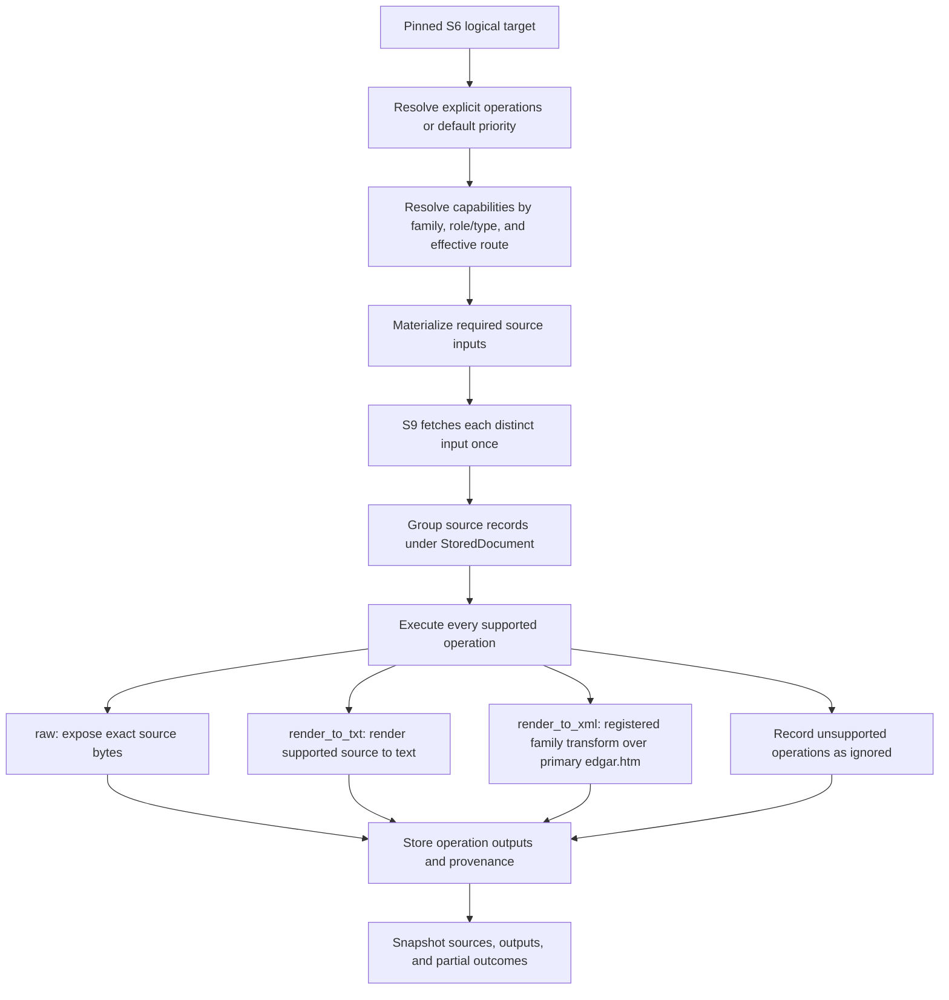

# S10 Form-Family Processing Decision Tree

**Status: proposed.** This document describes per-target acquisition operations and
processing outputs; it is not implemented behavior. The profile contract is planned in
the [S6 acquisition-policy plan](../document_planning/acquisition_policy_plan.md). Reconcile
this proposal with the existing [S10 processing contract](../S10_processing.md) before
implementation.

## Boundaries

One S6 target is one logical SEC document. Its policy may request one or more operations:
raw preservation, rendering to text, or a supported XML result. S9 acquires the source
body or bodies needed by those operations. Processing outputs are grouped under the
logical document; they are not duplicate document targets.

- **Document planning** pins an explicit operation set or requests the default operation
  priority. It does not read document bodies or make network requests.
- **S9 acquisition** fetches each distinct source input required by the planned
  operations. Multiple operations on one target that consume the same source bytes share
  one fetch.
  This proposal does not select direct versus bundle retrieval by size, group targets
  into a bundle request, or add ordinary direct-failure fallback; transport follows the
  pinned S6 target mode.
- **S10 processing** produces the requested supported output representations and records
  each operation outcome. It cannot fetch an unplanned URL or change the selected S6
  target.
- **XML export is a registered family transform.** For a registered form it consumes the
  primary `edgar.htm` input and produces XML; it does not fetch a `.xml` sibling or perform
  semantic XML/XBRL parsing. Flat XML remains raw input for a separate form-specific
  pipeline.
- **The old `document_storage.FilingProcessor` is retired.** Historical lessons do not
  make it a current runtime owner or authorize restoring its selection behavior.

The profile operation policy and the family/file-route capability registry are distinct.
The policy says what outputs are wanted; the registry says which operation implementation
exists for the form family and effective route.

## Operation resolution

The closed operation vocabulary is `raw`, `render_to_txt`, and `render_to_xml`.

- With an explicit policy, execute every listed operation implemented for the selected
  form family, target role/type, and effective file route. An unsupported operation is
  ignored for execution and recorded as not supported/not applicable; it does not fail
  other supported operations.
- With no explicit policy, choose the first implemented operation in this default priority:

  ```text
  render_to_xml > render_to_txt > raw
  ```

- “Implemented” means a registered capability for this family and route, not that a
  particular source path or conversion is guaranteed to succeed. Once an operation is
  chosen, a failed fetch or transform is recorded; it does not trigger an implicit
  operation or URL fallback.
- S9 retains acquired source bytes for integrity and replay regardless of the output
  operations. `raw` additionally exposes those bytes as a stored representation; it does
  not duplicate the acquisition body.

Capability registration is versioned and participates in processing identity. A change in
operation support or default resolution cannot silently change an existing stored result.

## File-route operation matrix

Resolve the effective route from the selected path and response metadata. The path matters:
`xsl*/.../*.xml` is an HTML rendering despite its `.xml` suffix, while flat `.xml` is the
source XML path.

| Effective file/path class | Operations |
|---|---|
| Images, `.fil`, `.zip`, `.eis`, `.paper` | `raw` only; ignore rendered operations. Paper records its raw/no-content state. |
| `.pdf` | `raw`, or `render_to_txt` when a PDF text extractor is registered. |
| Flat `.xml`, `.xsd` | `raw` only. Pass bytes unchanged to a separate form-specific XML pipeline. |
| `xsl*/.../*.xml` | `raw` returns the rendered HTML response; `render_to_txt` uses a registered export renderer; `render_to_xml` is available only through a family transform of primary `edgar.htm`, never a sibling `.xml` fetch. |
| `.txt` | `raw` or a supported `render_to_txt` view. |
| `.htm`, `.html`, `.xhtml` | `raw` or generic `render_to_txt`; a registered form-specific translator may add `render_to_xml`. |
| Unknown route | `raw` only unless a family and route capability is registered. Do not coerce unknown content to prose. |

For XSL `.xml`, the response is HTML. A registered `render_to_xml` transform consumes
the primary `edgar.htm`; it does not map the XSL locator to a sibling source. Operations
using the same source share one acquisition input.

### Form 4

Form 4 is not enabled for XML export by this proposal. Its family must explicitly
register and validate a transform over primary `edgar.htm` before `render_to_xml` is
supported. Presence of an XML bundle sibling does not determine capability.

## Processing flow



The `render_to_xml` branch is capability-specific: the family registry declares the
primary `edgar.htm` input, transform, output kind, and handler version. XML semantics
remain outside acquisition rendering.

## Family-specific processing

### Primary reports

An acquisition `render_to_txt` handler is an export renderer and must not call
`normalize_document` or inherit its cover detection, checkmark removal, reflow, or
table-repair behavior. Existing S10 normalization for diagnostics remains separate and
does not define a stored render representation. S10's own form/profile eligibility remains
governed by its processing contract and does not activate export handlers. Family
registration controls which forms have export handlers.

An early `find_cover_boundary_for_profile` probe can run before a conditional
misfile/exhibit diagnostic. Run that diagnostic only when the family enables it and there
is a qualifying suspicion signal, such as a recorded acquisition hint, contradictory
index/type metadata, or a missing/incompatible required boundary. These signals gate
diagnostic work; they do not prove body identity or replace the S6 target. Reuse the
boundary result when continuing normalization instead of adding a `stop_after` flag to
`normalize_document()`.

If the diagnostic tests for exhibit designators, it must exclude recognized TOC/index
spans before treating a match as body evidence. Verify the post-reflow character-span
coordinate contract before relying on that shield. `raw` remains the original source;
diagnostic text is distinct from `render_to_txt`. An unsupported `render_to_xml` operation
does not block either output.

### Indexed exhibits

An indexed exhibit already has an S6 row/type and locator. It uses no primary cover
boundary. Text and HTML operations follow the generic file route; flat XML stays raw for
downstream consumers. An exhibit pack may run only when the expected code/authority has
registered coverage and the policy/capability enables it. Content assessment is
diagnostic-only and cannot trigger a new index request or slot change.

## Stored type and snapshot

Keep source fetches and operation outputs distinct:

| Stored concept | Contents |
|---|---|
| `StoredDocument` | Logical target identity, pinned operation policy, source records, operation results, and aggregate completeness. |
| `AcquiredSource` | One distinct HTTP/bundle body with locator, route, attempts, status, digest/size, and staged-body reference. Operations using identical source bytes share it. |
| `StoredRepresentation` | One operation result with operation ID, output kind, source reference(s), status, output digest/size, handler/version, and stored artifact reference. `raw` may alias its source. |

The proposed stable identity, status, and representation-to-payload relations are defined
in the [representation materialization contract](representation_materialization_contract.md).
Do not merge `raw` and rendered results because they belong to one target or happen to
have the same digest. Content-addressed storage may share bytes while preserving each
operation/source reference and provenance.

Current S6 and S9 contracts model one target with one selected body. Multi-operation
processing requires versioned plan/work-order/run-state/handoff/receipt contracts and a
parent logical-document view. This is separate from the S5 inventory snapshot and does
not authorize S11 publication.

## Acceptance checks

- Explicit `[raw, render_to_txt, render_to_xml]` runs each supported operation and records
  unsupported ones as ignored without failing the other outputs.
- With no explicit policy, the first implemented operation wins in the stated priority;
  the capability/handler version is pinned.
- Operations sharing an input source reuse one acquisition input. `render_to_xml` uses
  primary `edgar.htm` only for forms with a registered family transform; it never fetches
  an XML sibling as the operation output.
- Form 4 remains raw/text only unless an XML transform is explicitly registered and
  validated for its family.
- Raw-only paths ignore render operations; PDF text runs only when supported; unknown
  routes remain explicit raw-only results.
- Export handlers never call filing normalization; S10 diagnostic normalization remains
  separate from stored representation materialization.
- Snapshot completeness is operation-aware and preserves each output/source status; a
  successful `raw` result cannot hide a failed required rendered result.
- Publish raw only, then request a render in a later plan: reuse the exact eligible raw
  source without refetching, materialize the missing render, and retain both outputs.
- Acquisition does not fetch unplanned sources, parse XML, change S6 identity, or publish
  S11 artifacts.

## Existing contracts to reconcile

The current [S6 specification](../document_planning/specs.md) and
[S10 processing contract](../S10_processing.md) still describe single-body/raw-first
behavior. The separate [S6 acquisition-policy plan](../document_planning/acquisition_policy_plan.md)
proposes per-target operation sets, default operation priority, shared source inputs, and
separate stored operation results. Fold accepted behavior into the normative S6/S10 specs
and version their work-order, snapshot, and receipt contracts before implementation.
