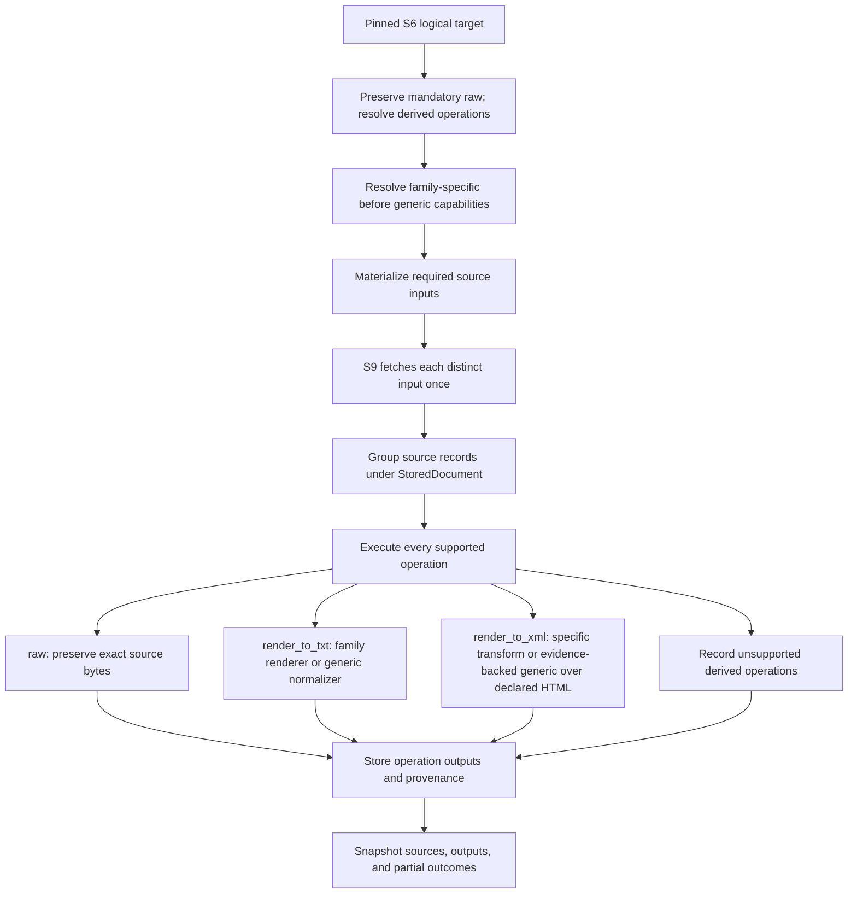

# S10 Form-Family Processing Decision Tree

**Status: partial implementation; this tree includes target-state behavior.** S6 bundle
v4 persists declarative operations and source inputs; the S9 work-order v3 resolves
operation support and handler pins. The exposed `acquisition run` path invokes
per-target processing inline under the same run lock. These contracts are wired, but
derived-operation execution is not production-enabled: `DEFAULT_PROCESSING_BUDGETS` is
empty, so budget-required normalization fails closed. Raw identity is available, while
the TEXT identity path is test-budgeted. Form 4 XML handling, a runtime role evaluator,
and durable operation snapshot publication are not implemented. The remaining decision
tree below describes policy/representations beyond that executable slice; do not infer
that a described handler is registered or runnable.

The separate `processing.run.execute_processing_run()` orchestration function is not the
CLI path. The current run CLI calls acquisition orchestration, which processes each
acquired target inline; there is no separate `process` operator action.

## Boundaries

One S6 target is one logical SEC document. S10 always preserves the selected source as
`raw`; its policy may additionally request text or a supported XML result. S9 acquires
the source body or bodies needed by those operations. Processing outputs are grouped
under the logical document; they are not duplicate document targets.

- **Document planning** pins an explicit operation set or requests the default operation
  priority. It does not read document bodies or make network requests.
- **S9 acquisition** fetches each distinct source input required by the planned
  operations. Multiple operations on one target that consume the same source bytes share
  one fetch.
  This proposal does not select direct versus bundle retrieval by size, group targets
  into a bundle request, or add ordinary direct-failure fallback; transport follows the
  pinned S6 target mode.
- **S10 processing** always preserves the exact acquired body as `raw`, then produces
  each requested supported representation and records its independent outcome. It cannot
  fetch an unplanned URL or change the selected S6 target.
- **XML export is a registered transform.** A form-specific handler wins over an
  evidence-backed generic handler. It consumes only a declared HTML path and produces
  XML; it does not fetch an XML sibling or perform semantic XML/XBRL parsing. Flat XML,
  XSD, ZIP, and other structured/binary inputs remain raw, regardless of form. Form 4's
  proposed handler is specific to its observed HTML path.
- **The old `document_storage.FilingProcessor` is retired.** Historical lessons do not
  make it a current runtime owner or authorize restoring its selection behavior.

The profile operation policy and family/file-route capability registry are distinct. The
policy says what outputs are wanted; the registry selects a form-specific handler first,
then an eligible generic handler. A family-specific handler overrides, rather than
disables, the generic fallback for other families.

## Operation resolution

The closed operation vocabulary is `raw`, `render_to_txt`, and `render_to_xml`.

- `raw` is the baseline representation for every acquired source, regardless of form,
  route, or renderer outcome. Explicit policy controls only additional derived operations.
- With an explicit policy, execute every listed derived operation implemented for the
  selected form family, target role/type, and effective file route. An unsupported
  operation is recorded as unsupported; it does not fail raw or other supported outputs.
- With no explicit derived-operation policy, choose the first implemented renderer in
  this default priority:

  ```text
  render_to_xml > render_to_txt
  ```

- “Implemented” means a registered capability for this family and route, not that a
  particular source path or conversion is guaranteed to succeed. Once an operation is
  chosen, a failed transform is recorded; it does not trigger another renderer or URL
  fallback. The raw representation remains available.
- S9 retains acquired source bytes for integrity and replay regardless of the output
  operations. The raw representation does not duplicate the acquisition body.

Capability registration is versioned and participates in processing identity. A change in
operation support or default resolution cannot silently change an existing stored result.
Changing a processor version does not itself invalidate every prior result using that
version; invalidation requires an explicit plan-scoped supersession selector.

## File-route operation matrix

Resolve the effective route from the selected path and response metadata. The path matters:
`xsl*/.../*.xml` is an HTML rendering despite its `.xml` suffix, while flat `.xml` is the
source XML path.

| Effective file/path class | Operations |
|---|---|
| Paper, binary, PDF, `.fil`, `.zip`, `.eis`, `.xml`, `.xsd`, and other non-text routes | `raw` only. PDF has no `render_to_txt` handler. A form-specific XML transform may consume a separately declared HTML input; it never rewrites these source bytes. |
| `.txt` | `raw` plus generic `render_to_txt` through the engine normalizer, unless a form-specific text handler overrides it. |
| `.htm`, `.html`, `.xhtml` | `raw` plus form-specific `render_to_txt` when registered; otherwise generic `render_to_txt` through the engine normalizer. A family-specific or evidence-backed generic `render_to_xml` may also be registered. |
| `xsl*/.../*.xml` selected as rendered markup | `raw` preserves the exact response. `render_to_txt` follows the rendered-markup handler precedence; `render_to_xml` uses a registered family-specific or evidence-backed generic transform and a declared HTML input. |
| Unknown route | `raw` only. Do not coerce unknown content to prose. |

For XSL `.xml`, the selected response remains the raw source even when its effective
content route is rendered markup. Its text export uses the same specific-over-generic
precedence. A registered `render_to_xml` transform consumes only the HTML input declared
by that form's capability; it does not map the XSL locator to a guessed sibling. Operations
using the same source share one acquisition input.

### Form 4

Form 4's observed `.xml`, XSL-nested `.xml`, and `.htm` files remain available as raw
sources. A proposed Form 4-specific `render_to_xml` handler may consume its declared
`.htm` path; it does not apply to another form. A later generic XML transform is fallback-only;
  a Form 4 override retains precedence. `render_to_txt` uses a Form 4 override if
  registered, otherwise the generic normalizer for a text/HTML representation. Form 4
  has no designed lazy-index trigger.

## Processing flow



The `render_to_xml` branch declares an HTML input, transform, output kind, and handler
version. A family-specific transform wins over a generic one; generic support requires
reviewed evidence. Flat XML/XSD remains raw and XML semantics stay outside acquisition
rendering.

## Family-specific processing

### Text rendering precedence

For `render_to_txt`, resolve a registered form-family/path-specific renderer first. If
none exists and the selected source is text or rendered markup, use the engine's
`normalize_document` path as the generic renderer. It supports primary cover-aware and
no-cover/exhibit contexts; a family-specific renderer overrides it where normalization is
not faithful. Raw remains unchanged and separately represented. Binary, paper, flat
XML/XSD, ZIP, and unknown routes do not enter this fallback.

An early `find_cover_boundary_for_profile` probe can run before a conditional
misfile/exhibit diagnostic. Run that diagnostic only when the family enables it and there
is a qualifying suspicion signal, such as a recorded acquisition hint, contradictory
index/type metadata, or a missing/incompatible required boundary. These signals gate
diagnostic work; they do not prove body identity or replace the S6 target. Reuse the
boundary result when continuing normalization instead of adding a `stop_after` flag to
`normalize_document()`.

If the diagnostic tests for exhibit designators, it must exclude recognized TOC/index
spans before treating a match as body evidence. Verify the post-reflow character-span
coordinate contract before relying on that shield. `raw` remains the original source;
diagnostic findings remain distinct from operation status and output identity. An
unsupported `render_to_xml` operation does not block raw or text output.

### Indexed exhibits

An indexed exhibit already has an S6 row/type and locator. It uses the generic no-cover
normalizer unless a form-family/route-specific `render_to_txt` handler overrides it. Flat
XML, XSD, ZIP, and binary inputs stay raw. An exhibit pack may run only when the expected
code/authority has registered coverage and the policy/capability enables it. Content
assessment is diagnostic-only and cannot trigger a new index request or slot change.

## Lazy-index and processor-version policy deltas

Lazy-index triggers are form-family-specific and require a designed text signal; they are
not enabled by `raw` alone. Families with no such design, including Form 4, do not perform
a lazy index. Their raw selection relies on the pinned URL/evidence available for the
filing era, including observed exhibit-like links. The current uniform
`exact_form_with_lazy_index` selector must be replaced by an explicit family trigger before
this policy is runtime behavior.

A plan may explicitly supersede prior processor versions for selected forms/families and
operations. A version bump alone preserves prior representations. Selective pruning must
not remove another form's outputs merely because they share a handler version; implement
it as a new immutable snapshot that retires only the plan-selected representations, then
let DAG retention remove unreachable snapshots.

## Stored type and snapshot

Keep source fetches and operation outputs distinct:

| Stored concept | Contents |
|---|---|
| `StoredDocument` | Logical target identity, pinned operation policy, source records, operation results, and aggregate completeness. |
| `AcquiredSource` | One distinct HTTP/bundle body with locator, route, attempts, status, digest/size, and staged-body reference. Operations using identical source bytes share it. |
| `StoredRepresentation` | One operation result with operation ID, output kind, source reference(s), status, output digest/size, handler/version, and stored artifact reference. `raw` may alias its source. |

The proposed stable identity, status, and representation-to-payload relations are defined
in the [representation materialization contract](representation_materialization_contract.md).
Do not merge `raw` and rendered results because they belong to one target or happen to
have the same digest. Content-addressed storage may share bytes while preserving each
operation/source reference and provenance.

S6 operation intent and S9 operation resolution are now versioned, but the proposed
`StoredDocument`/`AcquiredSource`/`StoredRepresentation` durable relations and
operation-aware S11 snapshot are not runtime contracts. Multiple operation rows can be
represented and resolved; production derived outputs remain blocked by resource-budget
admission. Keep this lifecycle separate from the S5 inventory snapshot and do not infer
S11 publication from the S6/S9 operation contracts.

## Acceptance checks

- Every acquired target retains `raw`, regardless of the explicit derived-operation set.
  Unsupported derived operations are recorded without failing raw or sibling outputs.
- With no explicit derived-operation policy, the first implemented renderer wins in the
  stated priority; the capability/handler version is pinned.
- Operations sharing an input source reuse one acquisition input. `render_to_xml` consumes
  a declared HTML input only; it never fetches an XML sibling as the operation output.
- Form 4 remains raw/text plus its proposed Form 4-specific HTML `render_to_xml`; that
  handler does not apply to other forms. A generic transform requires separate evidence
  and registration.
- Raw-only paths ignore render operations; PDF and unknown routes remain raw-only.
- `render_to_txt` uses a specific handler before the generic engine normalizer for eligible
  text/HTML sources. Raw remains a separate representation.
- Snapshot completeness is operation-aware and preserves each output/source status; a
  successful `raw` result cannot hide a failed required rendered result.
- Publish raw only, then request a render in a later plan: reuse the exact eligible raw
  source without refetching, materialize the missing render, and retain both outputs.
- Acquisition does not fetch unplanned sources, parse XML, change S6 identity, or publish
  S11 artifacts.

## Remaining contract reconciliation

The [S6 specification](../document_planning/specs.md), [acquisition-policy plan](../document_planning/acquisition_policy_plan.md),
and [S10 processing contract](../S10_processing.md) now describe versioned operation
intent/resolution and the combined run path. Keep their schema facts aligned with the
runtime. The separate representation-materialization proposal still describes desired
durable source/result relations and later S11 publication; it is not a missing S6/S9
operation schema and does not authorize adding an unbudgeted renderer.
