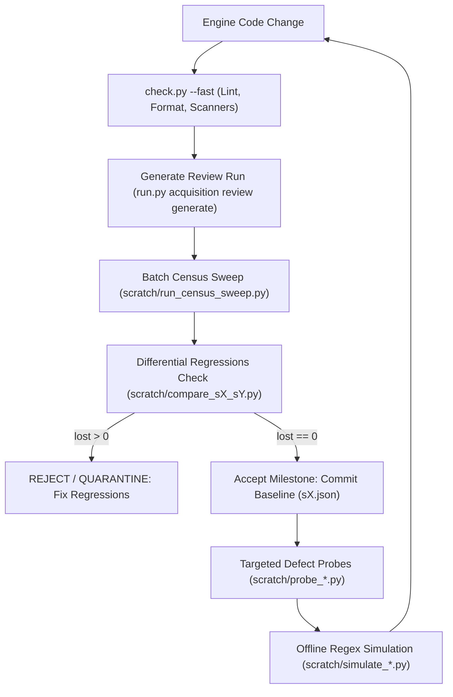

# XML-Based SEC Forms Architecture, Playbook & Skill Guide

Normative engineering guide and skill specification for implementing, normalizing, and verifying XML-based SEC form pipelines across the repository. This document synthesizes the lessons learned, architectural patterns, and strict constraints established across tabular HTML-to-XML conversion and modern native XML normalization pipelines.

---

## 1. Executive Summary & Problem Framing

Modern EDGAR filings increasingly mandate structured, machine-readable XML schemas, while historical archives (and occasional filer errors) contain unstructured or tabular HTML/ASCII presentations.

To handle both modern native XML and historical tabular HTML within a unified data model, the repository establishes an **acyclic, modular processing pipeline**:

1. **Acquisition & Normalization**: Accepts raw document bytes, detects native XML envelopes vs tabular HTML, parses HTML table grids into structured domain models, and synthesizes canonical SEC XML conforming to official schemas.
2. **Review & Semantic Analysis**: Evaluates extraction accuracy at scale across historical accessions, scoring field completeness, detecting unparsed tables, flagging boilerplate leaks, and verifying schema conformance without network egress.

---

## 2. Landscape Audit: Forms Requiring XML Pipelines

Of the form specifications across repository manifests, forms requiring structured XML acquisition and rendering pipelines follow a common transition pattern:

| Form Family                    | Description                      | Modern SEC XML Schema                      | Historical Format               | Required Pipeline Operation          | Status                                                               |
| ------------------------------ | -------------------------------- | ------------------------------------------ | ------------------------------- | ------------------------------------ | -------------------------------------------------------------------- |
| **Section 16 (Forms 3, 4, 5)** | Beneficial Ownership Disclosures | `<ownershipDocument>`                      | Tabular HTML / ASCII tables     | `AcquisitionOperation.RENDER_TO_XML` | Implemented (AASM)                                                   |
| **Form 144**                   | Proposed Sale of Securities      | `<noticeOfProposedSaleOfSecurities>`       | Multi-tier HTML / ASCII tables  | `AcquisitionOperation.RENDER_TO_XML` | Implemented (AASM)                                                   |
| **Form D**                     | Notice of Exempt Offering        | `<edgarSubmission>` / `<offeringData>`     | 16-item Tabular HTML notice     | `AcquisitionOperation.RENDER_TO_XML` | Planned                                                              |
| **Form 13F**                   | Institutional Holdings           | `<edgarSubmission>` / `<informationTable>` | Fixed-width ASCII / HTML tables | `AcquisitionOperation.RENDER_TO_XML` | Planned                                                              |
| **Schedule 13D/G**             | 5%+ Beneficial Ownership         | `<schedule13D>` / `<schedule13G>`          | Narrative HTML + Cover Matrix   | `AcquisitionOperation.RENDER_TO_XML` | Implemented (87.9% All-Core / 100% Native XML across 1,111 fixtures) |
| **EX-107**                     | Filing Fee Tables                | `<fee_tables>` / Rule 107 XML              | Unstructured HTML fee tables    | `AcquisitionOperation.RENDER_TO_XML` | Planned                                                              |

---

## 3. Normative Rules & Architectural Constraints

When creating or modifying an XML-based form pipeline, the following constraints are strictly binding and enforced by CI/AST policy scanners:

### Rule 1: No Inline `re.search` with Ad-Hoc Regex Literals

- **Prohibition**: Never write ad-hoc inline regex patterns like `re.search(r"...", text)` inside loops, table cell iterators, or parsing functions.
- **Enforcement**: All regexes must be compiled module constants (`_XYZ_RE = re.compile(...)`) declared in the owning `patterns.py` or imported from shared common modules (`edgar_sec.engine.forms.common.*`).

### Rule 2: Multi-Branch Alternation DSL (`regex-alternations`)

- **Prohibition**: Never hand-write 3+ branch alternation strings like `(?:TYPE_A|TYPE_B|TYPE_C)`.
- **Enforcement**: Must use `build_alternation(...)` from `edgar_sec.foundation.regex.builder`. This guarantees longest-first branch sorting and prevents catastrophic backtracking or accidental group capturing hazards.

### Rule 3: Zero Hardcoded Numerics in Evidence Packs

- **Prohibition**: Never hardcode ephemeral or specific numeric identifiers (e.g. OMB control numbers like `3235-0101` or specific form sequence numbers) in lexical evidence packs.
- **Enforcement**: Keep lexical packs vocabulary-driven (e.g. `"omb approval"`, `"omb control number"`, `"notice of proposed sale"`). Match numeric patterns via general regex tokens (e.g. `\d{4}-\d{4}`).

### Rule 4: Zero Fallback Leaks Across Forms

- **Prohibition**: Never fall back to another form's renderer (e.g. `else: render_other_form_to_xml(...)`).
- **Enforcement**: All form renderers must be explicitly registered with `DEFAULT_HANDLER_REGISTRY` in `edgar_sec/engine/document_processing/registry.py`. When a form or family does not have a registered renderer for `render_to_xml`, it must immediately raise:

```python
raise UnsupportedRenderOperation(f"Form {form!r} has no registered XML renderer")

```

### Rule 5: Zero Backward-Compatibility Shims & No Barrel Re-exports

- **Prohibition**: Never create legacy alias shims, forwarding functions, or barrel re-exports in `__init__.py`.
- **AST Scanner Keyword Trap**: Avoid docstrings or comments containing phrases like `"legacy HTML"`, `"compat shim"`, or `"deprecated"`, which trigger the `legacy-shims` AST policy scanner. Use neutral terms like `"tabular HTML"` or `"historical filings"`.
- **Leaf Imports**: Consumers must always import directly from leaf modules (e.g. `from edgar_sec.domain.forms.families.<form_family>.models import FormDocument`).

### Rule 6: SEC Target URL Resolution Trap (`xsl*` Stylesheets)

- **Problem**: The SEC serves XHTML stylesheet transforms for modern electronic filings (e.g. `/xsl<form_family>_X01/primary_doc.xml`). If requested with the `xsl*` path, EDGAR returns rendered HTML instead of pure submission XML.
- **Enforcement**: Target planning pipelines must strip `/xsl*` prefixes from document URLs when acquiring primary XML fixtures to retrieve pure `<edgarSubmission>` bytes.

### Rule 7: Prose Length Caps & Docstring Budgeting

- **Module docstrings**: Maximum 4 lines.
- **Function and class docstrings**: Maximum 3 lines.
- **Test module docstrings**: Maximum 3 lines.
- **Test function docstrings**: Maximum 2 lines.
- **Document intent, not execution**: Enforced by the `prose-length` policy scanner.

### Rule 8: Ground XML Output Against Mined Canonical Raw XML (Schema & N-Gram Mining)

- **Mandatory Discovery Script**: Never implement `render_to_xml.py` by guessing tag names or relying solely on narrative filing guidelines. Always write a temporary Python script (`scratch/mine_<form>_xml_structure.py`) to parse all canonical `raw.xml` cases in the fixture corpus using `xml.etree.ElementTree`.
- **Mine Hierarchy & Namespaces**: Extract complete tag paths (e.g. `/edgarSubmission/formData/.../address/com:street1`), exact namespace prefixes (`xmlns:com="[http://www.sec.gov/edgar/common](http://www.sec.gov/edgar/common)"`), and parent-to-child relationships. Verify exact schema tags (e.g. field casing, schema abbreviations, nested grouping tags).
- **Mine N-Grams & Field Values**: Sample text values and n-grams across tags to identify exact format requirements (e.g. date formats `MM/DD/YYYY` vs `YYYY-MM-DD`, decimal vs integer precision, Yes/No flag values `'Y'/'N'` vs `true/false`).
- **Sniff Out Anomalies & Sample Files**: The script must tally tag frequencies, identify optional vs mandatory elements, highlight rare edge cases, and print representative sample accession files to inspect directly.

### Rule 9: Diagnostic `unparsedSections` XML Contract

- **Envelope Embedding**: Every HTML-to-XML renderer (`render_to_xml.py`) MUST embed unparsed tables into the generated XML envelope under `<unparsedSections><unparsedSection tableIndex="..." role="...">...</unparsedSection></unparsedSections>` using `strip_decorative_presentation_attributes`.
- **Anomaly Sniffing**: `analysis.py` MUST match `unparsedSection` by namespace-independent local name, filter recognized boilerplate, compute `substantive_unparsed_count`, and collect representative `unparsed_samples`.

### Rule 10: Evidence-Based Classification and Preservation

- **Data Beats Boilerplate**: An instruction phrase does not make a populated table an instruction table. Require positive evidence before discarding it as boilerplate.
- **Contextual Continuations**: Merge sibling fragments only when their section context and row/column evidence match; otherwise retain them in `unparsedSections`.
- **No Field-Presence Suppression**: Do not discard distinct source values just because a destination field is already populated. Suppress only verified duplicates or explicit no-report markers after representing their meaning.

### Rule 11: Form-Schema Anchor Alignment State Machine (AASM) Over Fixed Coordinates

- **Prohibition**: Never attempt to construct brittle fixed column-index mappings (`mapping["code"] = 3`) by guessing column positions from multi-row headers across unaligned ASCII or tabular HTML grids.
- **Enforcement**: Model tabular data using `TableSchema` with typed `CanonicalColumn` definitions from `edgar_sec.engine.forms.common.alignment`. Process rows through the Anchor Alignment State Machine:
  1. **Strict Anchor Identification**: Detect high-confidence invariant tokens (ISO/US dates, transaction codes, currency-prefixed values, ownership codes `'D'/'I'`, and market exchange acronyms) in $O(N \cdot M)$ time.
  2. **Deficit Deduction**: When cell count is less than column count ($L_{\text{cells}} < L_{\text{cols}}$), deduce missing optional columns as `None` without shifting adjacent required columns.
  3. **Interval Projection**: Match unanchored cells strictly within the candidate columns bounded by adjacent anchors.

### Rule 12: Table Boundary Termination Over Post-Hoc Cell Filtering

- **Prohibition**: Never let trailing signature blocks, notary jurats, or footnote explanation sections enter data row iteration to be filtered cell-by-cell with localized string checks.
- **Enforcement**: Terminate table row collection immediately upon encountering structural boundary markers (`/s/`, `** signature`, `Explanation of Responses`). This prevents non-tabular text from ever reaching title or description fields.

### Rule 13: Centralized Statutory Vocabulary Over Localized Phrase Duplication

- **Prohibition**: Never maintain private, ad-hoc lists of legal boilerplate or artifact phrases inside individual form parsers.
- **Enforcement**: Always import and reuse repository-level statutory evidence packs and precompiled alternations (`STATUTORY_PAGE_BOILERPLATE`, `STATUTORY_CRIMINAL_WARNING_PHRASES`, `is_instruction_row`, `HEADER_LEAK_RE`) from `domain.forms.common.statutory` and `engine.forms.common.*`.

### Rule 14: Strict Non-Regression Invariance (`lost = 0`)

- **Prohibition**: Never commit a parser enhancement that resolves defects on a target population while introducing regressions on previously passing accessions.
- **Enforcement**: Every milestone change must be audited via automated differential census scripts (`scratch/compare_sX_sY.py`) across the benchmark corpus, strictly asserting `lost == 0`. If any previously passing case fails, the change must be quarantined and refined.

### Rule 15: Native XML Pass-Through Byte-Identical Invariance

- **Prohibition**: Never parse, mutate, or re-serialize modern electronic filings that already contain valid SEC schema XML.
- **Enforcement**: Top-level renderers (`render_to_xml.py`) must detect native XML envelopes (`<ownershipDocument>`, `<schedule13D>`, `<schedule13G>`, `<edgarSubmission>`), perform schema validation, and return the exact input text with 100% byte-identity, preserving namespaces, element ordering, and comments.

### Rule 16: Guarded Cross-Section Narrative Enrichment

- **Prohibition**: Never permit narrative disclosure references or placeholder labels (e.g. `"SEE ITEM 5"`, `"ITEM 4"`, `"SEE FOOTNOTE"`) to overwrite or populate structured cover matrix numeric fields.
- **Enforcement**: When falling back to narrative disclosures to enrich cover metadata, candidate values must be strictly validated using numeric extraction primitives with leading number isolation (`extract_leading_number=True`). If a narrative candidate contains no parseable numeric tokens, assignment is rejected.

### Rule 17: Centralized Entity & Pagination Preprocessing

- **Prohibition**: Never run boundary detection or token regexes over raw unescaped HTML entity noise or page artifacts.
- **Enforcement**: Decode HTML character entities (`&#9;`, `&#160;`, `&nbsp;`) and strip statutory pagination markers (`Page \d+ of \d+`, `Page \d+`) centrally before executing cover boundary cuts or narrative item segmentation.

---

## 4. The Canonical Modular Architecture (The Standard Form Pattern)

Every XML-based form pipeline is structured into standard, isolated modules across Layer 1 (Domain) and Layer 3 (Engine):

```text
edgar_sec/
├── domain/forms/families/<form_family>/
│   ├── __init__.py           # Package docstring only; zero barrel re-exports
│   ├── models.py             # Frozen dataclasses with __slots__ (Entities, Signatures, Tables)
│   ├── evidence.py           # Positive lexical packs, continuation markers, veto phrases
│   ├── processing.py         # FormProcessingProfile with review_analyzer pointer
│   ├── reports.py            # Typed report summary dataclasses
│   └── README.md             # Standardized contracts, invariants, and deliberate gaps
│
├── engine/forms/<form_family>/
│   ├── __init__.py           # Package docstring only
│   ├── patterns.py           # Precompiled module-level regexes via build_alternation
│   ├── sections.py           # HTML table classification and SectionRole partitioning
│   ├── metadata_parser.py    # Non-tabular/header metadata & signature extraction via lookahead
│   ├── securities.py         # Tabular transaction/holdings parsing via Anchor Alignment State Machine
│   ├── render_to_xml.py      # Canonical XML synthesis and native XML pass-through
│   ├── analysis.py           # Field completeness, scorecards, and anomaly detection
│   └── README.md             # Architectural contracts and layout
│
└── tests/
    ├── domain/forms/families/<form_family>/
    │   ├── test_models.py
    │   ├── test_evidence.py
    │   └── test_processing.py
    └── engine/forms/<form_family>/
        ├── test_patterns.py
        ├── test_sections.py
        ├── test_metadata_parser.py
        ├── test_securities.py
        ├── test_render_to_xml.py
        └── test_analysis.py

```

### Module Roles and Contracts

1. **`patterns.py`**:

- Owns all compiled regular expression patterns (`_IDENTIFIER_RE`, `_STATUTORY_LABEL_RE`, `_MARKER_RE`, etc.).
- Builds multi-branch alternations using `build_alternation(..., auto_escape=True)`.
- Never imports from upper layers (`pipelines`, `apps`, `tools`).

2. **`sections.py`**:

- Uses `parse_html` to classify table elements and resolves grids only for data-bearing roles.
- Assigns evidence-based `SectionRole` values (e.g. `COMBINED_HEADER`, `FILER_METADATA`, `TRANSACTION_GRID_PRIMARY`, `TRANSACTION_GRID_SECONDARY`, `SIGNATURES`, `REMARKS`, `INSTRUCTIONS`, `PAGE_ARTIFACT`, `UNPARSED`).
- Merges source-backed header and grid continuations while retaining unrecognized content in diagnostics.

3. **`metadata_parser.py`**:

- Extracts metadata from non-tabular cover boxes (entity identity, CIK, SEC file number, tax IDs, addresses, execution dates, signatories).
- Handles wrapped labels, values in adjacent or following cells, inline address columns, and marker columns without treating header markers as values.

4. **`securities.py`**:

- Strictly handles repetitive tabular data rows (e.g. primary transactions, secondary historical transactions, derivative holdings, security distribution schedules).
- Uses `TableSchema` and `align_row_to_schema` from `edgar_sec.engine.forms.common.alignment` with strict anchors, deficit deduction for missing optional columns, and interval projection. Terminates cleanly before signature or footnote blocks.

5. **`render_to_xml.py`**:

- Top-level dispatcher for `render_to_xml`.
- Checks if input bytes are already native XML (`_XML_DECL_RE` or root envelope patterns); passes them through intact if valid XML.
- For tabular HTML, invokes `partition_<family>_tables`, parses metadata and tables, and builds canonical `<edgarSubmission>` XML conforming to the official SEC XML schema.

6. **`analysis.py`**:

- Implements `analyze_case(case_dir: Path) -> FormCaseReport` and `summarize_cases(case_reports: list[FormCaseReport]) -> FormSummaryReport`.
- Measures field presence, detects namespace-qualified unparsed sections, flags boilerplate leakage, and highlights review signals (e.g. specialized plan adoption dates, exemption claims).

---

## 5. End-to-End Implementation Playbook (7-Step Sequence)

Follow this systematic step-by-step sequence when adding any new XML form:

### Step 1: Mine Raw XML Schemas, Attributes & N-Grams (Ground Truth Discovery)

1. Write a temporary Python script (`scratch/mine_<form_family>_xml_structure.py`) to parse all canonical `raw.xml` files in the fixture corpus using `xml.etree.ElementTree`.
2. Map the exact tag tree paths, namespaces (`xmlns:com`), element attributes, and parent-to-child relationships.
3. Extract n-grams, text patterns, and sample values across tags to confirm required formats (e.g. date formats, integer quantities, flag encodings).
4. Run anomaly and frequency checks to identify optional versus required elements and sample anomalous files to inspect.

### Step 2: Define Domain Models & Evidence (Layer 1)

1. Create `edgar_sec/domain/forms/families/<form_family>/models.py` with immutable, slotted dataclasses representing all sections and sub-items.
2. Create `evidence.py` with compiled lexical evidence packs (`EvidenceTier.PRIMARY`, `SECONDARY`, `VETO`).
3. Create `processing.py` defining `PROFILE_FORM_<FORM_FAMILY>` with `AcquisitionOperation.RENDER_TO_XML` and pointing `review_analyzer` to `edgar_sec.engine.forms.<form_family>.analysis`.
4. Create `reports.py` defining case and summary analysis report models.
5. Add unit tests in `tests/domain/forms/families/<form_family>/` (`test_models.py`, `test_evidence.py`, `test_processing.py`).

### Step 3: Register Aliases and Processing Catalog

1. In `edgar_sec/domain/forms/common/aliases.py`, register submission type aliases:

```python
"<form_family>": ("<PRIMARY_FORM>", "<AMENDMENT_FORM>")

```

2. In `edgar_sec/domain/forms/families/processing_profiles.py`, register the family in `CATALOG_PROFILES`:

```python
ProcessingCatalogEntry(family="<form_family>", profile=PROFILE_FORM_<FORM_FAMILY>),

```

### Step 4: Implement Engine Parsers, Unparsed Section Embedding & XML Serializer (Layer 3)

1. Create `patterns.py` with precompiled module constants using `build_alternation`.
2. Create `sections.py` with `SectionRole` classification and `partition_<form_family>_tables`.
3. Create `metadata_parser.py` using structural cell lookaheads for cover boxes, identity, and signatures.
4. Create `securities.py` using `TableSchema` and `align_row_to_schema` from `edgar_sec.engine.forms.common.alignment` for tabular row extraction.
5. Create `render_to_xml.py` producing canonical `<edgarSubmission>` XML with native XML pass-through and embedding `unparsedSections`.
6. Create `analysis.py` providing semantic review analysis, unparsed table sniffing, and anomaly reporting for offline evaluation.

### Step 5: Register Capabilities & Dispatcher

1. In `edgar_sec/engine/document_processing/capabilities.py`, register the capability in `DEFAULT_CAPABILITIES`:

```python
ProcessingCapability(
    handler_id="<form_family>_html_to_xml",
    handler_version="1",
    operation="render_to_xml",
    input_facts="markup route primary html body",
    output_kind=HandlerOutputKind.XML,
),

```

2. In `edgar_sec/engine/document_processing/registry.py`, register the handler in `default_handler_registry()`:

```python
registry.register(
    "<form_family>_html_to_xml",
    "1",
    "render_to_xml",
    HandlerOutputKind.XML,
    _<form_family>_html_to_xml,
    family="<form_family>",
)

```

3. In `edgar_sec/engine/forms/render.py`, ensure dispatch resolves via `DEFAULT_HANDLER_REGISTRY.resolve("render_to_xml", family, None)` and raises `UnsupportedRenderOperation` if unregistered.

### Step 6: Mirrored Unit Testing & Quality Gate

1. Add unit tests in `tests/engine/forms/<form_family>/`:

- `test_patterns.py`: Pattern compilation and regex matching.
- `test_sections.py`: Multi-table partitioning and classification.
- `test_metadata_parser.py`: Cover box extraction and signature resolution.
- `test_securities.py`: Tabular row mapping, schema alignment, and type conversion.
- `test_render_to_xml.py`: Native XML pass-through, HTML-to-XML conversion, and unparsed section serialization.
- `test_analysis.py`: Semantic case analysis and scorecard computation.

2. Run quality gate:

```bash
.venv/bin/python check.py --fast                  # Fast static gate: ruff format, lint, scanners
.venv/bin/python check.py tests/engine/forms/<form_family>/ tests/domain/forms/families/<form_family>/

```

### Step 7: Review Dataset Generation, Offline Semantic Sniffing & Scorecard Evaluation

1. Generate parsed review artifacts against historical captured fixtures:

```bash
.venv/bin/python -m edgar_sec.pipelines.document_acquisition.cli review generate --fixture <fixture_name>

```

2. Run offline semantic validation and summary reporting:

```bash
.venv/bin/python -m edgar_sec.pipelines.document_acquisition.cli review analyze --run <latest_run_id>

```

3. Inspect field scorecards, boilerplate leak signals, and unparsed table counts across the full dataset to verify high-fidelity extraction.

---

## 6. General Form Refinement & Quality Baseline Reference

When evaluating any newly implemented or refined HTML-to-XML pipeline, use standard review baselines and regression suites to measure extraction fidelity. Semantic gaps must be explicitly tracked in diagnostics rather than papered over with heuristic default values.

### Review Metric Verification Pattern

An extraction run over a benchmark dataset evaluates pipeline health across total accessions, unparsed table distributions, and field completeness metrics:

| Field Category                    | Cases with Value | Cases without Value | Notes                                             |
| --------------------------------- | ---------------- | ------------------- | ------------------------------------------------- |
| **Primary Filer / Issuer Entity** | High %           | Low %               | Verifies identification and CIK parsing           |
| **Reporting Person / Manager**    | High %           | Low %               | Verifies relationship and identity metadata       |
| **Security Class / Title**        | High %           | Low %               | Verifies instrument extraction                    |
| **Primary Quantities / Units**    | Expected %       | Variable            | Reflects transaction activity                     |
| **Aggregate Values / Valuation**  | Expected %       | Variable            | Source-dependent (often market-priced or unset)   |
| **Transaction / Period Date**     | High %           | Low %               | Verifies temporal extraction and date normalizers |
| **Signatures & Attestations**     | High %           | Low %               | Verifies non-tabular attestation blocks           |

_Missing-field counts always mix genuine source omissions with parser gaps; developers must inspect original accession source documents before altering parsing boundaries or guessing default values._

### Standard Source-Backed Refinement Principles

- **Mixed Content Disambiguation**: When an HTML table contains mixed substantive data and instructional text, preserve the substantive sections (e.g. metadata boxes, transaction rows, signatures) rather than discarding the table as boilerplate.
- **Fragmented Header Consolidation**: Merge sibling layout fragments into parent entity metadata. Handle wrapped text, offset label columns, and inline sub-fields without reading field labels as values.
- **Marker-Shifted Headers**: Handle wrapped column headers, numbered sub-item markers, and footnotes without corrupting adjacent columns. Leave market-dependent or optional values unset when the source filing does not specify an amount.
- **Contextual Continuation Merging**: Headerless continuation rows must merge with preceding tables only when column layouts, date alignments, and numeric structures match. Represent explicit negative disclosures (e.g. "None", "N/A") via distinct empty or no-report models rather than dropping rows.
- **Footnotes and Remarks**: Section notes and post-table remarks map to `<remarks>` or XML footnote elements. Preserve signature blocks even when positioned next to legal boilerplate or filing agent stamps.
- **Anchor Alignment State Machine**: Extract repetitive table rows via canonical column schemas and strict anchor recognition (temporal dates, enumerated transaction/operation codes, numerical amounts, and textual security titles), using deficit deduction to handle missing optional columns rather than brittle fixed-column coordinates that degrade when columns merge or shift.
- **Structural Boundary Termination**: Stop table row collection cleanly at structural boundary signals (signature lines, notary jurats, footnote section headers) rather than letting trailing non-tabular sections leak into data fields.
- **Namespace-Independent Diagnostics**: Review analysis must use namespace-independent element matching so that any `unparsedSection` embedded within the default SEC schema envelope is captured in diagnostic scorecards and audit samples.

### Triage Workflow for Remaining Extraction Gaps

1. **Unparsed Section Classification**: Categorize substantive unparsed sections into structural layout classes (e.g. split multi-column headers, nonstandard sub-item matrices, alternate orientation layouts). Retain unmapped structures inside `<unparsedSections>` diagnostics until explicit schema mappings are implemented.
2. **Distinguish Absence from Failure**: Continually separate source-absent values (e.g. optional items omitted by the filer) from parser omissions using anomaly reports.
3. **Artifact Freshness**: Following parser modifications, always regenerate review artifacts and re-run analysis to verify that changes resolve anomalies without introducing regressions across previously passing accessions.
4. **Gate Verification**: Ensure all tests and AST policy scanners pass cleanly before committing pipeline updates:

```bash
.venv/bin/python check.py tests/engine/forms/<form_family>/ tests/domain/forms/families/<form_family>/

```

---

## 7. Turnkey Form Implementation Template (Beginning-to-End Blueprint)

When implementing a new XML form family from scratch (e.g. Schedule 13D/G, Form D, Form 13F, EX-107), follow this standardized blueprint. Replace `<form_family>` (e.g. `schedule13`) and `<FORM_NAME>` (e.g. `SCHEDULE_13`) throughout.

### 7.1 Discovery Phase: Ground Truth Mining Script

Create a temporary discovery script in `scratch/mine_<form_family>_xml_structure.py` to extract exact tag paths, namespaces, value patterns, and frequencies from canonical SEC XML fixtures before writing code:

```python
"""Discovery script to mine canonical XML schema structure and tag patterns."""

from collections import Counter
from pathlib import Path
import xml.etree.ElementTree as ET

FIXTURE_CASES = Path(".artifacts/document_acquisition/review-runs/<run_id>/cases")


def main() -> None:
    tag_counter = Counter()
    sample_values: dict[str, list[str]] = {}

    for xml_file in FIXTURE_CASES.glob("*/operations/raw.xml"):
        try:
            tree = ET.parse(xml_file)
            root = tree.getroot()
            for elem in root.iter():
                tag = elem.tag
                tag_counter[tag] += 1
                if elem.text and elem.text.strip():
                    sample_values.setdefault(tag, []).append(elem.text.strip())
        except Exception as e:
            print(f"Error parsing {xml_file}: {e}")

    print("=== Discovered Tags & Frequencies ===")
    for tag, count in tag_counter.most_common(50):
        print(f"{tag}: {count}")


if __name__ == "__main__":
    main()
```

### 7.2 Domain Layer Blueprint (`edgar_sec/domain/forms/families/<form_family>/`)

#### File 1: `models.py`

Slotted, immutable dataclasses defining the typed document hierarchy:

```python
"""Domain models for <form_family> filings."""

from __future__ import annotations

from dataclasses import dataclass


@dataclass(frozen=True, slots=True)
class <FormFamily>Header:
    """Cover metadata and filing identification."""

    filer_name: str | None
    filer_cik: str | None
    irs_number: str | None
    file_number: str | None


@dataclass(frozen=True, slots=True)
class <FormFamily>ItemRow:
    """Tabular or structured item disclosures."""

    item_number: str
    description: str | None
    amount: float | None


@dataclass(frozen=True, slots=True)
class <FormFamily>Document:
    """Root canonical representation of <form_family> submission."""

    header: <FormFamily>Header
    items: tuple[<FormFamily>ItemRow, ...]
    unparsed_sections: tuple[str, ...]
```

#### File 2: `evidence.py`

Lexical evidence packs for section and table classification:

```python
"""Lexical evidence packs for <form_family> document parsing."""

from __future__ import annotations

from edgar_sec.foundation.text.evidence import EvidenceLexicalPack

<FORM_FAMILY>_HEADER_LEXICAL_PACK = EvidenceLexicalPack(
    primary=(
        "<primary term 1>",
        "<primary term 2>",
    ),
    secondary=(
        "<secondary term 1>",
        "<secondary term 2>",
    ),
    veto=(
        "<veto phrase 1>",
    ),
)
```

#### File 3: `processing.py`

Filing profile registration:

```python
"""Processing profile definition for <form_family>."""

from __future__ import annotations

from edgar_sec.domain.forms.families.models import FormProcessingProfile
from edgar_sec.domain.pipelines.document_acquisition.operations import (
    AcquisitionOperation,
)

PROFILE_FORM_<FORM_FAMILY> = FormProcessingProfile(
    family="<form_family>",
    supported_operations=(AcquisitionOperation.RENDER_TO_XML,),
    review_analyzer="edgar_sec.engine.forms.<form_family>.analysis",
)
```

#### File 4: `reports.py`

Typed case and summary diagnostic reports for offline evaluation:

```python
"""Report data models for <form_family> review evaluation."""

from __future__ import annotations

from dataclasses import dataclass


@dataclass(frozen=True, slots=True)
class <FormFamily>CaseReport:
    """Semantic evaluation report for a single accession."""

    accession_number: str
    is_valid: bool
    missing_fields: tuple[str, ...]
    anomalies: tuple[str, ...]


@dataclass(frozen=True, slots=True)
class <FormFamily>SummaryReport:
    """Aggregated report across the test fixture corpus."""

    total_cases: int
    field_scorecard: dict[str, float]
    anomalies: tuple[str, ...]
```

### 7.3 Engine Layer Blueprint (`edgar_sec/engine/forms/<form_family>/`)

#### File 1: `patterns.py`

Precompiled regular expressions using `build_alternation`:

```python
"""Compiled regular expression patterns for <form_family> parsing."""

from __future__ import annotations

import re

from edgar_sec.foundation.regex.builder import build_alternation

_SECTION_TITLE_TERMS = (
    r"<title variant a>",
    r"<title variant b>",
    r"<title variant c>",
)
_SECTION_TITLE_ALT = build_alternation(_SECTION_TITLE_TERMS, auto_escape=False)
SECTION_TITLE_RE = re.compile(rf"(?i)^\s*(?:{_SECTION_TITLE_ALT})")
```

#### File 2: `sections.py`

Table and section role classification:

```python
"""Section classification and grid extraction for <form_family>."""

from __future__ import annotations

from dataclasses import dataclass
from enum import StrEnum

from edgar_sec.engine.document.html.tree import parse_html
from edgar_sec.engine.tables.ascii_html.converter import resolve_html_table_grid
from edgar_sec.engine.tables.ascii_html.model import ResolvedGrid


class SectionRole(StrEnum):
    HEADER = "header"
    COVER_PAGE = "cover_page"
    TABLE_PRIMARY = "table_primary"
    SIGNATURES = "signatures"
    UNPARSED = "unparsed"


@dataclass(frozen=True, slots=True)
class ClassifiedSection:
    role: SectionRole
    table_index: int
    resolved_grid: ResolvedGrid


@dataclass(frozen=True, slots=True)
class <FormFamily>Sections:
    header: ClassifiedSection | None
    primary_table: ClassifiedSection | None
    signatures: ClassifiedSection | None
    unparsed: tuple[ClassifiedSection, ...]


def partition_<form_family>_tables(raw_html: str) -> <FormFamily>Sections:
    """Partition HTML into classified structured sections."""
    # Classify and resolve grids
    ...
```

#### File 3: `metadata_parser.py`

Cover box and metadata extraction:

```python
"""Metadata extraction for <form_family>."""

from __future__ import annotations

from edgar_sec.domain.forms.families.<form_family>.models import <FormFamily>Header
from edgar_sec.engine.forms.<form_family>.sections import ClassifiedSection


def parse_header_metadata(section: ClassifiedSection | None) -> <FormFamily>Header:
    """Extract header fields from classified cover section."""
    ...
```

#### File 4: `items.py` (or Tabular Items Parser (e.g. `securities.py`))

Tabular data parsing using the Anchor Alignment State Machine (AASM):

```python
"""Tabular row extraction via schema alignment for <form_family>."""

from __future__ import annotations

from edgar_sec.domain.forms.families.<form_family>.models import <FormFamily>ItemRow
from edgar_sec.engine.forms.common.alignment import (
    CanonicalColumn,
    TableSchema,
    align_row_to_schema,
)
from edgar_sec.engine.forms.<form_family>.sections import ClassifiedSection

_TABLE_SCHEMA = TableSchema(
    columns=(
        CanonicalColumn("item", is_anchor=True, validator=lambda x: bool(x)),
        CanonicalColumn("description", is_anchor=False),
        CanonicalColumn("amount", is_anchor=False),
    )
)


def parse_primary_items(
    section: ClassifiedSection | None,
) -> tuple[<FormFamily>ItemRow, ...]:
    """Parse table rows using canonical schema alignment."""
    if not section or not section.resolved_grid:
        return ()
    rows: list[<FormFamily>ItemRow] = []
    for raw_row in section.resolved_grid.rows:
        aligned = align_row_to_schema(raw_row, _TABLE_SCHEMA)
        if aligned:
            # Construct row
            ...
    return tuple(rows)
```

#### File 5: `render_to_xml.py`

Canonical XML synthesis and native pass-through:

```python
"""Canonical XML synthesis and pass-through for <form_family>."""

from __future__ import annotations

import re
import xml.etree.ElementTree as ET

from edgar_sec.engine.document.html.cleaner import (
    strip_decorative_presentation_attributes,
)
from edgar_sec.engine.forms.<form_family>.metadata_parser import (
    parse_header_metadata,
)
from edgar_sec.engine.forms.<form_family>.securities import parse_primary_items
from edgar_sec.engine.forms.<form_family>.sections import (
    partition_<form_family>_tables,
)

_XML_DECL_RE = re.compile(r"^\s*<\?xml\b", re.IGNORECASE)
_ROOT_ENVELOPE_RE = re.compile(r"<\s*<rootTag>\b", re.IGNORECASE)


def render_to_xml(raw_bytes: bytes) -> str:
    """Render raw document bytes into canonical XML."""
    text = raw_bytes.decode("utf-8", errors="replace")
    if _XML_DECL_RE.search(text) or _ROOT_ENVELOPE_RE.search(text):
        return text

    sections = partition_<form_family>_tables(text)
    header = parse_header_metadata(sections.header)
    items = parse_primary_items(sections.primary_table)

    root = ET.Element("<rootTag>")
    # Synthesize XML nodes conforming to official schema
    ...

    # Mandatory unparsed sections diagnostic embedding
    if sections.unparsed:
        unp_root = ET.SubElement(root, "unparsedSections")
        for u in sections.unparsed:
            sec_el = ET.SubElement(unp_root, "unparsedSection")
            sec_el.set("tableIndex", str(u.table_index))
            sec_el.set("role", str(u.role))
            sec_el.text = strip_decorative_presentation_attributes(u.raw_text)

    return ET.tostring(root, encoding="utf-8").decode("utf-8")
```

#### File 6: `analysis.py`

Semantic scorecard and anomaly analyzer:

```python
"""Semantic review analyzer for <form_family>."""

from __future__ import annotations

from pathlib import Path
import xml.etree.ElementTree as ET

from edgar_sec.domain.forms.families.<form_family>.reports import (
    <FormFamily>CaseReport,
    <FormFamily>SummaryReport,
)


def analyze_case(case_dir: Path) -> <FormFamily>CaseReport:
    """Analyze a single case output XML."""
    xml_path = case_dir / "operations" / "rendered.xml"
    if not xml_path.exists():
        return <FormFamily>CaseReport(
            accession_number=case_dir.name,
            is_valid=False,
            missing_fields=("rendered.xml",),
            anomalies=(),
        )
    ...


def summarize_cases(
    case_reports: list[<FormFamily>CaseReport],
) -> <FormFamily>SummaryReport:
    """Aggregate individual case reports into a summary scorecard."""
    ...
```

### 7.4 System Wiring & Registration Checklist

1. **`edgar_sec/domain/forms/common/aliases.py`**:
   Add family aliases mapping submission type to canonical family string:
   ```python
   "<form_family>": ("<PRIMARY_TYPE>", "<AMENDMENT_TYPE>"),
   ```
2. **`edgar_sec/domain/forms/families/processing_profiles.py`**:
   Import `PROFILE_FORM_<FORM_FAMILY>` and register:
   ```python
   ProcessingCatalogEntry(family="<form_family>", profile=PROFILE_FORM_<FORM_FAMILY>),
   ```
3. **`edgar_sec/engine/document_processing/capabilities.py`**:
   Register capability in `DEFAULT_CAPABILITIES`:
   ```python
   ProcessingCapability(
       handler_id="<form_family>_html_to_xml",
       handler_version="1",
       operation="render_to_xml",
       input_facts="markup route primary html body",
       output_kind=HandlerOutputKind.XML,
   ),
   ```
4. **`edgar_sec/engine/document_processing/registry.py`**:
   Register handler in `default_handler_registry()`:
   ```python
   registry.register(
       "<form_family>_html_to_xml",
       "1",
       "render_to_xml",
       HandlerOutputKind.XML,
       _<form_family>_html_to_xml,
       family="<form_family>",
   )
   ```

---

## 8. Real-World Reference Architecture: Schedule 13D/G Beneficial Ownership

Schedule 13 filings (5%+ beneficial ownership disclosures) represent the gold-standard reference implementation for hybrid tabular cover matrix and narrative statutory disclosures in the repository.

### 8.1 Structural Anatomy of Schedule 13D/G

Schedule 13 filings combine:

1. **Cover Page Table / Matrix (Items 1–14)**:
   - Primary Header: Issuer Name, Class of Securities, CUSIP Number, Event Date, Filing Amendment Number.
   - Names of Reporting Persons (Box 1) & IRS Identification Numbers.
   - Checkbox options (Box 2: Group disclosure, Box 3: SEC use only, Box 4: Source of funds).
   - Citizenship / Place of Organization (Box 6).
   - Beneficial Ownership Power Allocations:
     - Sole Voting Power (Box 7)
     - Shared Voting Power (Box 8)
     - Sole Dispositive Power (Box 9)
     - Shared Dispositive Power (Box 10)
   - Aggregate Amount Beneficially Owned (Box 11) & Exclusion Checkbox (Box 12).
   - Percent of Class Represented (Box 13).
   - Type of Reporting Person (Box 14: `IN`, `IV`, `IA`, `CO`, `BK`, `BD`, `PN`, `EP`, `HC`, etc.).
2. **Statutory Narrative Disclosures**:
   - **Schedule 13D Items (1–7)**:
     - Item 1: Security and Issuer
     - Item 2: Identity and Background
     - Item 3: Source and Amount of Funds or Other Consideration
     - Item 4: Purpose of Transaction
     - Item 5: Interest in Securities of the Issuer (with Roman numeral power allocations `(i)`-`(iv)`)
     - Item 6: Contracts, Arrangements, Understandings or Relationships
     - Item 7: Material to be Filed as Exhibits
   - **Schedule 13G Items (1–10)**:
     - Item 1: Issuer Identity and Address
     - Item 2: Filing Person Identity, Address, Citizenship, Title of Securities, CUSIP
     - Item 3: Institutional Classification Category (Rules 13d-1(b)(1)(ii))
     - Item 4: Ownership Totals, Percentages, and Powers
     - Item 5: Ownership of 5 Percent or Less of a Class (Exit Disclosures)
     - Item 6: Ownership of More than 5 Percent on Behalf of Another Person
     - Item 7: Identification of Subsidiary Acquiring Security
     - Item 8: Identification of Members of the Group
     - Item 9: Notice of Dissolution of Group
     - Item 10: Certifications
3. **Attestation & Signatures Block**:
   - Signature text, signatory name, title, and dated attestation.

### 8.2 Canonical XML Schema Representations (`<schedule13D>` / `<schedule13G>`)

Modern electronic Schedule 13 filings mandate schema-qualified SEC XML using schema version `X0202`:

```xml
<schedule13D xmlns="http://www.sec.gov/edgar/schedule13D" xmlns:com="http://www.sec.gov/edgar/common">
  <schemaVersion>X0202</schemaVersion>
  <headerData>
    <submissionType>SC 13D</submissionType>
    <filerInfo>
      <filer>
        <filerCredentials>
          <cik>0001234567</cik>
          <ccc>XXXXXXXX</ccc>
        </filerCredentials>
      </filer>
    </filerInfo>
  </headerData>
  <formData>
    <coverPage>
      <issuerInfo>
        <issuerName>ACME CORP</issuerName>
        <cusipNumber>123456789</cusipNumber>
      </issuerInfo>
      <reportingPerson>
        <name>Jane Doe</name>
        <citizenship>US</citizenship>
        <sharesOwned>
          <soleVotingPower>1500000</soleVotingPower>
          <sharedVotingPower>0</sharedVotingPower>
          <soleDispositivePower>1500000</soleDispositivePower>
          <sharedDispositivePower>0</sharedDispositivePower>
          <aggregateAmount>1500000</aggregateAmount>
          <percentOfClass>6.5</percentOfClass>
        </sharesOwned>
        <typeOfReportingPerson>IN</typeOfReportingPerson>
      </reportingPerson>
    </coverPage>
    <narrativeItems>
      <item1>...</item1>
      <item2>...</item2>
      <item3>...</item3>
      <item4>...</item4>
      <item5>...</item5>
      <item6>...</item6>
      <item7>...</item7>
    </narrativeItems>
    <signatureBlock>
      <signature>/s/ Jane Doe</signature>
      <date>2023-05-15</date>
    </signatureBlock>
  </formData>
</schedule13D>
```

### 8.3 Modular Beneficial Ownership Code Layout

The implementation is partitioned across Domain (Layer 1), Engine (Layer 3), and Common primitives:

```text
edgar_sec/
├── domain/forms/families/beneficial_ownership/
│   ├── models.py             # Slotted models: BeneficialOwnershipDocument, CoverPage, NarrativeItems
│   ├── processing.py         # PROFILE_FORM_BENEFICIAL_OWNERSHIP registration
│   └── reports.py            # BeneficialOwnershipCaseReport & BeneficialOwnershipSummaryReport
│
├── engine/forms/beneficial_ownership/
│   ├── parser.py             # Top-level orchestrator: boundary separation, cross-enrichment, validation
│   ├── cover_parser.py       # Boxes 1-14 matrix parser, reporting person extraction, CUSIP & date resolution
│   ├── narrative_parser.py   # Statutory Item 1-7 (13D) and 1-10 (13G) text partitioner
│   ├── item_subsections.py   # Roman numeral power subparts (i)-(iv), Item 3 codes, Item 10 certifications
│   ├── issuer.py             # Multi-tier issuer extraction: labelled headers, unlabelled FMR headers, candidate filtering
│   ├── render_to_xml.py      # Dual schema builder (<schedule13D> / <schedule13G>) with 100% native XML pass-through
│   └── analysis.py           # Offline review analyzer, field completeness scoring, and defect classification
│
└── engine/forms/common/
    ├── numbers.py            # Resilient numeric parsing: multiline (?s), approx prefixes, closing statements
    └── statutory.py          # Centralized statutory evidence packs, page markers, and boilerplate filters
```

---

## 9. The Iterative Phased Extraction Optimization Strategy

Building an industrial-grade SEC form extraction engine requires an iterative, phased progression. Attempting to parse narrative prose, table matrices, and metadata in a single monolithic pass leads to brittle regex collisions and hard-to-diagnose regressions. The repository establishes a strict 5-phase extraction lifecycle:

### Phase 0: Canonical Schema Discovery & Invariant Pinning

1. **Tag & Namespace Mining**:
   - Write a standalone script (`scratch/mine_<form>_xml_structure.py`) using `xml.etree.ElementTree` to parse all canonical `raw.xml` files in the fixture corpus.
   - Record exact element hierarchy, schema version tags (e.g. `X0202`), casing conventions (`lowerCamelCase` vs `TitleCase`), and namespace declarations (`xmlns:com`).
2. **Native XML Pass-Through Pinning**:
   - SEC filings exist as modern electronic XML or legacy tabular/narrative HTML.
   - In `render_to_xml.py`, implement an early-exit check: if raw bytes match XML declaration or root envelopes (`<schedule13D>`, `<schedule13G>`, `<ownershipDocument>`), decode, validate basic well-formedness, and return the exact raw string.
   - Verify that 100% of native XML cases in the benchmark suite pass through **byte-identical** before implementing any HTML parsing logic.

### Phase 1: Boundary Segmentation & Structural Preprocessing

1. **Whitespace & HTML Entity Normalization**:
   - Historical filings embed dirty formatting artifacts, such as `&#9;` (tabs), `&#160;` / `&nbsp;` (non-breaking spaces), and multiple consecutive spaces that break word boundaries.
   - Apply centralized entity unescaping and whitespace normalization across document text before boundary detection.
2. **Page Marker & Divider Stripping**:
   - Centralize pagination stripping using `STATUTORY_PAGE_MARKER_RE` (`Page \d+ of \d+`, `Page \d+`) and divider artifacts (`-------`, `======`).
   - Stripping these centrally prevents page breaks from bisecting multi-line tabular matrices or narrative sentences.
3. **Cover vs Narrative Boundary Separation**:
   - Hybrid forms contain both a cover matrix (Items 1–14) and narrative sections (Items 1–7 or 1–10).
   - In `parser.py`, bound the cover page extent strictly by the start of the first detected narrative body section (`sections.sections[0].start_line`).
   - Never use naive keyword cuts like `"Item 1"` to truncate the cover page, because internal cover matrix rows themselves contain labels like `"Item 1: Name of Reporting Person"`.

### Phase 2: Structural Narrative Partitioning & Subpart Decomposition

1. **Statutory Item Segmentation**:
   - In `narrative_parser.py`, scan for statutory item headings (`ITEM 1.`, `ITEM 2.`, etc.) using precompiled module alternations.
   - Record line-based intervals `[start_line, end_line)` for each statutory item, handling formatting variants (markdown bold `**`, uppercase headers, colon vs period separators).
2. **Roman Numeral Power Subpart Extraction**:
   - In beneficial ownership filings, beneficial ownership share allocations often appear in narrative text under Item 4 (13G) or Item 5 (13D) subdivided by Roman numerals:
     - `(i)`: Sole Voting Power
     - `(ii)`: Shared Voting Power
     - `(iii)`: Sole Dispositive Power
     - `(iv)`: Shared Dispositive Power
   - In `item_subsections.py`, isolate and parse these Roman numeral subparts to extract power allocations when tabular cover cells are empty.

### Phase 3: Statutory Qualifications & Cross-Section Fallbacks

1. **Institutional Classification Mapping (13G Item 3)**:
   - Extract filer institutional qualification checkboxes or text codes: `BD` (Broker Dealer), `BK` (Bank), `IC` (Insurance Company), `IV` (Investment Company), `IA` (Investment Adviser), `EP` (Employee Benefit Plan), `HC` (Holding Company), `SA` (Savings Association), `CP` (Church Plan).
2. **Fund Source Classification (13D Item 3)**:
   - Extract statutory source of funds codes: `WC` (Working Capital), `BK` (Bank Loans), `PF` (Personal Funds), `OO` (Other), `AF` (Affiliate Funds).
3. **Item 10 Certification Validation**:
   - Verify presence of standard 13G certifications (Rule 13d-1(b) or 13d-1(c) non-control attestations).
4. **Cross-Section Ownership Enrichment**:
   - Filers frequently write `"See Item 5"`, `"See Item 4"`, or `"See attached"` in cover page Box 7–11.
   - When cover slots contain reference strings, resolve values from the parsed narrative item subsections.
   - Enrich reporting person power allocations and aggregate amounts while preserving source audit trails.

### Phase 4: Numerical Extraction Resilience & Header Disclosures

1. **Multiline Disclosure Handling**:
   - Share allocations and percentages in historical ASCII filings are frequently split across newlines (e.g. `"Sole Voting Power:\n1,500,000 shares"`).
   - Use `(?s)` (`re.DOTALL`) in `engine/forms/common/numbers.py` to bridge line breaks between numeric labels and values.
2. **Approximate Prefix Stripping**:
   - Strip qualifiers like `"approx"`, `"approximately"`, `"approx."`, `"about"`, and `"estimated"` before numeric casting.
3. **Qualifying Ratios & Percentage Normalization**:
   - Parse leading numeric percentages while stripping trailing explanatory ratios or qualifiers (e.g. `"7.5% (approx)"` $\to$ `7.5`, `"5.2% based on 10,000,000 shares"` $\to$ `5.2`).
4. **Closing and Exit Statements**:
   - When filers dissolve or fall below thresholds, they report `"less than 5%"`, `"0%"`, or `"ceased to be a beneficial owner"`. Normalize these to `0.0` rather than treating them as missing fields.
5. **Unlabelled Header Recovery (`issuer.py`)**:
   - Unstandardized filings (e.g. Fidelity/FMR Schedule 13G formats) often omit explicit `"Name of Issuer:"` labels, embedding metadata directly in the header block:
     ```text
     Amendment No. 1
     ACME CORPORATION
     Common Stock
     CUSIP # 123456789
     ```
   - Implement candidate isolation: extract non-empty lines immediately preceding the CUSIP token, filter out common form/schedule tokens, verbs, and sentence prose, strip parentheticals (e.g. `(formerly known as XYZ)`), and select clean issuer candidates.
6. **Narrative Enrichment Guardrails**:
   - Prevent placeholder text (e.g. `"SEE ITEM 5"`, `"SEE FOOTNOTE"`) from leaking into numeric XML elements. Enforce `extract_leading_number=True` validation before allowing narrative fallback values to populate cover reporting person records.

---

## 10. The Empirical Diagnostic & Simulation Tooling Harness

Optimization must never proceed by guesswork. Every enhancement cycle relies on a standardized, offline diagnostic harness consisting of batch artifact generation, census sweeps, differential regression checking, and defect simulation:



### 10.1 The Diagnostic Tool Suite

| Script / Command | Purpose | Invariant / Expected Output |
| :--- | :--- | :--- |
| `run.py acquisition review generate --fixture <id> --no-progress` | Executes extraction across all benchmark cases and emits rendered XML. | Zero execution exceptions; produces `render_to_xml.xml` per case. |
| `scratch/run_census_sweep.py` | Parses generated XMLs, checks core field presence, validates native XML byte identity. | Emits `scratch/sX.json` and `scratch/sX_summary.json` with pass rates. |
| `scratch/compare_sX_sY.py` | Diffs two milestone census files ($S_A$ vs $S_B$), computing gained, lost, and net cases. | **Mandatory: `lost == 0`**. |
| `scratch/probe_<defect>.py` | Isolates accessions failing on a specific defect and prints surrounding document text. | Pinpoints exact regex or layout gaps without opening files manually. |
| `scratch/simulate_<enhancement>.py` | Tests candidate parsing logic offline against extracted case texts before editing engine. | Validates net gains and verifies zero collateral damage across test samples. |

### 10.2 Anatomy of the Batch Census Sweep (`scratch/run_census_sweep.py`)

The census sweep script inspects each case in `.artifacts/document_acquisition/review-runs/<run_id>/cases/` and enforces four core criteria:

1. **Issuer Identification**: Valid `issuer_name` present and non-empty.
2. **Temporal Alignment**: Valid `event_date` extracted and normalized.
3. **Beneficial Owner Completeness**: At least one `reporting_person` extracted with valid name and citizenship.
4. **Narrative / Tabular Disclosures**: At least one statutory item or cover matrix row populated.
5. **Native XML Invariance**: If input was native XML, generated output must match input byte-for-byte.

```python
# Conceptual core validation in scratch/run_census_sweep.py
is_all_core = (
    bool(report.issuer_name)
    and bool(report.event_date)
    and (report.reporting_person_count > 0)
    and (report.item_count > 0 or report.matrix_row_count > 0)
    and report.schema_valid
)
```

### 10.3 Differential Regression Audit (`scratch/compare_sX_sY.py`)

Never rely on net percentage increases alone. A net increase of +10 cases might hide 15 new successes and 5 regressions on previously working filings. The differential comparison script guarantees strict monotonicity:

```python
# scratch/compare_sX_sY.py logic
gained = [acc for acc in current_passing if acc not in baseline_passing]
lost = [acc for acc in baseline_passing if acc not in current_passing]

print(f"Baseline passing: {len(baseline_passing)}")
print(f"Current passing:  {len(current_passing)}")
print(f"Gained:           {len(gained)}")
print(f"Lost:             {len(lost)}")

assert len(lost) == 0, f"REGRESSION DETECTED: {len(lost)} cases lost!"
```

---

## 11. Anomaly Tracking & Forensic Triage Methodology

When optimizing extraction across hundreds or thousands of historical accessions, developer bandwidth must be allocated systematically using defect impact triage.

### 11.1 The Single-Defect vs Multi-Defect Triage Matrix

Accessions that fail `all_core` criteria fall into two distinct operational categories:

1. **Single-Defect Populations (High Priority / Immediate ROI)**:
   - Cases passing 3 of 4 core criteria (e.g. valid reporting persons, valid items, valid event date, but missing **only** issuer name).
   - Resolving a single parser gap for this cluster immediately converts all affected cases into `all_core` passing cases.
   - *Example*: Adding unlabelled FMR/Fidelity header recovery in Phase 4 resolved single-defect missing issuer gaps across 70 cases simultaneously.
2. **Multi-Defect Populations (Lower Priority / Forensic Analysis Required)**:
   - Cases failing 2 or more criteria (e.g. missing both issuer and reporting persons).
   - Usually indicates fundamentally non-standard document formatting, truncated filings, or non-filing exhibits.
   - Triage these only after single-defect clusters are exhausted.

### 11.2 Distinguishing Parser Gaps from Filer/Source Anomalies

Not all extraction failures represent code defects. Filer mistakes, non-standard amendments, and misfiled exhibits must be explicitly audited and distinguished:

```text
┌────────────────────────────────────────────────────────────────────────┐
│                        Review Run Failure Audit                        │
└───────────────────────────────────┬────────────────────────────────────┘
                                    │
           ┌────────────────────────┴────────────────────────┐
           ▼                                                 ▼
┌─────────────────────────────┐           ┌──────────────────────────────┐
│        Parser Defect        │           │    Filer / Source Anomaly    │
├─────────────────────────────┤           ├──────────────────────────────┤
│ • Unlabelled header layouts │           │ • Amendment has no cover box │
│ • Multiline split shares    │           │ • 1-paragraph narrative text │
│ • HTML entity whitespace    │           │ • Primary document is EX-99  │
│ • Roman numeral formatting  │           │ • Filer omitted event date   │
├─────────────────────────────┤           ├──────────────────────────────┤
│ ACTION: Refine parser regex │           │ ACTION: Record in quarantine │
│ and boundary algorithms.    │           │ dossier; do not hack engine. │
└─────────────────────────────┘           └──────────────────────────────┘
```

#### Recognizing True Filer / Source Anomalies:
- **Partial Text Amendments**: The filing contains only: `"Item 4 is hereby amended to reflect that XYZ acquired 10,000 shares."` It contains no cover page, no reporting person matrix, no CUSIP, and no signature. The parser correctly extracts narrative Item 4, but cannot invent a cover reporting person.
- **Exhibit-Only Primary Filings**: The accession primary document was filed as an agreement, joint filing agreement, or press release rather than the statutory Schedule form.
- **Genuine Source Omission**: The filing legitimately omits an event date or CUSIP number in the source text.

*Policy Rule*: Never add loose or permissive heuristics to "invent" default data for anomalous filings. Doing so risks corrupting well-formed filings and violates Rule 14. Document source anomalies in review run audit dossiers.

---

## 12. Empirical Milestone Progression & Benchmark Summary

The Schedule 13D/G beneficial ownership pipeline demonstrates the effectiveness of the 5-phase extraction lifecycle and regression harness. Across **1,111 test fixtures** evaluated under identical, offline conditions:

| Milestone | Focus / Architectural Changes | All-Core Passing | Pass Rate | Net Gain | Regressions (`lost`) | Native XML Pass |
| :--- | :--- | :--- | :--- | :--- | :--- | :--- |
| **$S_1 \to S_6$** | Initial Cover Matrix Parser, Boundary Cuts, Entity Stripping | 788 / 1,111 | 70.9% $\to$ 78.8% | Baseline | — | 100% |
| **$S_7 \to S_{10}$** | Phase 2: Narrative Item (1–7/1–10) Segmentation, Roman Numeral Powers | 903 / 1,111 | 81.28% | +115 cases | **0** | 100% |
| **$S_{11} \to S_{12}$**| Phase 3: Statutory Qualifications (Item 3 Codes), Cross-Section Fallback | 907 / 1,111 | 81.64% | +4 cases | **0** | 100% |
| **$S_{13}$** | Phase 4: Resilient Numerics (`(?s)`, approx, ratios), Unlabelled Headers | **977 / 1,111** | **87.94%** | **+70 cases** | **0** | **100% (248/248)** |

### Production Quality Gate Summary ($S_{13}$ Baseline):
- **Total Test Fixtures**: 1,111 accessions.
- **All-Core Passing**: 977 (87.94%).
- **Native SEC XML Byte-Identical Invariance**: 248 / 248 (100.0%).
- **Execution Errors**: 0.
- **Schema Validation Errors**: 0.
- **Cumulative Regressions Across Entire Project**: **0 (`lost == 0`)**.
- **Repository Policy Scanners**: 18 / 18 clean; unit tests fast (< 2.0s).

